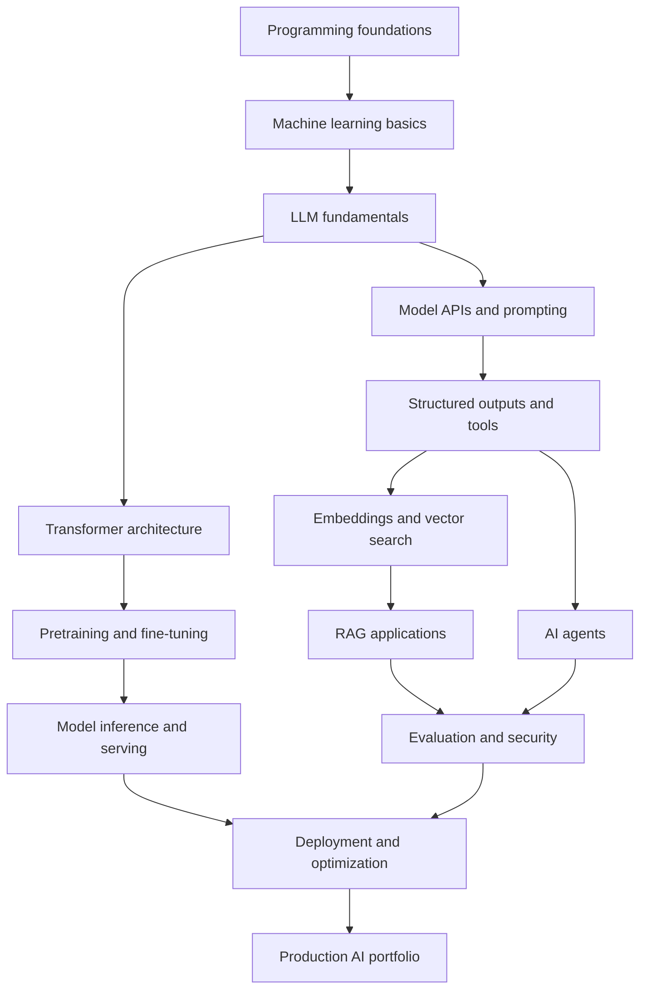
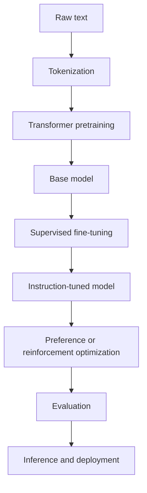

---

title: "AI Engineering — Integrated Master Handbook" aliases:

- Complete AI Engineer Course
- LLM Engineering Master Roadmap
- AI Learning Vault type: master-index status: in-progress difficulty: beginner-to-advanced created: 2026-10-22 tags:
- ai-engineering
- llm
- generative-ai
- machine-learning
- rag
- ai-agents
- llmops
- obsidian sources:
- https://roadmap.sh/ai-engineer
- [https://github.com/FareedKhan-dev/train-llm-from-scratch](https://github.com/FareedKhan-dev/train-llm-from-scratch)
- https://www.youtube.com/watch?v=kBM5UXRbo3U&list=PLWSlr9idVBc0

---

# AI Engineering — Integrated Master Handbook

> [!abstract] Mission Learn how AI works, build applications with existing models, understand how to train language models, and deploy reliable AI products. Use this note as the entry point to the entire Obsidian learning vault.

## 1. Primary learning resources

|Resource|Purpose|
|---|---|
|AI Engineer roadmap|Application engineering and AI technology map|
|[Train LLM From Scratch](https://github.com/FareedKhan-dev/train-llm-from-scratch)|Model implementation, pretraining and post-training|
|LLM training documentation|Theory, code and diagrams for model training|
|YouTube course playlist|Video lessons to review and annotate|
|Hugging Face LLM Course|Transformers, tokenizers and model workflows|
|Python tutorial|Programming foundation|
|PyTorch tutorials|Neural networks and tensor programming|
|Prompt engineering guide|Model instructions and prompting|
|MCP documentation|Connecting models to tools and resources|
|OWASP LLM security|AI application threat models|

## 2. The complete learning architecture



The branches overlap. You can build applications using pretrained models without training a model yourself.

## 3. Learning modules

### Module 1 — Programming foundations

**Definition:** The software skills needed to implement, test and maintain AI applications.

Topics:

- Python syntax, functions, classes and exceptions.
- Data structures, JSON and file handling.
- Git, GitHub and version control.
- HTTP, REST APIs and authentication.
- SQL, databases and basic data modeling.
- Virtual environments, packages and testing.

Resources:

- Python
- Git
- GitHub Skills
- FastAPI
- SQLBolt

**Deliverable:** A Python application that reads structured data, calls an API, validates the response and writes results to a file.

### Module 2 — Machine learning and deep learning

**Definition:** Machine learning fits models to data; deep learning uses neural networks with multiple learned layers.

Topics:

- Vectors, matrices and tensor operations.
- Training, validation and test sets.
- Loss functions and optimization.
- Gradient descent and backpropagation.
- Overfitting and generalization.
- Neural network layers and activation functions.
- GPU computation and memory.

Resources:

- Google Machine Learning Crash Course
- PyTorch tutorials
- NumPy

**Deliverable:** Train a small neural network and evaluate it on data that was not used for training.

### Module 3 — LLM fundamentals

**Definition:** A large language model processes token sequences and learns statistical patterns that allow it to generate or interpret language.

Topics:

- Tokenization and vocabulary.
- Embedding layers.
- Positional information.
- Self-attention and causal masking.
- Transformer blocks.
- Next-token prediction.
- Cross-entropy loss.
- Sampling and decoding.
- Context windows and hallucinations.

Resources:

- The Illustrated Transformer
- Attention Is All You Need
- Hugging Face LLM Course

**Deliverable:** Explain how text becomes token IDs, how a Transformer produces logits, and how logits become generated tokens.

### Module 4 — Model APIs and prompt engineering

**Definition:** Model APIs allow applications to use hosted models. Prompt engineering shapes instructions and examples to obtain useful outputs.

Topics:

- API keys and authentication.
- User and system instructions.
- Conversation history.
- Sampling and output limits.
- Structured JSON output.
- Streaming and tool calls.
- Timeouts, retries and rate limits.
- Prompt testing and version control.
- Token and cost management.

Resources:

- OpenAI API documentation
- Anthropic documentation
- Gemini API documentation

**Deliverable:** An API-backed assistant that returns validated structured data and handles provider errors safely.

### Module 5 — Embeddings and semantic search

**Definition:** Embeddings encode content as vectors so an application can find items with similar meaning.

Topics:

- Embedding dimensions.
- Cosine similarity and distance metrics.
- Document and query encoding.
- Vector indexing.
- Metadata filtering.
- Keyword versus semantic search.
- Hybrid retrieval.
- Retrieval quality evaluation.

Resources:

- OpenAI embeddings
- Sentence Transformers
- FAISS
- Qdrant

**Deliverable:** Semantic search over your own Markdown notes.

### Module 6 — Retrieval-augmented generation

**Definition:** RAG retrieves relevant external evidence and supplies it to a language model before generation.

Topics:

- Document ingestion and parsing.
- Chunking and metadata.
- Embedding generation.
- Vector and keyword retrieval.
- Query rewriting and reranking.
- Context assembly.
- Source citations.
- Missing-evidence handling.
- Retrieval and answer evaluation.

Resources:

- LangChain
- LlamaIndex
- Ragas

**Deliverable:** A document assistant that answers questions with verifiable source references.

### Module 7 — AI agents and tools

**Definition:** An agent uses a model to choose actions, call permitted tools and use their results to complete a task.

Topics:

- Function and tool calling.
- Tool schemas and argument validation.
- Workflow orchestration.
- State and memory.
- Planning and execution.
- Human approval.
- MCP integrations.
- Tool failure recovery.
- Agent evaluation and stopping conditions.

Resources:

- OpenAI Agents guide
- LangChain documentation
- Model Context Protocol

**Deliverable:** A research assistant that retrieves information, calls controlled tools and prepares a sourced report.

### Module 8 — Multimodal AI

**Definition:** Multimodal systems process or generate multiple forms of data, such as text, images, audio and video.

Topics:

- Image understanding and OCR.
- Image generation and editing.
- Speech recognition.
- Text-to-speech.
- Audio summarization.
- Video frame sampling.
- Timestamped answers.
- Multimodal retrieval.

Resources:

- OpenAI images
- OpenAI audio
- Hugging Face tasks
- Hugging Face Diffusers

**Deliverable:** An audio or image assistant that produces structured outputs and lets users verify the original evidence.

### Module 9 — Training an LLM from scratch

**Definition:** Pretraining optimizes model weights on large text collections, commonly through next-token prediction. Post-training adapts the base model to instructions and preferences.

Follow the original project in this order:

1. [Repository overview](https://github.com/FareedKhan-dev/train-llm-from-scratch)
2. Training documentation
3. Data pipeline
4. Pretraining
5. Supervised fine-tuning
6. Reward model
7. DPO and related methods
8. PPO
9. GRPO and RLVR
10. Evaluation
11. Inference

**Deliverable:** Train a small model, generate text, fine-tune it and compare evaluation results across stages.

### Module 10 — Evaluation, safety and production

**Definition:** Evaluation measures system quality. Observability monitors real behavior. Security controls prevent unauthorized access and unsafe operations.

Topics:

- Representative test datasets.
- Correctness and groundedness.
- RAG and agent metrics.
- Human review.
- LLM-as-a-judge limitations.
- Prompt injection.
- Secret management.
- Privacy and access control.
- Logging and tracing.
- Deployment, monitoring and rollback.
- Latency and cost optimization.

Resources:

- NIST AI Risk Management Framework
- OWASP LLM Top 10
- OpenTelemetry
- Docker
- GitHub Actions

**Deliverable:** Deploy an AI application with authentication, tests, monitoring, evaluation and documented security controls.

---

## 4. YouTube course — lesson tracker

**Playlist:** Watch the course

Use the following tracker until the playlist's exact titles and sequence have been verified. Add one lesson note for each actual video rather than using guessed titles.

|Lesson|Video title|Status|Notes|
|---|---|---|---|
|01|Add verified title|Not started|[[YT-01]]|
|02|Add verified title|Not started|[[YT-02]]|
|03|Add verified title|Not started|[[YT-03]]|
|04|Add verified title|Not started|[[YT-04]]|
|05|Add verified title|Not started|[[YT-05]]|

Duplicate the rows to cover every video.

### Video lesson note template

Save this template as `Templates/YouTube Lesson.md`.

```
---
title: "Verified video title"
type: video-lesson
status: not-started
difficulty: beginner
playlist: "AI course playlist"
video_url: ""
video_id: ""
duration: ""
tags:
  - youtube-course
  - ai-engineering
related:
  - "[[AI Engineering Master Handbook]]"
---
```

# {{title}}

## 1. Lesson overview

Explain the lesson's purpose in plain English.

## 2. Prerequisites

- [[Prerequisite concept]]

## 3. Short introduction

What problem does this topic solve?

## 4. Key definitions

|Term|Definition|Example|
|---|---|---|
|Term 1|Short explanation|Example|

## 5. Detailed notes

Organize the explanation by the video's actual topics and subtopics.

## 6. Code and practical examples

```
# Add verified code or a minimal example here.
```

## 7. Mermaid diagram

```
flowchart TD
    A["Input"] --> B["Processing"]
    B --> C["Output"]
```

Replace the example with a diagram of the actual lesson.

## 8. Common mistakes

- Mistake:
- Why it happens:
- How to fix it:

## 9. Practice exercise

Describe a small implementation task.

## 10. Questions to answer without notes

- [ ] Question 1
- [ ] Question 2
- [ ] Question 3

## 11. Timestamped references

- `00:00` — Add a verified section and timestamp.

## 12. Summary

Write five to ten concise points.

## 13. Related notes

- [[LLM Fundamentals]]
- [[AI Engineering Master Handbook]]

## 14. Completion

- [ ] Watched the video
- [ ] Took notes
- [ ] Reproduced the example
- [ ] Completed the exercise
- [ ] Reviewed the definitions

````

---

## 5. Core architecture diagrams

### RAG

```mermaid
flowchart TD
    A["Documents"] --> B["Parse and chunk"]
    B --> C["Embed and index"]
    D["User question"] --> E["Embed query"]
    E --> F["Retrieve relevant chunks"]
    C --> F
    F --> G["Build evidence context"]
    G --> H["Language model"]
    H --> I["Answer with citations"]
````

### Agent tool loop

```mermaid
flowchart TD
    A["User goal"] --> B["Model selects action"]
    B --> C{"Tool needed?"}
    C -- No --> D["Final answer"]
    C -- Yes --> E["Validate permissions and arguments"]
    E --> F["Execute tool"]
    F --> G["Observe result"]
    G --> H{"Goal complete?"}
    H -- No --> B
    H -- Yes --> D
```

### Model training lifecycle



---

## 6. Master glossary

|Term|Short definition|
|---|---|
|Transformer|Neural network architecture based on attention|
|Tokenization|Converting text into token IDs|
|Attention|Mechanism for computing relationships between tokens|
|Pretraining|Learning general patterns from a training corpus|
|SFT|Supervised fine-tuning on examples of desired behavior|
|Reward model|Model that scores outputs according to learned preferences|
|DPO|Direct Preference Optimization|
|PPO|Proximal Policy Optimization|
|GRPO|Group Relative Policy Optimization|
|Embedding|Numerical vector representation of content|
|RAG|Retrieval-augmented generation|
|Vector database|System for vector indexing and similarity search|
|Reranker|Model or method that reorders retrieved results|
|Agent|Model-driven workflow that can choose and execute tools|
|MCP|Model Context Protocol|
|Grounding|Connecting an answer to evidence|
|Hallucination|Unsupported or incorrect generated content|
|Context engineering|Selecting and organizing information supplied to a model|
|Prompt injection|Malicious content attempting to manipulate model behavior|
|Evaluation|Measuring quality against criteria and examples|
|Observability|Understanding system behavior through logs, metrics and traces|
|Quantization|Representing numerical model values at reduced precision|
|Inference|Running a trained model to produce outputs|
|LLMOps|Practices for operating and maintaining LLM applications|

---

## 7. Weekly learning dashboard

- [ ] Week 1 — Python and Git.
- [ ] Week 2 — HTTP, APIs and SQL.
- [ ] Week 3 — Neural networks and PyTorch.
- [ ] Week 4 — Tokens, Transformers and inference.
- [ ] Week 5 — Model APIs and prompting.
- [ ] Week 6 — Embeddings and vector search.
- [ ] Week 7 — RAG and citations.
- [ ] Week 8 — Agents and tool calling.
- [ ] Week 9 — Multimodal AI.
- [ ] Week 10 — Evaluation and security.
- [ ] Week 11 — Backend and deployment.
- [ ] Week 12 — Portfolio project and documentation.
- [ ] Continue — Train and fine-tune a small LLM.

## 8. Final portfolio checklist

- [ ] LLM API chatbot.
- [ ] Structured extraction service.
- [ ] Semantic search application.
- [ ] Citation-based RAG assistant.
- [ ] Tool-using agent with permission controls.
- [ ] Multimodal application.
- [ ] Evaluation test suite.
- [ ] Deployed AI service.
- [ ] Small LLM training experiment.
- [ ] README with architecture, setup, limitations, and results.

> [!tip] How to use this vault Study one module at a time. Link every new concept to its prerequisites, complete at least one exercise, and record actual results. Prefer official documentation for changing APIs and model capabilities. Keep the YouTube notes tied to verified titles, transcripts and timestamps.