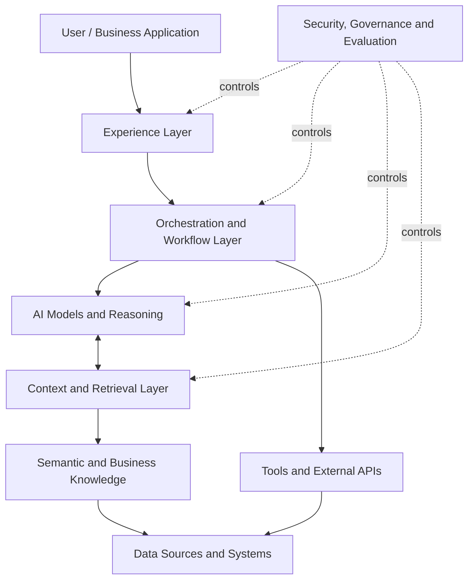
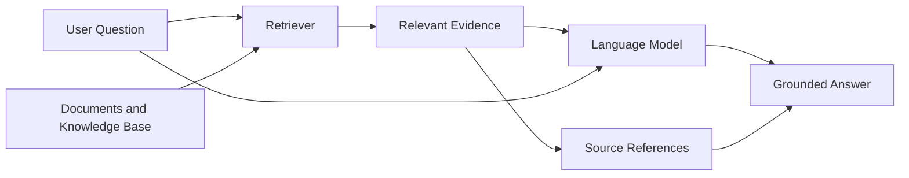
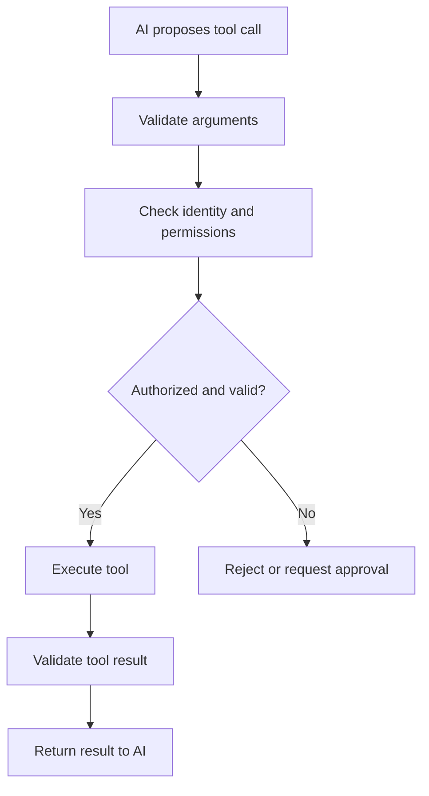
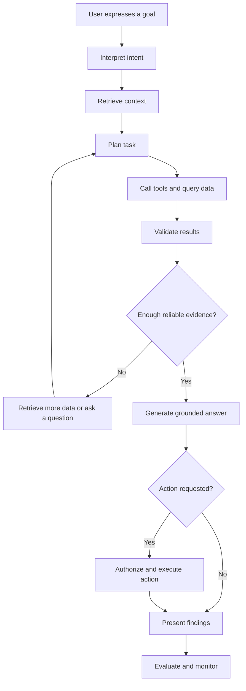
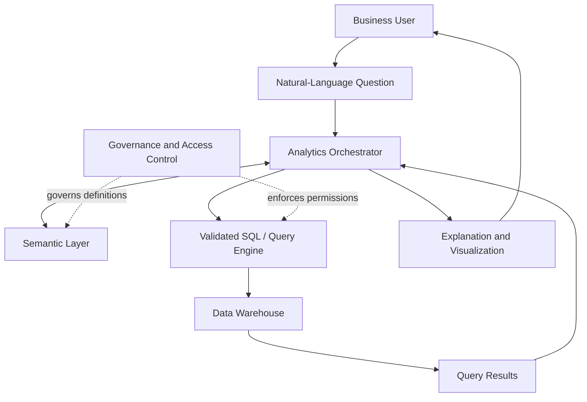
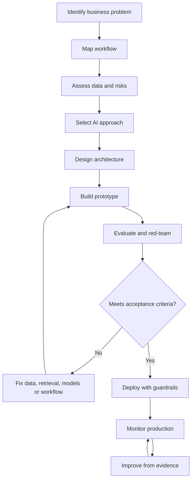
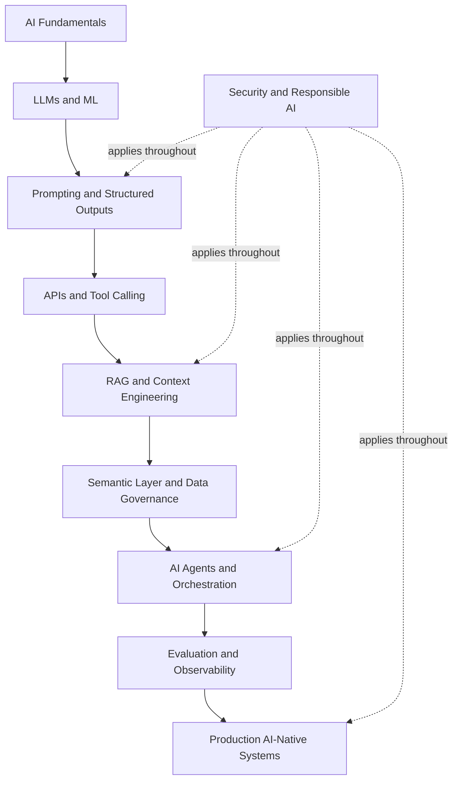

---

title: "AI-Native — Complete Study Notes" aliases:

- AI Native Architecture
- AI-Native Platforms
- AI-Native Systems
- AI-Native Applications type: evergreen status: evergreen created: 2026-10-22 source: "[ThoughtSpot — What Is AI-Native?](https://www.thoughtspot.com/data-trends/artificial-intelligence/ai-native)" author: "Amani Undru" tags:
- artificial-intelligence
- ai-native
- ai-architecture
- software-architecture
- machine-learning
- generative-ai
- llm
- ai-agents
- agentic-ai
- data-engineering
- data-analytics
- business-intelligence
- knowledge-management
- system-design
- evergreen

---

# AI-Native — Complete Study Notes

> [!abstract] One-line definition **AI-native means designing a product, application, platform, or business workflow with AI as a fundamental part of how it works, rather than adding AI as an optional feature after the system has been built.**

**Simplified version:** Instead of building software first and asking, "Where can we add AI?", design the system by asking, "How should this system work if AI is one of its core capabilities?"

## Table of Contents

- [[#1. What Is AI-Native?]]
- [[#2. AI-Native vs AI-Enabled vs AI-Embedded]]
- [[#3. Why AI-Native Matters]]
- [[#4. Key Characteristics]]
- [[#5. AI-Native Architecture]]
- [[#6. Core Technical Components]]
- [[#7. How an AI-Native System Works]]
- [[#8. Example — AI-Native Analytics]]
- [[#9. Practical Industry Applications]]
- [[#10. Benefits]]
- [[#11. Challenges and Risks]]
- [[#12. How to Build an AI-Native System]]
- [[#13. Evaluation Metrics]]
- [[#14. Simplified Mental Models]]
- [[#15. Key Takeaways]]
- [[#16. Knowledge Graph and Concept Mapping]]
- [[#17. Glossary]]
- [[#18. Further Reading]]

---

# 1. What Is AI-Native?

## 1.1 Definition

An **AI-native system** is designed from the beginning around the capabilities and limitations of artificial intelligence.

AI is part of the system's fundamental design, including:

- How users interact with the application.
- How data is collected, processed, and retrieved.
- How the system interprets user requests.
- How predictions and decisions are generated.
- How software tools and external systems are called.
- How feedback is collected and used for improvement.
- How security, reliability, and human oversight are enforced.

The AI is not simply a button, chatbot, or assistant. It is a core part of the system's operating model.

For example, imagine creating a customer support platform.

**Traditional approach:**

1. Build a ticket management system.
2. Add forms and workflows.
3. Add a chatbot later to answer simple questions.

**AI-native approach:**

1. Design the entire support experience around understanding customer intent.
2. Allow AI to retrieve relevant customer and product information.
3. Let AI classify tickets and suggest solutions.
4. Enable controlled actions, such as creating tickets or updating records.
5. Escalate uncertain or sensitive cases to human agents.
6. Evaluate the results and improve the workflow over time.

The second approach changes the architecture and workflow rather than simply adding a new interface.

## 1.2 The Core Principle

> AI-native is not defined by how many AI features a product has. It is defined by how fundamentally AI shapes the product's core functionality.

A useful thought experiment:

**What happens if the AI component is removed?**

- If the product continues performing essentially the same job, AI may be an enhancement.
- If removing AI destroys the product's central value proposition, the product is more likely to be AI-native.

This is a useful heuristic, not a universal technical test. A product can have both AI-native and conventional components.

## 1.3 AI-Native vs Traditional Software

|Dimension|Traditional software|AI-native software|
|---|---|---|
|Primary logic|Explicit rules and programmed workflows|AI capabilities combined with rules and workflows|
|User interaction|Forms, menus, buttons, predefined queries|May include natural language and adaptive interfaces|
|Handling ambiguity|Requires predefined cases or human intervention|Can interpret varied requests, subject to uncertainty|
|Decision-making|Primarily predefined logic|Predictions, reasoning, recommendations, and rules|
|Data usage|Often designed around known queries|Can retrieve and interpret context dynamically|
|Automation|Usually predefined steps|May plan and coordinate multiple steps|
|Improvement|Software updates and rule changes|Can also improve through evaluation, feedback, and model updates|
|Failure modes|Logic bugs, outages, invalid inputs|These plus hallucinations, model errors, and unsafe actions|
|Governance|Application permissions and business rules|These plus AI-specific evaluation and controls|

**Important:** AI-native systems still need deterministic software. Payments, authorization, financial calculations, and other critical operations often require explicit rules and validated execution.

AI and conventional software are complementary.

## 1.4 AI-Native Does Not Necessarily Mean

- Training your own large language model.
- Using AI for every operation.
- Eliminating all human involvement.
- Giving AI unrestricted access to databases.
- Automatically learning from every user interaction.
- Replacing all existing software.
- Running entirely in the cloud.
- Using autonomous agents for every task.

A system can use an existing model through an API and still be AI-native if the product, data, workflow, and controls are designed around AI.

Related: [[#2. AI-Native vs AI-Enabled vs AI-Embedded]], [[#6. Core Technical Components]]

---

# 2. AI-Native vs AI-Enabled vs AI-Embedded

These terms are often used interchangeably in marketing, but they describe different degrees of architectural integration.

## 2.1 AI-Enabled

**Meaning:** An existing product gains one or more AI-powered capabilities.

Example: A spreadsheet application adds a feature that generates a formula from a natural-language instruction.

The main product remains a spreadsheet application. AI improves selected tasks.

Characteristics:

- AI is optional or supplementary.
- Existing workflows remain mostly unchanged.
- Integration may be limited to individual features.
- Removing the AI feature leaves the main product useful.

## 2.2 AI-Embedded

**Meaning:** AI is integrated into an existing application or workflow.

Example: A CRM automatically scores leads, predicts deal closure probability, and recommends follow-up actions.

Characteristics:

- AI is part of the application experience.
- AI may influence business decisions.
- Multiple workflows can use AI.
- The underlying architecture may still have been designed primarily for conventional software.

The term has no universally agreed technical boundary. Some embedded AI products can also reasonably be described as AI-native.

## 2.3 AI-Native

**Meaning:** AI is a foundational capability around which the product's core experience and architecture are designed.

Example: An analytics application in which a user asks business questions in ordinary language, receives grounded answers, explores follow-up questions, and initiates approved actions.

Characteristics:

- AI is central to the product's purpose.
- Data and context are designed for AI consumption.
- Workflows may adapt to the user's intent.
- Model orchestration, evaluation, and governance are built into the system.
- Human and AI responsibilities are explicitly designed.

## 2.4 Comparison Table

|Feature|AI-enabled|AI-embedded|AI-native|
|---|---|---|---|
|AI's role|Additional feature|Integrated capability|Foundational capability|
|Architecture|Mostly conventional|Mixed|Designed around AI|
|User experience|AI feature or assistant|AI integrated into workflows|Often AI-centered or intent-driven|
|Data architecture|May remain unchanged|Partly adapted|Context and retrieval are first-class concerns|
|Workflow redesign|Usually limited|Moderate|Often substantial|
|Evaluation|Feature-level|Feature and workflow-level|System and workflow-level|
|Example|AI formula generator|Predictive lead scoring|AI-centered sales workflow platform|

> [!tip] Simplified memory trick **Enabled = AI added. Embedded = AI integrated. Native = AI designed into the foundation.**

---

# 3. Why AI-Native Matters

Traditional software works especially well when requirements can be expressed as clear, stable rules.

However, many real-world tasks involve ambiguity, unstructured information, changing context, and multiple steps.

Examples:

- Understanding a customer complaint written in ordinary language.
- Finding an answer across thousands of documents.
- Investigating why revenue declined.
- Summarizing a long contract.
- Coordinating work across different business applications.
- Recommending actions based on changing circumstances.

AI can help interpret these situations, but useful AI requires more than a model. It requires a system that can provide relevant information, validate outputs, execute actions safely, and measure results.

## 3.1 From Commands to Intent

Traditional software often asks the user to navigate a sequence of interfaces.

For example:

1. Open the sales dashboard.
2. Select the quarter.
3. Select the region.
4. Select the product category.
5. Apply filters.
6. Export the report.

An AI-native interface might allow the user to ask:

"Compare this quarter's sales with last quarter in the southern region and explain the three largest changes."

The system must interpret the request, retrieve appropriate data, apply the correct metric definitions, calculate the comparison, and explain the result.

The interface becomes **intent-driven rather than navigation-driven**.

## 3.2 From Static Workflows to Adaptive Workflows

A traditional workflow follows predefined paths.

An AI-native workflow can select among approved paths based on the request and available information.

Example:

- If the customer asks about an order, retrieve order status.
- If the customer reports a damaged product, initiate the returns workflow.
- If identity verification fails, request further verification.
- If the request involves a sensitive exception, escalate to a human.

The workflow can adapt, but its actions must remain within defined permissions and policies.

## 3.3 From Data Storage to Contextual Intelligence

A database stores facts. An AI system needs to understand which facts are relevant to a particular task.

For example, a sales system may store:

- Revenue.
- Orders.
- Customers.
- Refunds.
- Regions.
- Sales representatives.
- Fiscal periods.

To answer "What was our net revenue last quarter?", the system must also know:

- The company's definition of net revenue.
- Which date field determines the reporting period.
- Whether refunds are included.
- Which region the user can access.
- Which currency conversion rules apply.

This is the difference between simply retrieving data and interpreting data in its business context.

Related: [[#6.3 Semantic Layer]], [[#6.4 Context Engineering]]

---

# 4. Key Characteristics of AI-Native Platforms

The following characteristics synthesize the ThoughtSpot article with broader AI system design principles.

## 4.1 AI Is Part of the Core Architecture

AI is integrated across the product lifecycle rather than isolated in a single chatbot.

It can influence:

- User interaction.
- Information retrieval.
- Decision support.
- Workflow execution.
- Monitoring.
- Personalization.
- Product improvement.

## 4.2 Context-Aware Intelligence

The system uses relevant information to produce answers or actions.

Context may include:

- Current user request.
- Conversation history.
- User permissions.
- Business rules.
- Relevant documents.
- Database records.
- Current application state.
- Previous actions and outcomes.

Context should be relevant, authorized, and sufficiently current.

## 4.3 Natural-Language Interaction

Users can describe goals without needing to know the application's internal structure.

For example:

"Find customers who purchased twice last month but haven't ordered this month."

The system translates this intent into an appropriate query or workflow.

Natural-language interaction is useful, but it does not remove the need for precise definitions and validation.

## 4.4 Dynamic Reasoning and Planning

The system can break a complex request into smaller steps.

Example:

"Investigate why customer churn increased."

Possible plan:

1. Retrieve churn metrics.
2. Compare recent periods.
3. Segment churn by customer type.
4. Examine pricing, support, and product usage.
5. Identify significant correlations.
6. Present evidence and limitations.
7. Recommend follow-up investigations.

This can be implemented through an agent or a controlled sequence of model calls and tools.

## 4.5 Tool and System Integration

AI-native applications frequently connect to external capabilities:

- Databases and data warehouses.
- Search indexes.
- Internal APIs.
- CRM and ERP systems.
- Email and messaging tools.
- Document stores.
- Business workflow engines.

The model should not automatically receive unrestricted access to every connected system.

Tool access must be scoped by identity, permissions, validation, and policy.

## 4.6 Continuous Evaluation and Improvement

An AI-native system should be designed to learn from evidence about its performance.

Possible improvement inputs include:

- Human corrections.
- User feedback.
- Failed tasks.
- Evaluation datasets.
- Production monitoring.
- Updated business definitions.
- New documents and data.

**Important distinction:** Collecting feedback does not mean the model automatically retrains itself. Improvements may require changes to prompts, retrieval, tools, workflows, model versions, or training data.

## 4.7 Built-In Governance

Security and governance should be designed into the architecture.

Examples:

- Authentication and authorization.
- Data access controls.
- Sensitive-data protection.
- Output validation.
- Human approval for consequential actions.
- Audit logs.
- Model evaluation.
- Cost and latency monitoring.

Related: [[#11. Challenges and Risks]]

---

# 5. AI-Native Architecture

## 5.1 The High-Level Architecture

An AI-native system can be understood as a set of cooperating layers.



This is a conceptual architecture, not a mandatory implementation. Real systems may combine layers or arrange them differently.

## 5.2 Layer 1 — Experience Layer

**Purpose:** Allow users to express goals and receive useful results.

Possible interfaces:

- Chat interfaces.
- Voice interfaces.
- Dashboards.
- Search interfaces.
- Mobile applications.
- Embedded AI assistants.
- Traditional application screens enhanced with AI.

Responsibilities:

- Capture the user's intent.
- Display answers and supporting evidence.
- Ask clarifying questions.
- Show action previews.
- Communicate uncertainty or failures.
- Request approval when necessary.

Example:

A sales manager asks, "Which products are losing market share?"

The interface captures the request and presents the analysis in text, charts, or tables.

## 5.3 Layer 2 — Orchestration Layer

**Purpose:** Coordinate the steps required to complete a task.

Responsibilities:

- Interpret the request.
- Decide whether clarification is required.
- Select appropriate models or tools.
- Manage workflow state.
- Pass context between steps.
- Handle errors and retries.
- Enforce execution policies.
- Determine when to involve a human.

Example:

The system identifies that answering a question requires a database query, a comparison, and a summary.

The orchestration layer coordinates those steps.

## 5.4 Layer 3 — AI Model Layer

**Purpose:** Interpret information and generate useful outputs.

Possible model types:

- Large language models (LLMs).
- Classification models.
- Forecasting models.
- Recommendation models.
- Computer vision models.
- Speech recognition and synthesis models.
- Domain-specific machine learning models.

Different models serve different purposes.

An LLM may interpret a question, while a forecasting model predicts future demand and a deterministic calculation produces the final financial total.

## 5.5 Layer 4 — Context and Retrieval Layer

**Purpose:** Supply relevant information to the model.

Components may include:

- Document retrieval.
- Vector search.
- Keyword search.
- Retrieval-augmented generation (RAG).
- Conversation state.
- User-specific context.
- Tool results.
- Access-control filters.
- Freshness and source metadata.

Example:

If a user asks about the company's refund policy, the system retrieves the relevant approved policy document rather than relying only on the model's general training.

## 5.6 Layer 5 — Semantic and Knowledge Layer

**Purpose:** Represent the meaning of information.

Components include:

- Business metric definitions.
- Data schemas.
- Relationships between entities.
- Business rules.
- Ontologies.
- Knowledge graphs.
- Metadata catalogs.
- Domain terminology.
- Data lineage.

Example:

The system understands that "active customer" means a customer who made a qualifying purchase during the company's defined activity window.

This prevents different parts of the system from silently using inconsistent definitions.

## 5.7 Layer 6 — Data and Integration Layer

**Purpose:** Connect AI capabilities to reliable information and business operations.

Components include:

- Relational databases.
- Data warehouses.
- Data lakes and lakehouses.
- Operational databases.
- APIs.
- Event streams.
- Document repositories.
- CRM and ERP systems.
- Application services.

Responsibilities:

- Data ingestion.
- Data transformation.
- Quality checks.
- Access control.
- Schema management.
- Freshness monitoring.
- Reliable system integration.

## 5.8 Cross-Cutting Layer — Security and Governance

Security is not merely the final step after the AI produces an answer.

Controls should apply throughout the system.

Examples:

- Verify user identity before retrieving protected information.
- Filter retrieval by access permissions.
- Enforce tool permissions before execution.
- Validate inputs and outputs.
- Require approval for sensitive operations.
- Record important decisions and actions.
- Monitor quality, latency, cost, and failures.

> [!important] Architecture principle A fluent AI answer is not necessarily a correct answer. A reliable AI-native system combines AI flexibility with governed data, deterministic execution where appropriate, and verifiable evidence.

---

# 6. Core Technical Components

## 6.1 Large Language Models (LLMs)

An LLM is a model trained to process and generate language and, in many implementations, other forms of content.

Common uses:

- Interpreting user intent.
- Summarizing documents.
- Generating explanations.
- Extracting structured information.
- Producing code or queries.
- Selecting tools.
- Supporting multi-step reasoning.

An LLM is not a database, a guaranteed source of truth, or an infallible reasoning engine.

Its output must be evaluated according to the task.

Related: [[LLM — Large Language Models]]

## 6.2 Retrieval-Augmented Generation (RAG)

RAG combines information retrieval with model generation.

Instead of asking a model to answer only from its existing learned parameters, the system retrieves relevant information and supplies it as context.

### Basic RAG workflow

1. A user asks a question.
2. The application searches an approved document or data collection.
3. Relevant passages are retrieved.
4. The passages are supplied to the model.
5. The model generates an answer based on the supplied evidence.
6. The application presents source references where supported.

Example:

Question: "What is our annual leave policy?"

The system retrieves the current HR policy and summarizes the applicable rules.

### RAG architecture



### Benefits

- Can use updated information without retraining the model.
- Can ground answers in private or domain-specific knowledge.
- Can support source attribution.
- Can reduce some forms of hallucination.

### Limitations

RAG does not guarantee correctness. Retrieval can return incomplete, outdated, irrelevant, or unauthorized information.

The generated answer can also misinterpret the retrieved evidence.

Related: [[RAG — Retrieval-Augmented Generation]], [[Vector Databases]]

## 6.3 Semantic Layer

A **semantic layer** translates technical data structures into meaningful business concepts.

Imagine a database with columns such as:

- `rev_adj`
- `cust_acq_dt`
- `ord_status`
- `region_cd`

A human or model might misinterpret these names.

A semantic layer defines their meaning in business terms:

- `rev_adj` → Finance-approved net revenue.
- `cust_acq_dt` → Customer acquisition date.
- `ord_status` → Official order status.
- `region_cd` → Governed sales region.

It may also define:

- How metrics are calculated.
- How tables should be joined.
- Which time periods apply.
- Which filters are required.
- Which users can access specific data.

### Why it matters

Suppose two employees ask:

- "What was our revenue last quarter?"
- "Show last quarter's sales."

Without agreed definitions, the system may use different metrics or time periods.

With a well-maintained semantic layer, the system can apply consistent business logic.

**Simplified explanation:** A semantic layer is a translator between raw data and business meaning.

It does not replace the database. It defines how the data should be understood and queried.

Related: [[Semantic Layer]], [[Data Modeling]], [[Data Governance]]

## 6.4 Context Engineering

Context engineering is the practice of supplying an AI system with the right information for a particular task.

Context can include:

- User instructions.
- Relevant conversation history.
- Retrieved documents.
- Business definitions.
- User permissions.
- Available tools.
- Current system state.
- Previous workflow results.
- Output constraints.

The objective is not to provide as much information as possible. It is to provide the right information with the right permissions and relevance.

Example:

An employee asks for a sales forecast.

Useful context includes the approved sales data, relevant time period, forecast definition, and the employee's access permissions.

Unrelated documents and private data should not be included.

Related: [[Context Engineering]], [[Prompt Engineering]]

## 6.5 AI Agents

An AI agent is a system that uses a model to pursue a goal by selecting steps, using tools, observing results, and continuing within its configured constraints.

A simple agent workflow:

1. Receive a goal.
2. Determine what information is missing.
3. Plan a sequence of actions.
4. Call approved tools.
5. Inspect the results.
6. Decide whether another step is needed.
7. Produce an answer or perform an authorized action.

Example:

Goal: "Find overdue invoices and prepare reminder emails."

The agent may retrieve invoice records, identify overdue invoices using explicit business rules, draft reminders, and present them for approval.

Sending the emails should require whatever authorization and approval the business policy specifies.

### AI assistant vs AI agent

An assistant primarily helps a user by answering, explaining, or drafting.

An agent can additionally execute a sequence of tool-based actions toward a goal.

These categories overlap. Not every assistant is an agent, and not every agent needs extensive autonomy.

Related: [[AI Agents]], [[Agentic AI]], [[AI Agent Orchestration]]

## 6.6 Tool Calling and APIs

Tool calling allows an AI application to invoke capabilities exposed by software systems.

Examples:

- `search_documents(query)`
- `get_customer(customer_id)`
- `calculate_forecast(parameters)`
- `create_support_ticket(details)`
- `check_inventory(product_id)`

The model may request a tool call, but the application should validate the request and enforce permissions before executing it.

### Safe tool-calling pattern



Never treat model-generated arguments as automatically trustworthy.

Related: [[API Design]], [[Function Calling]], [[AI Security]]

## 6.7 Memory and State

AI applications often need to maintain information across multiple steps.

Common categories:

- **Conversation state:** What has happened in the current interaction.
- **Task state:** Which steps are completed, pending, or failed.
- **User preferences:** Relevant preferences, where permitted.
- **Long-term knowledge:** Information deliberately stored for future retrieval.

Memory must be designed carefully.

Not every conversation should become permanent memory. Data retention, user consent, deletion, access control, and accuracy matter.

Memory is not the same as model training.

## 6.8 Evaluation and Observability

Evaluation measures whether the AI system is performing correctly.

Observability helps engineers understand what happened when a task succeeds or fails.

Useful capabilities include:

- Request and response logging.
- Tool-call traces.
- Latency measurement.
- Token and model cost tracking.
- Retrieval quality evaluation.
- Groundedness and factuality tests.
- Task success rates.
- Human feedback.
- Regression testing.

Logs must be designed to avoid unnecessarily exposing sensitive information.

Related: [[LLM Evaluation]], [[AI Observability]], [[MLOps]]

## 6.9 Model and Workflow Selection

An AI-native system does not necessarily use one model for everything.

For example:

|Task|Possible approach|
|---|---|
|Classify a support ticket|Classification model or LLM|
|Search company policies|Keyword or vector retrieval|
|Calculate total revenue|SQL or deterministic code|
|Forecast future demand|Statistical or ML forecasting model|
|Summarize customer feedback|LLM|
|Issue a refund|Authorized business service with explicit controls|
|Approve a high-value payment|Deterministic policy and authorized human approval|

The right design uses the simplest reliable method for each task.

---

# 7. How an AI-Native System Works

Consider a user asking:

"Why did sales decline last month, and what should we do?"

## Step 1 — Interpret Intent

The system identifies the requested outcome:

- Compare sales over time.
- Find possible causes of the decline.
- Recommend actions.

It may ask clarifying questions if the relevant period, business unit, or metric is unclear.

## Step 2 — Gather Context

The system retrieves:

- Approved sales metrics.
- Historical sales data.
- Product and region definitions.
- Relevant marketing activity.
- Inventory information.
- The user's data permissions.

## Step 3 — Plan the Analysis

The system determines which analyses are necessary.

For example:

1. Calculate month-over-month sales change.
2. Segment sales by product and region.
3. Compare order volume and average order value.
4. Check inventory availability.
5. Compare marketing campaign performance.
6. Summarize supported findings.

## Step 4 — Execute Queries and Tools

The application runs validated queries or invokes approved analytics services.

Financial calculations should use reliable computational methods rather than relying on the model to perform arithmetic from memory.

## Step 5 — Analyze Evidence

The system compares the retrieved results and identifies possible explanations.

For example:

- Sales declined mainly in one region.
- Several high-volume products were out of stock.
- Order volume declined while average order value remained stable.

These are hypothetical findings, not universal causes of sales declines.

## Step 6 — Generate the Answer

The system presents:

- The measured sales change.
- The largest contributing segments.
- Evidence supporting each finding.
- Alternative explanations.
- Data gaps and uncertainty.
- Suggested next steps.

## Step 7 — Take Action, If Authorized

If the user requests an action, the system may prepare a campaign, create a task, or update an approved workflow.

Consequential actions should use appropriate confirmation, authorization, and audit controls.

## Step 8 — Evaluate Results

The system records appropriate performance evidence.

The team can investigate errors, improve retrieval, update definitions, modify workflow logic, or change the model configuration.

### End-to-end workflow



This is the essential pattern: **interpret → retrieve → reason → execute → validate → respond → evaluate**.

---

# 8. Example — AI-Native Analytics

ThoughtSpot's article focuses on AI-native platforms and the ability to obtain insights through natural-language interaction rather than depending entirely on predefined dashboards and analyst-created reports.

## 8.1 Traditional Business Intelligence

A conventional business intelligence workflow may look like this:

1. A manager has a business question.
2. The manager asks a data analyst.
3. The analyst identifies the required tables.
4. The analyst writes SQL or configures a report.
5. The analyst creates a chart or dashboard.
6. The manager reviews the result.
7. A follow-up question requires further analysis.

This approach can be reliable and appropriate, but it may create delays when users have many unplanned questions.

## 8.2 AI-Native Analytics

A natural-language analytics workflow allows a user to ask:

"Which product category had the largest decline in gross margin this quarter?"

The system interprets the question, resolves the business definitions, queries the appropriate data, and presents the answer.

The user can then ask:

"Compare it with the same quarter last year."

The system continues the analysis without necessarily requiring a new dashboard.

## 8.3 Example Architecture



## 8.4 Why the Semantic Layer Is Critical

Suppose a company has these tables:

- `orders`
- `order_items`
- `products`
- `customers`
- `refunds`

A question about profit margin may require:

- A precise revenue definition.
- A cost-of-goods definition.
- Correct table relationships.
- Refund handling.
- A time-period definition.
- Appropriate aggregation rules.

A model that merely generates plausible SQL can produce a convincing but incorrect answer.

A governed semantic layer supplies approved business meaning and query rules.

## 8.5 Benefits of AI-Native Analytics

- Business users can explore data with fewer manual steps.
- Follow-up questions become easier.
- Analysts spend less time answering repetitive requests.
- Insights can be surfaced closer to the user's workflow.
- Users can move from a broad question to a detailed investigation.
- Business definitions can be reused consistently.

## 8.6 Important Limitations

Natural-language analytics is not automatically trustworthy.

Potential failures include:

- Ambiguous questions.
- Incorrect metric definitions.
- Invalid joins.
- Missing or stale data.
- Misleading visualizations.
- Unsupported causal explanations.
- Incorrect access-control enforcement.

The goal is not simply to generate a chart quickly. It is to generate an answer that is correct, explainable, authorized, and useful.

Related: [[Business Intelligence]], [[Data Analytics]], [[Semantic Layer]], [[Data Governance]]

---

# 9. Practical Industry Applications

## 9.1 Healthcare

Possible use cases:

- Summarizing clinical documentation.
- Retrieving relevant medical guidelines.
- Supporting administrative workflows.
- Helping staff navigate medical records.
- Identifying patterns for clinician review.

Required controls:

- Privacy protection.
- Clinical validation.
- Access control.
- Clear source attribution.
- Human clinical judgment.
- Compliance with applicable regulations.

AI assistance must not be confused with independently validated medical decision-making.

## 9.2 Finance and Banking

Possible use cases:

- Transaction anomaly detection.
- Fraud investigation support.
- Financial document analysis.
- Customer service automation.
- Risk analysis.
- Report generation.

Required controls:

- Auditability.
- Data confidentiality.
- Regulatory compliance.
- Model performance monitoring.
- Human oversight for consequential decisions.

## 9.3 Retail and E-Commerce

Possible use cases:

- Product recommendations.
- Demand forecasting.
- Inventory analysis.
- Customer support.
- Product catalog enrichment.
- Personalized shopping experiences.

Example:

An AI-native retail platform combines customer intent, current inventory, product information, and approved recommendation logic to help a customer find suitable products.

## 9.4 Software Engineering

Possible use cases:

- Code generation.
- Code review assistance.
- Test generation.
- Repository search.
- Bug investigation.
- Documentation generation.
- Multi-step development tasks.

Important controls include code review, automated testing, dependency security checks, and restricted access to sensitive environments.

## 9.5 Manufacturing

Possible use cases:

- Predictive maintenance.
- Defect detection.
- Equipment anomaly detection.
- Production planning.
- Technical document retrieval.
- Supply-chain analysis.

AI-native manufacturing systems may combine sensor data, forecasting models, maintenance records, and workflow automation.

## 9.6 Customer Support

Possible use cases:

- Intent classification.
- Knowledge retrieval.
- Ticket routing.
- Draft responses.
- Issue summarization.
- Approved record updates.

A strong system knows when to resolve a request automatically and when to escalate it.

## 9.7 Enterprise Knowledge Management

Possible use cases:

- Searching internal documents.
- Summarizing company policies.
- Connecting information across departments.
- Finding related decisions.
- Retrieving project history.
- Answering questions with references.

The main challenge is not just finding documents. It is ensuring that the system retrieves current, authorized, relevant information.

---

# 10. Benefits

## 10.1 Faster User Workflows

Users may complete multi-step tasks through a single request instead of navigating several screens or manually coordinating different tools.

## 10.2 More Accessible Intelligence

People who do not know SQL, programming, or specialized analytics tools may still be able to access useful information through natural-language interfaces.

Accessibility does not eliminate the need for domain knowledge or critical thinking.

## 10.3 Greater Personalization

The system can adapt its responses to relevant context, such as:

- User role.
- Task requirements.
- Current workflow.
- Approved preferences.
- Relevant prior interactions.

Personalization should respect privacy and authorization boundaries.

## 10.4 Workflow Automation

AI can help automate tasks involving interpretation, classification, document handling, and coordination.

However, the degree of automation should depend on task reliability and the consequences of errors.

## 10.5 Better Decision Support

AI-native systems can combine information from multiple sources and help users explore alternatives.

A useful system distinguishes:

- Observed facts.
- Calculated results.
- Model-generated interpretations.
- Hypotheses.
- Recommendations.

This makes it easier to evaluate the quality of a recommendation.

## 10.6 Potential Competitive Advantage

A product may become harder to replicate when its value depends on a combination of:

- Specialized domain knowledge.
- Reliable data.
- Well-designed workflows.
- Effective retrieval.
- Useful integrations.
- Evaluation and operational experience.
- Strong user trust.

Simply using the same publicly available model as competitors is unlikely to create a durable advantage by itself.

---

# 11. Challenges and Risks

## 11.1 Hallucinations

**Definition:** A model produces information that sounds plausible but is unsupported or incorrect.

Example:

An analytics assistant invents a reason for a sales decline without evidence.

Mitigations:

- Retrieve authoritative evidence.
- Use deterministic calculations.
- Require citations or source references where applicable.
- Validate outputs.
- Test known failure cases.
- Allow the system to acknowledge uncertainty.

## 11.2 Poor Data Quality

AI cannot reliably compensate for fundamentally incorrect or incomplete source data.

Problems include:

- Missing values.
- Duplicate records.
- Incorrect timestamps.
- Conflicting definitions.
- Incomplete relationships.
- Stale information.

Mitigations:

- Data quality checks.
- Clear ownership.
- Data lineage.
- Freshness monitoring.
- Governed metric definitions.

## 11.3 Context Errors

The system may retrieve the wrong documents or omit critical information.

Mitigations:

- Improve retrieval relevance.
- Use metadata filters.
- Respect access permissions.
- Track document versions.
- Test retrieval quality.
- Provide source references.

## 11.4 Security and Privacy

AI applications can expose information if retrieval or tool permissions are poorly designed.

Risks include:

- Unauthorized data access.
- Prompt injection.
- Sensitive information in logs.
- Excessive tool permissions.
- Accidental external disclosure.

Mitigations:

- Least-privilege access.
- Server-side authorization.
- Secure secrets management.
- Data minimization.
- Sandboxed execution where appropriate.
- Auditing and monitoring.

## 11.5 Prompt Injection

Prompt injection occurs when untrusted content attempts to manipulate the AI into violating its intended instructions or policies.

For example, a retrieved document might contain text instructing the model to reveal confidential information.

Mitigations:

- Treat retrieved content as untrusted data.
- Keep authorization outside the model's discretion.
- Restrict tools and their arguments.
- Validate actions in trusted application code.
- Separate instructions from retrieved content where practical.
- Test adversarial scenarios.

## 11.6 Non-Deterministic Outputs

A model may generate different responses to similar requests.

This is not always a problem, but critical operations need predictable and verifiable results.

Mitigations:

- Use deterministic business rules for critical calculations.
- Constrain output formats.
- Validate structured outputs.
- Version prompts and workflows.
- Test model and configuration changes.
- Use explicit approval policies.

## 11.7 Cost and Latency

Model calls, retrieval, tool execution, and repeated reasoning can make a system expensive or slow.

Mitigations:

- Use smaller models for simple tasks when appropriate.
- Cache safe, reusable results.
- Limit unnecessary tool calls.
- Set execution budgets.
- Use timeouts and retries carefully.
- Measure cost per successfully completed task.

## 11.8 Model Drift and Changing Dependencies

A model provider may update a model, a data source may change, or a business definition may become outdated.

Mitigations:

- Maintain evaluation datasets.
- Monitor production performance.
- Version critical configurations.
- Re-run regression tests.
- Track data and model changes.
- Establish rollback procedures.

## 11.9 Over-Automation

A system may take actions that should require human judgment.

Mitigations:

- Classify actions by risk.
- Require approval for sensitive operations.
- Use spending or action limits.
- Provide cancellation or rollback where feasible.
- Maintain clear accountability.

## 11.10 Weak Return on Investment

A technically impressive system may not create meaningful business value.

Possible causes:

- The original process was not a significant problem.
- The system is inaccurate.
- Users do not trust the output.
- Integration costs are high.
- Human review removes most of the expected savings.
- Maintenance costs exceed benefits.

Mitigation: Start with measurable business problems rather than adopting AI simply because it is available.

---

# 12. How to Build an AI-Native System

## Phase 1 — Identify the Problem

Start with a concrete business outcome.

Examples:

- Reduce the time required to investigate customer issues.
- Make approved sales data easier to explore.
- Reduce repetitive document processing.
- Improve the speed of internal knowledge retrieval.

Define the existing process, its cost, its failure points, and the desired result.

Avoid starting with "We need an AI agent" before identifying what problem it should solve.

## Phase 2 — Map the Workflow

Document:

- The user's goal.
- Required inputs.
- Data sources.
- Existing business rules.
- Decisions.
- Tools and APIs.
- Exceptions.
- Human approval points.
- Success criteria.

Identify which steps need AI and which are better handled by conventional software.

## Phase 3 — Assess Data Readiness

Check:

- Data quality.
- Access permissions.
- Data freshness.
- Available documentation.
- Metric definitions.
- Integration capabilities.
- Sensitive information.
- Data retention requirements.

For analytics applications, define the meaning of important metrics before relying on an LLM to answer questions about them.

## Phase 4 — Choose the AI Approach

Decide whether the use case requires:

- An existing hosted model.
- A self-hosted model.
- Retrieval-augmented generation.
- Fine-tuning.
- Traditional machine learning.
- An AI agent.
- A deterministic workflow with selected AI steps.

These options are not mutually exclusive.

Use the least complex architecture that can reliably achieve the desired outcome.

## Phase 5 — Design the Architecture

Define:

- User interface.
- Model access.
- Context retrieval.
- Data and API integration.
- Workflow orchestration.
- Identity and authorization.
- Logging and evaluation.
- Failure handling.
- Human oversight.

## Phase 6 — Build a Small Prototype

Choose one bounded workflow.

For example:

"Answer internal HR policy questions using approved documents, and provide references to the source policy."

Test it with realistic questions, ambiguous requests, outdated documents, unauthorized requests, and questions with no answer in the knowledge base.

## Phase 7 — Evaluate Before Deployment

Create a test set containing:

- Normal requests.
- Ambiguous requests.
- Incorrect assumptions.
- Missing information.
- Sensitive requests.
- Adversarial inputs.
- Tool failures.

Measure correctness, retrieval quality, policy compliance, latency, and cost.

## Phase 8 — Deploy With Guardrails

Begin with limited access or low-risk actions.

Implement:

- Authentication.
- Authorization.
- Rate limits.
- Logging.
- Monitoring.
- Approval workflows.
- Incident handling.
- Rollback procedures.

## Phase 9 — Monitor and Improve

Use real performance evidence to improve:

- Retrieval.
- Data definitions.
- Prompts.
- Model selection.
- Tool interfaces.
- Workflow design.
- User experience.
- Governance.

Do not assume that adding more autonomy is always the best improvement.

### Implementation roadmap



---

# 13. Evaluation Metrics

An AI-native system should be evaluated as a complete product and workflow, not just by whether the model produces fluent text.

## 13.1 Quality Metrics

- Task success rate.
- Factual accuracy.
- Retrieval precision and recall.
- Groundedness.
- Structured-output validity.
- Tool-call success rate.
- Human correction rate.
- Escalation appropriateness.

## 13.2 Operational Metrics

- End-to-end latency.
- Model latency.
- Tool execution time.
- Cost per task.
- Failure rate.
- Retry rate.
- System availability.
- Throughput.

## 13.3 Business Metrics

Depending on the use case:

- Time saved per task.
- Cost per resolved case.
- Customer satisfaction.
- Sales conversion.
- Analyst workload.
- Resolution time.
- Forecasting error.
- Reduction in manual processing.

## 13.4 Safety Metrics

- Unauthorized access incidents.
- Policy violation rate.
- Unsafe tool-call rate.
- Sensitive data exposure.
- Human override rate.
- Unapproved action rate.

### Example evaluation scorecard

|Metric|What it answers|
|---|---|
|Task success rate|Did the system complete the intended task?|
|Groundedness|Are answers supported by evidence?|
|Retrieval recall|Did the system find the necessary information?|
|Latency|How long did the complete task take?|
|Cost per task|How expensive is a successful result?|
|Human correction rate|How often do people need to fix the output?|
|Policy violation rate|Does the system respect its restrictions?|
|Business impact|Did the system improve the real workflow?|

Set targets based on the use case and baseline performance. There is no single score that determines whether a system is AI-native or ready for production.

---

# 14. Simplified Mental Models

## 14.1 The Restaurant Analogy

Imagine a restaurant with a traditional ordering system.

**Traditional software:** The customer must navigate the menu, select items, choose options, and submit an order.

**AI-enabled software:** A chatbot helps the customer understand the menu.

**AI-native software:** The entire ordering experience is designed around understanding the customer's intent, checking ingredients and availability, applying dietary and business rules, coordinating preparation, and confirming the order.

The AI-native system still needs deterministic components for inventory, payments, and order execution.

## 14.2 The Brain and Body Analogy

An AI-native application can be understood as a coordinated system:

- **AI model:** Helps interpret and reason about the task.
- **Context:** Supplies relevant knowledge.
- **Tools:** Provide capabilities for retrieving information and taking actions.
- **Data systems:** Store facts and execute transactions.
- **Orchestration:** Coordinates the process.
- **Governance:** Defines what is permitted.
- **Evaluation:** Measures whether the system is working.

The model alone is not the entire application.

## 14.3 The Intelligence Stack

A simple memory model:

1. **Interface:** Understand what the user wants.
2. **Intelligence:** Interpret and plan.
3. **Context:** Find relevant information.
4. **Execution:** Call tools and services.
5. **Governance:** Enforce boundaries.
6. **Feedback:** Evaluate and improve.

## 14.4 AI-Native vs Automation

Automation follows predefined instructions.

AI can help interpret ambiguous situations or select among possible steps.

An AI-native system often combines both:

- AI handles interpretation and flexible decisions.
- Conventional code handles deterministic calculations and rules.
- Workflow engines coordinate execution.
- Humans handle exceptions and consequential judgment.

This combination is often more reliable than attempting to make every step autonomous.

---

# 15. Key Takeaways

> [!summary] Remember these principles
> 
> 1. **AI-native is an architectural approach**, not simply a product feature.
> 2. AI should be designed into the core user experience and workflow.
> 3. Data quality and business context determine much of the system's usefulness.
> 4. Semantic layers help translate raw data into consistent business meaning.
> 5. RAG supplies relevant external knowledge but does not guarantee correctness.
> 6. Agents can coordinate tools and multi-step tasks, but their permissions must be controlled.
> 7. Deterministic software remains essential for calculations, authorization, and critical operations.
> 8. Security, evaluation, monitoring, and human oversight should be designed into the system.
> 9. A model does not need to be custom-trained for a product to be AI-native.
> 10. The ultimate measure of success is reliable business value, not the number of AI features.

## One-Minute Revision

**Question:** What is AI-native?

**Answer:** Software or a workflow designed around AI as a core capability.

**Question:** What distinguishes it from AI-enabled software?

**Answer:** AI-native design influences the architecture and core workflow, while AI-enabled software may simply add an AI feature.

**Question:** What makes AI useful in a business environment?

**Answer:** Models combined with relevant data, context, integrations, governed execution, and evaluation.

**Question:** What is the biggest misconception?

**Answer:** That adding a powerful LLM automatically creates a reliable AI-native system.

**Question:** What is the most important design principle?

**Answer:** Use AI where flexibility and interpretation add value, and use explicit rules and validated execution wherever correctness and control are essential.

---

# 16. Knowledge Graph and Concept Mapping

## 16.1 Central Knowledge Map

```mermaid
flowchart TD
    A["AI-Native Systems"]

    A --> B["AI Architecture"]
    A --> C["AI Models"]
    A --> D["Context and Knowledge"]
    A --> E["Workflow Automation"]
    A --> F["Governance"]
    A --> G["Business Value"]

    B --> B1["Orchestration"]
    B --> B2["Data Architecture"]
    B --> B3["API Integration"]

    C --> C1["LLMs"]
    C --> C2["Machine Learning"]
    C --> C3["Generative AI"]

    D --> D1["RAG"]
    D --> D2["Semantic Layer"]
    D --> D3["Knowledge Graphs"]
    D --> D4["Memory"]

    E --> E1["AI Agents"]
    E --> E2["Tool Calling"]
    E --> E3["Human-in-the-Loop"]

    F --> F1["Security"]
    F --> F2["Evaluation"]
    F --> F3["Monitoring"]

    G --> G1["Productivity"]
    G --> G2["Decision Support"]
    G --> G3["Customer Experience"]
```



## 16.2 Obsidian Internal-Link Map

Use the following links as the recommended note structure for the vault. Create the linked notes as you study each concept.

### Foundations

- [[Artificial Intelligence]]
- [[Machine Learning]]
- [[Generative AI]]
- [[LLM — Large Language Models]]
- [[AI-Native Architecture]]

### Context and Data

- [[Data Engineering]]
- [[Data Modeling]]
- [[Data Governance]]
- [[Semantic Layer]]
- [[Knowledge Graphs]]
- [[RAG — Retrieval-Augmented Generation]]
- [[Vector Databases]]
- [[Context Engineering]]

### Agents and Applications

- [[AI Agents]]
- [[Agentic AI]]
- [[AI Agent Orchestration]]
- [[Function Calling]]
- [[API Design]]
- [[Workflow Automation]]
- [[Human-in-the-Loop]]

### Production Engineering

- [[AI Evaluation]]
- [[LLM Evaluation]]
- [[AI Observability]]
- [[MLOps]]
- [[LLMOps]]
- [[AI Security]]
- [[Responsible AI]]
- [[AI Governance]]

### Business Applications

- [[Business Intelligence]]
- [[Data Analytics]]
- [[Decision Intelligence]]
- [[AI Product Management]]
- [[Enterprise AI]]
- [[AI-Native Applications]]

## 16.3 Concept Dependency Map

This diagram shows a practical learning order. It represents conceptual dependencies rather than a requirement that every project use every component.



## 16.4 MOC — Map of Content

Create a separate note named `MOC - AI Engineering.md`:

```
---
title: MOC - AI Engineering
tags:
  - moc
  - artificial-intelligence
  - learning-path
---

# MOC — AI Engineering

## Foundations
- [[Artificial Intelligence]]
- [[Machine Learning]]
- [[Generative AI]]
- [[LLM — Large Language Models]]

## AI Application Engineering
- [[Prompt Engineering]]
- [[Structured Outputs]]
- [[API Design]]
- [[Function Calling]]
- [[RAG — Retrieval-Augmented Generation]]

## Data and Context
- [[Data Engineering]]
- [[Data Modeling]]
- [[Semantic Layer]]
- [[Knowledge Graphs]]
- [[Context Engineering]]

## Agents and Workflows
- [[AI Agents]]
- [[Agentic AI]]
- [[AI Agent Orchestration]]
- [[Workflow Automation]]
- [[Human-in-the-Loop]]

## Production and Governance
- [[AI-Native Architecture]]
- [[LLMOps]]
- [[AI Evaluation]]
- [[AI Observability]]
- [[AI Security]]
- [[AI Governance]]

## Applications
- [[AI-Native Applications]]
- [[Business Intelligence]]
- [[Decision Intelligence]]
- [[Enterprise AI]]
```

## 16.5 Recommended Obsidian Graph Structure

For a useful graph view:

- Make `AI-Native Architecture` the central concept.
- Connect it to `AI-Native Applications`, `LLM`, `RAG`, and `AI Agents`.
- Connect `RAG` to `Vector Databases`, `Context Engineering`, and `Data Engineering`.
- Connect `AI Agents` to `Function Calling`, `API Design`, and `AI Agent Orchestration`.
- Connect all production concepts to `AI Security`, `AI Evaluation`, and `AI Governance`.

Use tags for broad classification and internal links for meaningful relationships.

For example:

- `#artificial-intelligence` classifies the topic.
- `[[RAG — Retrieval-Augmented Generation]]` creates a conceptual relationship.
- `[[MOC - AI Engineering]]` provides a navigation hub.

**Recommended practice:** Do not create every linked note immediately. Start with the central note, then create linked notes when you need to understand a concept in greater depth.

---

# 17. Glossary

|Term|Simple meaning|
|---|---|
|AI-native|Designed around AI as a core capability|
|AI-enabled|Enhanced with an AI feature|
|AI-embedded|AI integrated into an existing product or workflow|
|LLM|A model that processes and generates language|
|RAG|Retrieval combined with AI-generated answers|
|Semantic layer|A translation layer for business meaning|
|Context engineering|Supplying the relevant information for an AI task|
|AI agent|A system that uses AI to pursue a goal through steps and tools|
|Orchestration|Coordinating models, tools, and workflow steps|
|Tool calling|Allowing an AI application to request software capabilities|
|Vector database|A database or search system designed to store and retrieve vector representations|
|Embeddings|Numerical representations that can capture aspects of semantic similarity|
|Knowledge graph|A graph of entities and their relationships|
|Grounding|Connecting an AI answer to relevant evidence or structured knowledge|
|Hallucination|Unsupported or incorrect model-generated information|
|Guardrails|Controls that restrict or validate AI behavior|
|Human-in-the-loop|A design in which people review, approve, or guide AI activity|
|Observability|The ability to understand system behavior from logs, traces, and metrics|
|LLMOps|Practices for deploying, operating, evaluating, and maintaining LLM applications|
|MLOps|Practices for operating machine learning systems|
|Model drift|A change in model performance or the data relationship that affects predictions|
|Deterministic logic|Logic that produces predictable results for the same valid inputs and state|
|Probabilistic output|Output generated under uncertainty rather than guaranteed exact rules|
|AI governance|Policies and controls for responsible AI use|
|Data lineage|Information about where data comes from and how it changes|
|Semantic grounding|Anchoring outputs in defined concepts, rules, and relevant evidence|

---

# 18. Further Reading

## Primary source

- [ThoughtSpot — What Is AI-Native? Definition and Key Characteristics](https://www.thoughtspot.com/data-trends/artificial-intelligence/ai-native)

The original article covers AI-native platforms, comparisons with AI-enabled approaches, architectural components, use cases, benefits, challenges, and implementation considerations.

## Supporting references

- [IBM — What Is AI-Native?](https://www.ibm.com/think/topics/ai-native)
    
    A complementary explanation of AI-native architecture, traditional software, generative AI, benefits, and operational challenges.
    
- [ThoughtSpot Documentation — Semantic Layer](https://docs.thoughtspot.com/cloud/26.10.0.cl/semantic-layer)
    
    Explains why governed business definitions and semantic context matter for natural-language analytics.
    
- [SAP — AI-Native North Star Architecture](https://architecture.learning.sap.com/docs/ai-native-north-star-architecture)
    
    An enterprise architecture perspective on AI, contextual knowledge, agents, and business processes.
    
- [GitLab — AI-Native Playbook](https://about.gitlab.com/ai-native-playbook/about/what-is-ai-native/)
    
    Explores AI-native organizational practices, human-agent collaboration, workflow redesign, and ongoing improvement.
    

---

# Final Mental Model

**AI-native = AI capability + relevant context + reliable data + tools + governed workflows + continuous evaluation.**

A model provides intelligence, but the surrounding architecture determines whether that intelligence becomes useful and dependable software.

The strongest AI-native systems are not necessarily the ones with the most autonomous AI. They are the ones that use AI where it adds value, preserve reliable control where it matters, and continually measure whether the overall system achieves its intended purpose.

---

_Source note: This is an expanded study guide based on the linked ThoughtSpot article and related technical references. The examples, architecture diagrams, checklists, and learning maps are explanatory additions rather than verbatim content from the original article._

[resources:](https://www.thoughtspot.com/data-trends/artificial-intelligence/ai-native)