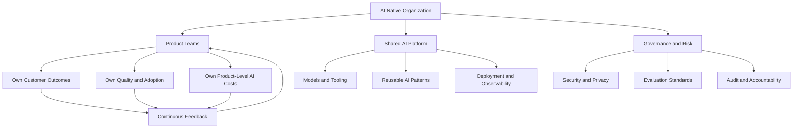
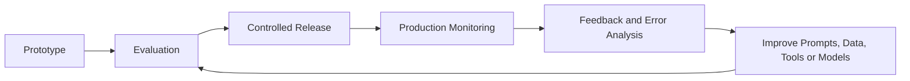

---

title: "AI-Native — Product School Perspective" aliases:

- AI-Native Product Strategy
- AI-Native Operating Model type: source-note status: evergreen created: 2026-10-22 source: https://productschool.com/blog/artificial-intelligence/ai-native author: Carlos Gonzalez de Villaumbrosia published: 2026-02-03 related:
- "[[AI-Native — Complete Study Notes]]"
- "[[AI-Native Architecture]]"
- "[[AI Product Management]]"
- "[[LLMOps]]"
- "[[AI Evaluation]]" tags:
- ai-native
- artificial-intelligence
- product-management
- ai-strategy
- operating-model
- product-discovery
- llmops
- ai-governance
- evergreen

---

# AI-Native — Product School Perspective

> [!abstract] Central idea AI-native is a fundamental change in how a product creates value and how an organization discovers, builds, evaluates, and delivers products. It is not simply the addition of AI features to existing software.

**Source:** AI Native: What It Means and How to Get There — Product School

**Author:** Carlos Gonzalez de Villaumbrosia, CEO at Product School.

**Published:** February 3, 2026. The page notes an update on February 4, 2026.

## 1. Core Concept

The article compares AI-native to the shift from desktop-first to mobile-first products.

Mobile-first was not simply about creating an iPhone app. It required reconsidering the entire product experience around mobile usage.

Likewise, AI-native is not simply about adding a chatbot. It requires redesigning how intelligence is used, how decisions are made, and how products adapt to user needs.

### Simplified explanation

Traditional product thinking:

1. Identify a feature users need.
2. Design a workflow.
3. Build the product.
4. Add AI where useful.

AI-native product thinking:

1. Identify the user's desired outcome.
2. Ask which parts of the workflow AI can fundamentally change.
3. Design the product around those capabilities.
4. Establish boundaries, evaluation, and recovery mechanisms.
5. Continuously improve the experience using evidence.

The difference is not just the technology. It is the starting assumption behind product design.

## 2. The "Remove AI" Test

Product School proposes a simple way to distinguish AI-native products from AI-enhanced products.

Ask:

**If the AI disappeared, would the product still deliver essentially the same value?**

- If yes, AI may be an enhancement.
- If no, AI may be fundamental to the product's value proposition.

This is a useful heuristic rather than a strict classification rule.

### Example A — AI-enhanced writing application

A conventional writing application adds text summarization.

Without summarization, users can still write and edit documents. The AI improves productivity but is not essential to the core product.

### Example B — AI-native application builder

A user describes an application in natural language, and the system generates a working application.

If AI is removed, the central mechanism for creating the application disappears.

The article identifies Lovable as an example of this AI-native product pattern.

### Example C — Knowledge workspace

The article describes Notion as moving from AI-embedded toward AI-native through experiences such as asking questions in natural language and retrieving information across a workspace.

The distinction is about how central AI becomes to the user's workflow, not merely how many AI features exist.

## 3. AI-Native Product vs AI-Powered Product

|Dimension|AI-powered product|AI-native product|
|---|---|---|
|Core value|Existing value enhanced by AI|AI is central to value creation|
|Product design|Existing workflow first|AI capabilities shape workflow design|
|User experience|AI assists the user|AI may become the main way the user achieves the goal|
|Product roadmap|AI features added to existing plans|AI capabilities help define the roadmap|
|Evaluation|May focus on individual features|Measures quality of the complete experience|
|Organizational impact|Often limited to a team or feature|Can change multiple functions and operating processes|

**Key insight:** A product can be technically sophisticated and still be AI-embedded if AI remains peripheral to its main value proposition.

---

# 4. AI-Native Is Also an Organizational Model

A company cannot reliably build AI-native products if it treats AI as an isolated experiment.

Product School argues that organizations need to change how teams work, make decisions, and deliver products.

## 4.1 AI-Embedded Organization

Typical characteristics:

- A dedicated AI team handles most AI work.
- Other teams occasionally consume AI features or tools.
- AI pilots exist alongside the main product roadmap.
- Teams continue using mostly conventional workflows.
- Success may be measured by the number of pilots or AI features.
- AI evaluation and governance may be inconsistent.

This structure can deliver useful features, but it can also prevent successful experiments from becoming part of the core product.

## 4.2 AI-Native Organization

Typical characteristics:

- Each business function owns its AI outcomes.
- Shared teams provide reusable infrastructure and standards.
- AI is integrated into product discovery and delivery.
- Data is accessible through governed interfaces.
- Evaluation and monitoring are part of release processes.
- Teams measure business outcomes rather than AI adoption alone.
- Employees develop practical AI literacy appropriate to their roles.
- Cost, risk, quality, and performance are managed together.

### Organizational model

The key balance is **distributed ownership with shared infrastructure and clear governance**.

Product teams remain accountable for the outcomes of their AI features, while platform teams make it easier to build and operate those features safely.

## 4.3 Why a Dedicated AI Team Is Not Enough

A centralized team can provide expertise, infrastructure, and standards.

However, if it owns every AI initiative, other teams may treat AI as somebody else's responsibility.

This can lead to:

- Slow handoffs.
- Isolated prototypes.
- Limited adoption.
- Unclear product ownership.
- Poor connection between experiments and customer outcomes.

A better approach is to give product teams ownership of outcomes while providing a shared platform and enablement function.

---

# 5. The Six-Step AI-Native Transformation Framework

The article proposes six steps for moving from AI-embedded practices toward AI-native products and organizations.

## Step 1 — Choose an AI-Native Wedge

A **wedge** is a narrow starting point where AI can create measurable value.

Instead of telling every department to adopt AI, select one or two workflows or customer journeys.

Examples:

- Internal knowledge retrieval.
- Sales analytics.
- Customer support resolution.
- Software development workflows.
- Document processing.

Define a measurable baseline before implementation.

Possible metrics:

- Time required to complete a task.
- Number of manual handoffs.
- Error rate.
- Cost per successful task.
- Customer satisfaction.
- Conversion rate.

The purpose is to establish whether AI actually improves the workflow.

## Step 2 — Integrate AI Into the Operating Rhythm

AI should participate in the normal product development process, not operate as a separate innovation project.

Potential uses include:

- Summarizing customer feedback.
- Identifying recurring support issues.
- Drafting product requirements.
- Generating solution alternatives.
- Testing assumptions.
- Designing experiments.
- Exploring user research.
- Analyzing product performance.

The deeper change is from feature-first thinking to capability-first thinking.

Instead of asking only, "Which feature should we build?", ask:

- What outcome should the system achieve?
- Which decisions can it make reliably?
- Which decisions must remain with people?
- What should happen when information is missing?
- How should it recover from failure?
- How will we know whether it is improving?

## Step 3 — Build a Reusable AI Platform

AI-native systems should not depend on one-off engineering solutions.

A shared platform can provide:

- Secure model access.
- Model and prompt versioning.
- Reusable retrieval components.
- Standard tool integrations.
- Evaluation pipelines.
- Logging and tracing.
- Cost monitoring.
- Deployment workflows.
- Incident management.

This operational discipline is commonly associated with **LLMOps**.

The objective is to make reliable AI development repeatable across teams.

Related: [[LLMOps]], [[AI Platform Engineering]], [[AI Observability]]

## Step 4 — Make Evaluation Mandatory

A successful demonstration is not sufficient evidence that an AI feature is ready for production.

Model outputs can vary, data can change, and edge cases can expose failures.

Before shipping, define:

- Expected behavior.
- Accuracy requirements.
- Safety restrictions.
- Failure conditions.
- Escalation rules.
- Latency and cost limits.
- Monitoring requirements.

Test the system against representative and adversarial cases.

After deployment, continue monitoring real-world performance.

Related: [[AI Evaluation]], [[Responsible AI]], [[Human-in-the-Loop]]

## Step 5 — Build Role-Based AI Literacy

Different roles need different levels of AI knowledge.

### Product managers

Need to understand:

- AI capabilities and limitations.
- Product experimentation.
- Evaluation metrics.
- Workflow redesign.
- Cost and latency trade-offs.
- Privacy and risk.

### Engineers

Need to understand:

- Model integration.
- APIs and tool calling.
- Retrieval and context.
- Testing and observability.
- Security and deployment.

### Designers

Need to understand:

- AI interaction patterns.
- Uncertainty and error states.
- User trust.
- Human approval.
- Recovery and escalation.

### Business and operations teams

Need to understand:

- Appropriate AI use.
- Output verification.
- Data confidentiality.
- Escalation procedures.
- Workflow changes.

Training should be hands-on and connected to real projects rather than limited to general awareness sessions.

## Step 6 — Establish Ownership and Governance

AI-native teams need clear accountability.

A useful division of responsibilities:

- Product teams own business outcomes, adoption, quality, and product-level risk.
- Platform teams provide reusable infrastructure and technical standards.
- Security and governance teams define controls and oversight.
- Business owners define acceptable outcomes and operational constraints.
- Human reviewers handle cases that require judgment or approval.

Governance should enable controlled experimentation rather than forcing every request through an unnecessarily slow process.

---

# 6. Product Discovery Changes

One of the article's important insights is that AI-native product discovery is different from conventional feature planning.

## Conventional feature discovery

The team asks:

- What feature do users want?
- What screen should we build?
- Which workflow should we improve?
- How do we implement the requested functionality?

## AI-native capability discovery

The team also asks:

- What user goal could become much easier?
- What decisions could the system help make?
- Which steps could be automated safely?
- What information does the system need?
- When should it ask for clarification?
- When should it refuse or escalate?
- How should it respond to uncertain results?
- How will feedback improve the system?

### Feature specification vs capability specification

A feature specification describes what the software should contain.

A capability specification describes the behavior the system should reliably provide.

Example:

**Feature specification:** Add a chat box to the sales dashboard.

**Capability specification:** Enable authorized sales managers to ask questions about approved sales metrics, receive answers supported by governed data, explore follow-up questions, and understand when the available evidence is insufficient.

The second specification is more outcome-oriented. It also creates explicit requirements for permissions, evaluation, and failure handling.

---

# 7. LLMOps — From Prototype to Production

The article emphasizes that AI-native organizations must invest in what happens after a successful prototype.

LLMOps is the operational discipline of building, deploying, monitoring, and maintaining applications that use large language models.

## Essential components

### Versioning

Track:

- Model versions.
- Prompts.
- Retrieval configurations.
- Tool definitions.
- Evaluation datasets.
- Workflow versions.

This helps teams investigate regressions and reproduce failures.

### Evaluation

Test representative requests and edge cases before and after changes.

### Guardrails

Enforce permitted behavior, output constraints, data-access restrictions, and action limits.

### Monitoring

Track:

- Output quality.
- Latency.
- Cost.
- Tool failures.
- User corrections.
- Escalations.
- Safety incidents.

### Incident response

Define what happens when:

- An AI provider experiences an outage.
- Output quality degrades.
- A tool executes incorrectly.
- Costs increase unexpectedly.
- Sensitive information is exposed.
- A model update causes regressions.

### Production feedback loop

This is a continuous improvement process, not a guarantee that the model will automatically learn from every interaction.

---

# 8. Measuring AI-Native Success

The article distinguishes outcome-oriented measurement from vanity metrics.

## Weak indicators when used alone

- Number of AI pilots.
- Number of chatbots deployed.
- Number of prompts generated.
- Total AI usage.
- Number of employees with access to AI.
- Number of features labeled "AI-powered."

These indicators can measure activity without proving value.

## Stronger indicators

|Metric|What it measures|
|---|---|
|Time-to-value|How quickly users achieve their desired outcome|
|Task completion rate|Whether the system completes the intended task|
|Throughput|How much useful work is completed|
|Quality|Accuracy and usefulness of the result|
|Cost per successful task|Economic efficiency|
|Customer impact|Whether customer outcomes improve|
|Human correction rate|How often outputs need repair|
|Escalation quality|Whether difficult cases reach the right people|
|Reliability|Whether performance remains acceptable in production|
|Adoption with outcomes|Whether usage produces measurable benefits|

The correct metrics depend on the workflow. A high-risk financial workflow should prioritize correctness and control differently from a low-risk brainstorming assistant.

---

# 9. Examples From the Article

## Lovable — AI-Native Software Creation

Product School presents Lovable as an example of an AI-native product.

The core experience allows users to describe an application in natural language and use AI to generate a working software product.

The example illustrates a product whose central value mechanism depends on AI-driven generation.

## Notion — Moving Toward AI-Native Workflows

The article presents Notion as a product moving from AI-embedded toward AI-native experiences.

Its workspace existed before its AI capabilities. Natural-language question answering and retrieval across workspace content can make AI central to how users discover and use information.

This example illustrates that the transition toward AI-native design can be gradual.

**Interpretation:** These are illustrative examples from the article, not a definitive independent classification of the companies or a claim that their products are entirely autonomous.

---

# 10. Knowledge Map

```mermaid
flowchart TD
    A["AI-Native Product Strategy"]

    A --> B["Product Design"]
    A --> C["Organizational Model"]
    A --> D["AI Platform"]
    A --> E["Evaluation"]
    A --> F["Governance"]
    A --> G["Business Outcomes"]

    B --> B1["Capability Specifications"]
    B --> B2["Workflow Redesign"]
    B --> B3["Product Discovery"]

    C --> C1["Distributed Ownership"]
    C --> C2["AI Literacy"]
    C --> C3["Shared Enablement"]

    D --> D1["LLMOps"]
    D --> D2["Reusable Components"]
    D --> D3["Observability"]

    E --> E1["Quality"]
    E --> E2["Safety"]
    E --> E3["Regression Testing"]

    F --> F1["Permissions"]
    F --> F2["Auditability"]
    F --> F3["Human Oversight"]

    G --> G1["Time-to-Value"]
    G --> G2["Cost Efficiency"]
    G --> G3["Customer Impact"]
```

## Recommended Obsidian links

- [[AI-Native — Complete Study Notes]]
- [[AI-Native Architecture]]
- [[AI Product Management]]
- [[Product Discovery]]
- [[AI Operating Model]]
- [[LLMOps]]
- [[AI Evaluation]]
- [[AI Observability]]
- [[AI Governance]]
- [[AI Agents]]
- [[Human-in-the-Loop]]
- [[AI Product Metrics]]

---

# 11. Final Takeaways

1. AI-native is a change in how a product creates value, not merely an increase in AI features.
2. The "remove AI" test helps distinguish foundational AI capabilities from supplementary features.
3. An AI-native organization embeds AI in discovery, decisions, delivery, and operations.
4. Product teams need ownership of outcomes, supported by shared infrastructure.
5. A narrow, measurable starting point is usually better than a company-wide mandate.
6. AI capabilities need evaluation, monitoring, guardrails, and escalation paths before production.
7. Teams need practical, role-specific AI literacy.
8. Success should be measured through quality, speed, cost, reliability, and business impact.
9. AI-native products require operational discipline as much as experimentation.
10. The goal is not maximum autonomy; it is reliable value creation with appropriate controls.

> [!summary] Simplified mental model **AI-native product = AI-centered value proposition + redesigned workflow + shared platform + measurable outcomes + accountable governance.**

The most important question is not "Does our company use AI?" It is "Has AI fundamentally changed how we create value, make decisions, and deliver our product?"

---

## Source

Carlos Gonzalez de Villaumbrosia, Product School, AI Native: What It Means and How to Get There, published February 3, 2026; updated February 4, 2026.

This note summarizes the source and adds explanatory tables, diagrams, examples, and Obsidian links. The added frameworks are study aids, not verbatim source material.

[resources](https://productschool.com/blog/artificial-intelligence/ai-native)