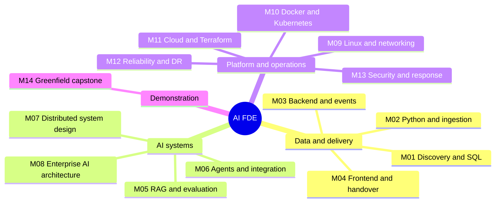

# FDE Curriculum Mind Map

Learning home: [[AI FDE Master Roadmap]] combines the roadmap.sh tracks into a prerequisite-ordered checklist and notes index. This note remains the session-by-session study companion.

Source: [[scaler_ai_fde_final_master_sheets]]. This study outline expands Sheet 2 without changing its session order. Each checkbox is a study branch: learn the named concepts, follow its public resources, then demonstrate the skill in the session lab. Resources are supplementary public documentation, papers, and guides, not official Scaler course materials.

## Using This Map in Obsidian

Use the Outline pane to fold modules and sessions. Check off a branch after you can explain it and reproduce a small example. Add notes beneath any branch; use the session's Notes, Questions, and Evidence fields for summaries and lab links. Link another note to a session with `[[FDE Curriculum Mind Map#M01-S01]]`. You can extract a branch into its own note later without creating hundreds of empty notes now.

The Mermaid overview below renders in Obsidian Reading view. The detailed map uses native Markdown headings and checklists, so no community plugin is required. Obsidian Graph view shows links between files, not individual headings; separate topic notes will become graph nodes when you create and link them.

Public reading is free to access; cloud accounts, GPUs, hosted APIs, certification exams, and some product features may cost money. Use local emulators and small synthetic datasets first. Provider names, model availability, service lifecycle, regions, and SDK versions change: verify current documentation before each cloud lab. Resource URLs are curated, not all live-verified. Numerical targets in the source curriculum are lab goals, not guarantees or universal acceptance thresholds. Run security, chaos, and load exercises only in explicitly authorized isolated environments with budgets and stop conditions.

## Module Overview

## Learning Path

- [[#M01 - FDE Launchpad]]
- [[#M02 - Ingestion Pipeline]]
- [[#M03 - Platform Backend]]
- [[#M04 - Frontend Layer]]
- [[#M05 - Production RAG]]
- [[#M06 - Agents and Enterprise]]
- [[#M07 - System Design]]
- [[#M08 - Enterprise AI Architecture]]
- [[#M09 - Linux and Networking]]
- [[#M10 - Docker and Kubernetes]]
- [[#M11 - Cloud and Terraform]]
- [[#M12 - Reliability and Disaster Recovery]]
- [[#M13 - Security Sign-Off]]
- [[#M14 - Capstone Simulation]]

## M01 - FDE Launchpad

Prerequisites: basic spreadsheet literacy and a local PostgreSQL sandbox. Outcome: explain the client's problem, implement a safe relational model, and defend the data architecture.

### M01-S01
- [ ] **FDE engagement lifecycle:** distinguish discovery, prototype, pilot, production acceptance, and handover; name the decision owner and success evidence for each stage. [Read][discovery]
- [ ] **Stakeholder trust and discovery:** map users, sponsors, security reviewers, and blockers; ask evidence-seeking questions; record constraints, unknowns, and follow-up owners rather than treating trust as a literal equation. [Read][interviews]
- [ ] **MECE problem decomposition:** separate symptoms from causes, build non-overlapping issue branches, test completeness against the user journey, and prioritize uncertain assumptions. [Read][problem]
- [ ] **BLUF and Pyramid communication:** lead with the recommendation, group supporting reasons, separate evidence from assumptions, and end with the decision needed. [Read][plain]

### M01-S02
- [ ] **Site survey and PRD-lite:** inventory systems, data owners, access paths, user needs, nonfunctional requirements, acceptance criteria, and unresolved risks. [Read][discovery]
- [ ] **SOW and scope control:** define inclusions, exclusions, milestones, dependencies, change requests, and acceptance owners; distinguish an estimate from a commitment. [Read][sow]
- [ ] **Architecture decision records:** capture context, decision drivers, alternatives, consequences, and a review trigger in a MADR record. [Read][adr]
- [ ] **Executive weekly update:** report outcome achieved, evidence, next milestone, risk owner, and a specific decision request in a short readable memo. [Read][plain]

### M01-S03
- [ ] **Relational entities and keys:** identify table grain, candidate and composite keys, foreign-key cardinality, nullable relationships, and orphan prevention. [Read][pg-constraints]
- [ ] **Join semantics:** compare inner, left/right/full outer, and cross joins; predict row multiplication and demonstrate how a WHERE predicate can undo an outer join. [Read][pg-joins]
- [ ] **Aggregation:** use GROUP BY, HAVING, DISTINCT, conditional aggregates, and NULL-aware COUNT to calculate revenue without double-counting order lines. [Read][pg-aggregate]

### M01-S04
- [ ] **Views and materialized views:** compare freshness and query cost, choose refresh ownership, and satisfy the unique-index requirement for concurrent materialized-view refresh. [Read][pg-matview]
- [ ] **Window ranking and offsets:** partition and order rows; compare ROW_NUMBER, RANK, DENSE_RANK, LAG, and LEAD with deterministic tie handling. [Read][pg-window]
- [ ] **Rolling business metrics:** contrast ROWS and RANGE frames, cumulative sums, moving averages, and time-bucket gaps; verify results against hand-calculated examples. [Read][pg-window]

### M01-S05
- [ ] **Planner diagnostics:** inspect estimated versus actual rows, scan/join choices, buffers, sort spills, and statistics; remember EXPLAIN ANALYZE executes the statement. [Read][pg-explain]
- [ ] **Index selection:** compare B-tree, GIN, composite ordering, partial predicates, and INCLUDE covering columns; measure read benefit against write and storage cost. [Read][pg-index]
- [ ] **Performance evidence:** identify high-total-time queries with pg_stat_statements, benchmark representative parameters and warm/cold caches, and report p95 rather than one fast execution. [Read][pg-stats]

### M01-S06
- [ ] **ACID and isolation:** reproduce dirty/nonrepeatable/phantom-read concepts and write skew; compare PostgreSQL READ COMMITTED, REPEATABLE READ, and SERIALIZABLE behavior. [Read][pg-isolation]
- [ ] **Atomic inventory updates:** use conditional UPDATE, SELECT FOR UPDATE, and short transactions to prevent overselling; verify invariants with concurrent clients. [Read][pg-lock]
- [ ] **Deadlocks and retries:** choose a consistent lock order, inspect blocked sessions, set timeouts, and retry the entire transaction on serialization/deadlock failures. [Read][pg-lock]

### M01-S07
- [ ] **Normalization trade-offs:** identify functional dependencies and update anomalies through 3NF; denormalize only for a measured access pattern with an explicit consistency owner. [Read][normalization]
- [ ] **Expand-and-contract migrations:** add compatible columns, deploy dual-read/write transitions, backfill in bounded batches, validate, and remove old fields only after consumers migrate. [Read][parallel-change]
- [ ] **Migration tools and constraints:** version Alembic revisions, test upgrades on realistic data, estimate lock duration, and plan recovery for irreversible data changes. [Read][alembic] [Constraints][pg-constraints]

### M01-S08
- [ ] **Retail domain model:** define customers, products/SKUs, orders/order items, payments, refunds, and shipments with explicit cardinalities and lifecycle boundaries. [Read][pg-ddl]
- [ ] **Production DDL:** select money/quantity types, UTC-aware timestamps, tenant-scoped uniqueness, referential actions, CHECK constraints, and useful indexes. [Read][pg-constraints]
- [ ] **Schema communication and tests:** draw a DBML ERD, load synthetic fixtures, and assert orphan, duplicate, and invalid-state rejection before calling the schema production-ready. [Read][dbml] [SQL tests][pgtap]

### M01-S09
- [ ] **Tenant RLS:** compare USING and WITH CHECK, table-owner/BYPASSRLS behavior, FORCE ROW LEVEL SECURITY, and transaction-scoped tenant context with connection pooling. [Read][pg-rls]
- [ ] **PII encryption and keys:** compare column encryption with storage encryption, keep keys outside data tables, plan rotation, and understand what pgcrypto cannot hide from a privileged server operator. [Read][pg-crypto]
- [ ] **Least privilege and auditing:** separate application, migration, and audit roles; log access without recording sensitive values; distinguish audit triggers from pgAudit statement auditing. [Read][pg-roles] [Audit][pgaudit]

### M01-S10
- [ ] **Federated SQL access:** configure postgres_fdw servers/user mappings, restrict remote permissions, inspect pushdown, and assess remote latency and transaction limitations. [Read][pg-fdw]
- [ ] **Bastions and SSH tunnels:** use jump hosts, local port forwarding, host-key verification, short-lived access, and least-privilege tunnel destinations. [Read][ssh]
- [ ] **Private connectivity and CDC:** distinguish private service endpoints, routed peering/VPNs, and replication services; verify DNS, firewall rules, and return paths independently. [AWS][aws-private] [Azure][azure-private] [GCP][gcp-private]

### M01-S11
- [ ] **OLTP, OLAP, and HTAP:** compare transaction latency, scan throughput, write amplification, isolation, and freshness requirements for actual retail queries. [Read][warehouse]
- [ ] **Row versus column storage:** explain column projection, compression, partition pruning, and why a warehouse is not automatically a checkout database. [Read][duckdb-storage]
- [ ] **Engine decision and costs:** compare concurrency, ingestion, egress, operational effort, and predictable versus bursty demand; record workload assumptions in an ADR. [Read][adr] [Pricing][cloud-pricing]

### M01-S12
- [ ] **DuckDB file diagnostics:** inspect CSV inference, malformed rows, JSON nesting, Parquet schema evolution, and date/null consistency before transformation. [Read][duckdb-data]
- [ ] **Object-store access:** configure scoped secrets and httpfs/Azure extensions; use projection and predicate pushdown to avoid downloading whole datasets unnecessarily. [Read][duckdb-remote]
- [ ] **Quality profiling and Arrow:** calculate missingness, duplicate business keys, invalid ranges, and join coverage; exchange Arrow data without assuming every conversion is zero-copy. [Read][duckdb-arrow]

### M01-S13
- [ ] **Batch versus CDC:** compare freshness, source impact, snapshot-to-stream handoff, ordering, deletes, and replay needs. [Read][debezium]
- [ ] **Bronze/Silver/Gold contracts:** retain raw evidence, enforce cleaned schemas, publish business aggregates, and define lineage plus quarantine ownership. [Read][medallion]
- [ ] **Idempotency and watermarks:** choose stable event keys, persist progress atomically with writes, and handle late/out-of-order events and safe backfills. [Read][spark-stream]

### M01-S14
- [ ] **Executive architecture story:** connect ERD choices to checkout correctness, tenant isolation, operational ownership, and a specific sign-off request. [Read][plain] [Diagrams][c4]
- [ ] **Security evidence:** demonstrate RLS denial cases and key ownership; distinguish implemented controls from untested compliance claims. [Read][pg-rls]
- [ ] **Database TCO:** estimate compute, storage, backups, IOPS, replicas, egress, and staff effort; show sensitivity to traffic and retention assumptions. [AWS][aws-calc] [Azure][azure-calc] [GCP][gcp-calc]

### M01-S15
- [ ] **Business KPI definitions:** specify revenue recognition, returns, time zones, denominator, cohort, and data freshness before comparing results. [Read][dbt-metrics]
- [ ] **Insight versus causality:** separate descriptive SQL findings from causal claims; quantify uncertainty and check selection bias before recommending action. [Read][experiments]
- [ ] **Client-ready recommendation:** provide a BLUF, supporting chart/table, limitations, proposed action owner, and a measurable follow-up outcome. [Read][plain] [Charts][data-viz]

## M02 - Ingestion Pipeline

Prerequisites: M01, basic Python syntax, Git, and a local object-store emulator. Outcome: a typed, tested, restart-safe ingestion package and distributed transformation pipeline.

### M02-S01
- [ ] **Packaging and environments:** declare build/runtime/dev dependencies in pyproject.toml, pin an interpreter, lock dependencies with uv/Poetry, and reproduce installation in a fresh environment. [Read][uv] [Packaging][packaging]
- [ ] **Quality gates:** configure Ruff lint/format, strict mypy, and pre-commit; distinguish style, type, and runtime failures and require the same checks in CI. [Ruff][ruff] [mypy][mypy] [Hooks][precommit]
- [ ] **Private package distribution:** separate publishing credentials from consumption, understand package indexes and dependency-confusion risk, and document cloud artifact registry access. [Read][packaging]

### M02-S02
- [ ] **Lazy iteration:** build generators with yield/yield from, compose itertools, recognize one-shot iterators, and avoid accidental list materialization. [Read][iterators] [Utilities][itertools]
- [ ] **Chunked cloud reads:** consume bounded byte chunks, decode across chunk boundaries safely, close streams, and propagate cancellation; compare smart_open with SDK streaming. [Read][smartopen] [S3 stream][s3-stream]
- [ ] **Memory guarantees:** bound buffers, record size, decompression, and in-flight tasks; measure peak RSS as file size grows rather than assuming all streaming code is O(1). [Read][tracemalloc]

### M02-S03
- [ ] **Decorators and higher-order functions:** preserve signatures/metadata with wraps, distinguish decoration time from call time, and support async functions without blocking the event loop. [Read][functools]
- [ ] **Context-managed resources:** use contextmanager/asynccontextmanager and ExitStack for partial setup failures, rollback, and reliable closure. [Read][contextlib]
- [ ] **Retry and timing wrappers:** separate retryable failures from validation errors, use monotonic timing, preserve exceptions, and prevent duplicate side effects. [Read][tenacity]

### M02-S04
- [ ] **Domain objects:** use dataclasses for value-oriented data, distinguish mutable defaults from factories, and keep serialization concerns outside core business rules. [Read][dataclasses]
- [ ] **ABCs and Protocols:** compare nominal versus structural typing, define minimal storage interfaces, and test substitutability with an in-memory fake. [Read][protocols] [ABCs][abc]
- [ ] **Dependency inversion:** inject S3/Blob/GCS adapters and credentials at the application boundary; standardize object metadata and error semantics without hiding provider differences. [Read][architecture-python]

### M02-S05
- [ ] **Async task lifecycle:** compare gather and TaskGroup failure behavior, cancellation, deadlines, semaphores, bounded queues, and backpressure. [Read][asyncio]
- [ ] **I/O versus CPU concurrency:** choose threads for blocking I/O and processes for suitable CPU work; measure serialization overhead and understand interpreter/GIL assumptions. [Read][futures]
- [ ] **Async HTTP and storage clients:** reuse sessions, cap connection pools, release responses, and verify whether each cloud SDK operation is actually asynchronous. [Read][aiohttp] [Azure async][azure-blob-python] [GCS alternative][gcloud-aio]

### M02-S06
- [ ] **Exception taxonomy:** distinguish transport, authentication, validation, transient throttling, and permanent domain failures; chain exceptions while preserving useful context. [Read][exceptions]
- [ ] **Backoff budgets:** implement exponential backoff with jitter, maximum attempts/elapsed time, Retry-After handling, and cancellation-aware retries. [Read][tenacity] [Retry rationale][aws-retries]
- [ ] **Poison records and DLQs:** retain original payload references, reason codes, attempt history, and safe replay keys; alert on quarantine growth without leaking PII. [Read][sqs-dlq]

### M02-S07
- [ ] **Pydantic boundaries:** compare strict/coercive validation, field/model validators, discriminated unions, schema evolution, and structured error reporting. [Read][pydantic]
- [ ] **Structured logs:** bind request/job/tenant identifiers, serialize exceptions, redact secrets, and distinguish event timestamps from ingestion timestamps. [Read][structlog]
- [ ] **Cloud log integration:** propagate correlation context through async work, choose retention and sampling, and test that malformed records remain traceable without logging their PII. [Read][otel-logs]

### M02-S08
- [ ] **Unit tests:** organize pytest fixtures, parametrized edge cases, temporary files, and failure assertions around observable behavior rather than implementation details. [Read][pytest]
- [ ] **Async and integration tests:** test cancellation, retries, partial writes, and resource closure; use moto/LocalStack, Azurite, or GCS emulators while documenting parity gaps. [Async][pytest-async] [Mocks][moto] [Azure emulator][azurite] [GCS emulator][fake-gcs]
- [ ] **CI and coverage:** run repeatable installs, lint, types, tests, and branch coverage in GitHub Actions; do not mistake 90% coverage for proof of correctness. [Read][actions] [Coverage][coverage]

### M02-S09
- [ ] **Clean architecture boundaries:** separate entities/use cases from SDKs, filesystem, and database transactions; make dependencies point toward business policy. [Read][architecture-python]
- [ ] **Practical SOLID:** apply single responsibility and interface segregation where they reduce change coupling; avoid abstracting a provider before a genuine variation exists. [Read][architecture-python]
- [ ] **Legacy refactoring:** add characterization tests, replace one I/O boundary at a time, preserve behavior, and package a runnable CLI/job with explicit configuration. [Read][refactoring] [CLI][argparse]

### M02-S10
- [ ] **Spark execution model:** trace driver/executor roles, transformations/actions, DAG stages, shuffles, and Catalyst plans using explain and the Spark UI. [Read][spark-sql]
- [ ] **Partitioning and joins:** distinguish input, shuffle, and output partitions; compare broadcast/sort-merge joins, skew mitigation, AQE, caching, and spill behavior. [Read][spark-performance]
- [ ] **Columnar formats:** compare Parquet layout with Delta/Iceberg table metadata, schema evolution, predicate pushdown, and small-file compaction. [Parquet][parquet] [Delta][delta] [Iceberg][iceberg]

### M02-S11
- [ ] **End-to-end lakehouse job:** define input/output contracts, validate retail events, deduplicate by business key, and write appropriately partitioned Silver/Gold tables. [Read][spark-sql] [Design][medallion]
- [ ] **Atomicity and reruns:** distinguish append from merge/upsert, handle schema drift, and prove a rerun does not double-count events. [Delta][delta] [Iceberg][iceberg]
- [ ] **Operational delivery:** size executor resources from measurements, publish catalog metadata, compact small files, and document recovery from a partially completed run. [Read][spark-performance]

### M02-S12
- [ ] **Timed build planning:** translate the brief into a minimal input/output contract, failure cases, resource budget, and acceptance tests before implementing. [Read][pytest]
- [ ] **Resilient implementation:** combine bounded streaming, Pydantic validation, async limits, and safe retries; inject a malformed record and transient outage. [Read][asyncio] [Validation][pydantic]
- [ ] **Submission evidence:** show reproducible commands, passing tests, peak memory, rerun correctness, known limitations, and recovery instructions. [Read][techdocs]

### M02-S13
- [ ] **Review mechanics:** use focused commits, readable diffs, PR descriptions, and GitHub review threads; distinguish blocking defects from suggestions. [Read][github-review]
- [ ] **Technical review checklist:** inspect data-loss paths, exception swallowing, secret exposure, unbounded memory, missing timeouts, and inadequate tests. [Read][google-review]
- [ ] **Client collaboration:** explain impact with a reproducible case, propose a small fix, acknowledge constraints, and agree ownership of deferred work. [Read][google-review]

### M02-S14
- [ ] **Developer onboarding:** document prerequisites, environment/configuration, a synthetic sample run, test commands, and the expected output. [Read][diataxis]
- [ ] **Architecture diagrams:** use C4 context/container views and Mermaid sequence diagrams to show ownership, data flows, trust boundaries, and external dependencies. [C4][c4] [Mermaid][mermaid]
- [ ] **Ingestion runbooks:** specify symptoms, verification queries, quarantine inspection, idempotent replay, rollback limits, and escalation contacts. [Read][sre-emergency]

## M03 - Platform Backend

Prerequisites: M01-M02, SQL transactions, Python async, HTTP basics. Outcome: a tenant-safe backend, event backbone, and analytics warehouse with operational evidence.

### M03-S01
- [ ] **REST resource contracts:** model nouns and relationships, distinguish safe/idempotent methods, choose status codes, and make error bodies actionable. [Read][http] [API design][api-design]
- [ ] **Pagination and filtering:** compare offset with cursor pagination, use stable ordering, validate bounds, and document race/freshness semantics. [Read][api-design]
- [ ] **Transport assumptions:** compare HTTP/1.1 and HTTP/2 multiplexing, TLS termination, proxies, and connection reuse without tying business behavior to one gateway. [Read][http]

### M03-S02
- [ ] **FastAPI routing:** organize APIRouter modules, validate path/query/header parameters, and define consistent responses and route prefixes. [Read][fastapi]
- [ ] **ASGI lifespan:** initialize/close shared clients at startup/shutdown, distinguish request scope from application scope, and implement graceful termination. [Read][fastapi-lifespan]
- [ ] **Middleware ordering:** implement request IDs and timing, configure explicit CORS origins, and test preflight/error responses and trusted-proxy assumptions. [Read][starlette-middleware]

### M03-S03
- [ ] **Dependency injection and schemas:** use Depends for auth, services, and unit-of-work boundaries; separate input/output models to avoid exposing internal fields. [Read][fastapi-di]
- [ ] **Async persistence:** create SQLAlchemy async sessions per unit of work, manage commit/rollback/closure, and avoid sharing one session across concurrent tasks. [Read][sqlalchemy-async]
- [ ] **Background execution:** distinguish small in-process tasks from durable queued jobs; account for worker restarts and transaction visibility. [Read][fastapi-background]

### M03-S04
- [ ] **Pooled upstream clients:** reuse httpx.AsyncClient with lifecycle cleanup, explicit limits, and connect/read/write/pool timeouts. [Read][httpx]
- [ ] **Retries and idempotency:** retry selected transport/status failures under a deadline; protect mutations with idempotency keys and avoid retry amplification. [Read][aws-retries]
- [ ] **Circuit breakers:** model closed/open/half-open states, failure thresholds, probe traffic, and fallback behavior; test upstream recovery. [Read][circuit]

### M03-S05
- [ ] **OAuth2 and PKCE:** trace authorization code exchange, state, redirect URI validation, scopes, and PKCE; distinguish authentication from delegated authorization. [Read][oauth-security]
- [ ] **JWT/JWKS verification:** allowlist algorithms, validate signature/issuer/audience/expiry, cache signing keys safely, and handle key rotation. [Read][jwt] [Library][pyjwt]
- [ ] **Credential lifecycle:** hash application-owned passwords with Argon2id, rotate/revoke refresh tokens, and keep authentication logs free of credentials. [Read][passwords]

### M03-S06
- [ ] **OIDC federation:** interpret discovery, ID token versus access token, issuer, audience, claims, and enterprise group mapping. [Read][oidc]
- [ ] **RBAC authorization:** define deny-by-default roles and object-level permissions, validate server-side on every operation, and test cross-role access. [Read][authorization]
- [ ] **Tenant propagation:** bind tenant identity from verified claims, enforce RLS inside transactions, reset pooled context, and test cross-tenant reads/writes. [Read][pg-rls]

### M03-S07
- [ ] **Order state machine:** enumerate legal transitions, guards, terminal states, cancellation/refund paths, and domain invariants. [Read][state-machine]
- [ ] **Optimistic concurrency:** implement version columns or compare-and-swap updates and return a useful conflict when a stale client changes state. [Read][sqlalchemy-version]
- [ ] **Atomic side effects:** commit state plus event intent together and prove duplicate requests cannot trigger duplicate fulfillment. [Read][outbox]

### M03-S08
- [ ] **Payment webhooks:** verify HMAC against raw request bytes, reject stale/replayed events, handle out-of-order delivery, and never trust a browser success redirect as payment proof. [Read][stripe-webhooks]
- [ ] **Idempotent money operations:** persist idempotency keys and request fingerprints, reconcile provider state, and model refunds separately from order cancellation. [Read][stripe-idempotency]
- [ ] **Notifications:** enqueue only after durable state changes, retry with DLQ handling, and track delivery status without making SMS/email delivery part of checkout atomicity. [Read][outbox] [DLQ][sqs-dlq]

### M03-S09
- [ ] **OpenAPI contract:** describe schemas, authentication, error responses, pagination, and examples; distinguish OpenAPI 3.1 from runtime implementation guarantees. [Read][openapi]
- [ ] **TypeScript SDK generation:** generate clients from the committed schema, check nullability/enums, and test generated requests against the backend. [Read][openapi-ts]
- [ ] **API compatibility:** define version/deprecation policies and distinguish additive changes from renamed fields, stricter validation, and enum changes that break consumers. [Read][semver] [Design][api-design]

### M03-S10
- [ ] **Schema-derived fuzzing:** configure Schemathesis to generate boundary/invalid inputs, reproduce failures, and avoid destructive operations outside test environments. [Read][schemathesis]
- [ ] **Consumer contracts:** write Pact expectations for real consumer interactions, verify against providers, and understand why a schema alone does not prove behavioral compatibility. [Read][pact]
- [ ] **Breaking-change CI gate:** compare baseline and candidate OpenAPI with oasdiff, review exceptions explicitly, and archive reports as build evidence. [Read][oasdiff]

### M03-S11
- [ ] **WebSocket lifecycle:** authenticate connections, authorize subscriptions, manage heartbeats/disconnects, bound outbound queues, and distribute events across replicas. [Read][websockets]
- [ ] **SSE delivery:** frame event/data/id fields, configure reconnect/Last-Event-ID, disable proxy buffering, and handle stream cancellation. [Read][sse]
- [ ] **Real-time consistency:** reconcile an initial snapshot with incremental updates, deduplicate event IDs, and document ordering and delivery guarantees. [Read][kafka-design]

### M03-S12
- [ ] **Cache correctness:** compare cache-aside/write-through, TTL jitter, invalidation, key versioning, tenant namespaces, and stampede protection. [Read][cache-aside]
- [ ] **Redis messaging:** contrast lossy Pub/Sub with persisted Streams, consumer groups, pending entries, acknowledgements, and trimming. [Read][redis-pubsub] [Streams][redis-streams]
- [ ] **Worker queues:** design Celery/ARQ jobs for at-least-once execution, backoff, deadlines, DLQs, and safe shutdown. [Read][celery] [ARQ][arq]

### M03-S13
- [ ] **Trace instrumentation:** propagate W3C traceparent through HTTP/jobs, create useful spans, and control sensitive attributes and cardinality. [Read][otel] [Propagation][trace-context]
- [ ] **RED metrics:** instrument request rate, errors, and duration histograms; choose labels and buckets that support meaningful p95/p99 queries. [Read][prometheus]
- [ ] **Correlated dashboards:** connect logs to trace IDs, distinguish sampling from missing instrumentation, and create an alert with a tested diagnostic path. [Read][otel-logs] [Dashboards][grafana]

### M03-S14
- [ ] **JSONB modeling:** use operators, containment/path queries, GIN or expression indexes, and CHECK constraints without hiding core relational keys in opaque JSON. [Read][pg-json]
- [ ] **Full-text search:** construct tsvector/tsquery with appropriate dictionaries, weight fields, rank results, and measure language/tokenization effects. [Read][pg-fts]
- [ ] **Vector storage:** choose embedding dimensions and distance operator, build HNSW indexes, and test filtered recall, memory, and tenant isolation. [Read][pgvector]

### M03-S15
- [ ] **N+1 elimination:** inspect emitted SQL, compare selectinload/joinedload, control result duplication, and test query counts on realistic relationships. [Read][sqlalchemy-loading]
- [ ] **Pool sizing:** budget connections across replicas/workers, set checkout timeouts, close sessions, and understand PgBouncer transaction-pooling limitations. [Read][sqlalchemy-pool] [PgBouncer][pgbouncer]
- [ ] **Lock waits and latency:** distinguish pool waits, database locks, CPU, and I/O from query traces; measure throughput and tail latency before/after tuning. [Read][pg-monitor]

### M03-S16
- [ ] **Dimensional modeling:** define fact grain, conformed dimensions, surrogate keys, and SCD Type 2 effective intervals without overlapping histories. [Read][kimball]
- [ ] **dbt project design:** separate sources/staging/intermediate/marts, use ref/source dependencies, and select incremental strategies appropriate to late-arriving data. [Read][dbt]
- [ ] **Tests and lineage:** add uniqueness, not-null, relationships, accepted-values, and business-rule tests; publish docs and distinguish tests from freshness checks. [Read][dbt-tests]

### M03-S17
- [ ] **DAG structure:** define tasks/dependencies, scheduling intervals, data intervals, and retries without expensive network calls at parse time. [Read][airflow]
- [ ] **Backfills and sensors:** design interval-idempotent writes, bound catchup/concurrency, use appropriate sensors, and recover missed partitions without duplicate loads. [Read][airflow-practices]
- [ ] **Operational controls:** inject secrets from managed backends, configure callbacks/deadlines supported by the installed version, and test alert ownership. [Read][airflow-practices] [Prefect alternative][prefect]

### M03-S18
- [ ] **Kafka fundamentals:** explain broker/topic/partition roles, choose keys for per-entity ordering, and reason about consumer-group parallelism and rebalances. [Read][kafka-intro]
- [ ] **Delivery semantics:** coordinate offset commits with side effects, compare at-most/at-least/exactly-once scopes, and handle poison records through dead-letter topics. [Read][kafka-design]
- [ ] **Event schemas:** define Avro/Protobuf contracts, schema compatibility rules, evolution defaults, and a registry-based validation workflow. [Read][schema-registry] [Protobuf][protobuf]

### M03-S19
- [ ] **Incident triage:** use RED metrics and traces to distinguish upstream timeouts, exhausted pools, and database contention; preserve a timeline before restarting everything. [Read][sre-troubleshoot]
- [ ] **Connection leaks and consumer lag:** reproduce session leakage, inspect wait states, relate lag to partition assignment and processing rate, and apply a bounded fix. [Read][sqlalchemy-pool] [Kafka operations][kafka-ops]
- [ ] **Recovery evidence:** rerun the failing workload, verify backlog drain and data correctness, then write impact, cause, contributing factors, and owned actions. [Read][sre-postmortem]

### M03-S20
- [ ] **API sign-off review:** walk through requirements, contracts, authorization, failure modes, compatibility, and unresolved decisions with named approvers. [Read][api-design] [ADRs][adr]
- [ ] **Sev-1 communication:** assign incident commander, technical lead, and communications lead; publish impact, mitigation, next update time, and uncertainty. [Read][sre-incident]
- [ ] **Handover and closure:** separate mitigation from permanent repair, define recovery criteria, record decisions, and schedule a blameless review. [Read][sre-postmortem]

## M04 - Frontend Layer

Prerequisites: M03 API contracts, basic JavaScript, and an accessible browser test environment. Outcome: a usable operations dashboard with authenticated live data and handover evidence.

### M04-S01
- [ ] **Browser pipeline:** trace DOM/CSSOM, style/layout/paint/compositing, event-loop tasks and microtasks; identify layout thrashing in browser tools. [Read][mdn-render] [Event loop][mdn-loop]
- [ ] **Semantic HTML and accessibility:** use landmarks, labels, buttons, headings, keyboard focus, and accessible names before adding visual styling. [Read][mdn-accessibility]
- [ ] **Responsive layout:** combine Grid/Flexbox, overflow constraints, breakpoints, and Tailwind utilities; test dense tables on narrow viewports without hiding essential actions. [Read][mdn-css] [Tailwind][tailwind]

### M04-S02
- [ ] **Strict TypeScript:** model interfaces, generics, discriminated unions, nullability, and exhaustive state handling; recognize that types do not validate server JSON at runtime. [Read][typescript]
- [ ] **Async request control:** use Fetch, AbortController, HTTP error checks, cancellation, and stale-response protection with a typed result/error boundary. [Read][mdn-fetch]
- [ ] **Contract integration:** consume the generated SDK, validate uncertain boundaries, and distinguish transport errors from domain validation errors. [Read][openapi-ts] [Runtime schemas][zod]

### M04-S03
- [ ] **Composition and state:** design component boundaries, props, unidirectional flow, controlled state, and state colocation around actual ownership. [Read][react-state]
- [ ] **Effects and hooks:** use effects for external synchronization, clean up subscriptions, avoid derived-state effects, and extract hooks for reusable behavior. [Read][react-effects]
- [ ] **Rendering performance:** measure re-renders, understand stable identity and keys, and use useMemo only when profiling or compiler constraints justify it. [Read][react-memo]

### M04-S04
- [ ] **Form control models:** compare controlled/uncontrolled inputs, default values, dirty/touched state, and reusable field composition with React Hook Form. [Read][rhf]
- [ ] **Validation parity:** express Zod schemas for coercion, optional/null values, cross-field rules, and server error mapping; test parity with Pydantic using shared examples. [Read][zod] [Backend][pydantic]
- [ ] **Accessible submissions:** connect errors to fields, manage focus, prevent double submits, show pending/success/failure states, and preserve entered data after rejection. [Read][w3c-forms]

### M04-S05
- [ ] **Server-state lifecycle:** choose stable query keys, staleTime/gcTime, retries, background refetching, and tenant-specific cache isolation. [Read][tanstack-query]
- [ ] **Mutations and optimistic UI:** cancel conflicting reads, snapshot cache, update optimistically, rollback failures, and invalidate the right queries. [Read][tanstack-optimistic]
- [ ] **Live synchronization:** merge socket/SSE updates with cached snapshots, handle reconnects and out-of-order events, and show loading/empty/stale/error states. [Read][tanstack-query] [SSE][sse]

### M04-S06
- [ ] **Dense data tables:** define columns, stable row IDs, sorting, filters, pagination, selection, and virtualization based on dataset size. [Read][tanstack-table]
- [ ] **Search and URL state:** debounce input, cancel obsolete requests, serialize filters in query parameters, and support reload/back/forward navigation. [Read][react-router]
- [ ] **Trustworthy KPI charts:** label units/time range, distinguish missing from zero, provide accessible summaries, and avoid misleading axes. [Read][recharts] [Chart choice][data-viz]

### M04-S07
- [ ] **Rendering models:** compare CSR/SSR/SSG/ISR for freshness, interactivity, SEO, caching, and operational complexity. [Read][next]
- [ ] **Server/client boundaries:** identify React Server Component boundaries, serialization limits, hydration behavior, and where secrets must remain server-side. [Read][next-server]
- [ ] **Architecture defense:** compare hosting/runtime constraints and write ADR-003 with the simplest rendering model that meets the dashboard's requirements. [Read][adr] [Next deployment][next-deploy]

### M04-S08
- [ ] **Browser OIDC flow:** implement authorization code with PKCE, callback/state validation, renewal, and logout using a maintained client library. [Read][oauth-security] [MSAL][msal]
- [ ] **Session storage trade-offs:** compare HttpOnly/Secure/SameSite cookies with in-memory access tokens, XSS/CSRF risks, and backend-for-frontend boundaries. [Read][session-security]
- [ ] **Role-gated UI:** protect routes and component actions, handle expired sessions, and prove backend authorization still denies direct unauthorized API calls. [Read][authorization] [Routing][react-router]

### M04-S09
- [ ] **LLM stream rendering:** incrementally display text, preserve stream boundaries, sanitize rendered Markdown, and expose cancellation and partial-failure states. [Read][ai-sdk] [XSS prevention][xss]
- [ ] **Citations and tool progress:** map sources to retrieved evidence, show queued/running/approval/completed/failed tool states, and do not present model claims as verified actions. [Read][ai-sdk]
- [ ] **Live alerts:** reconnect WebSockets, deduplicate notifications, bound alert volume, and provide accessible non-disruptive status announcements. [Read][websockets] [ARIA status][aria-status]

### M04-S10
- [ ] **Component tests:** test visible behavior, accessible roles, validation, and loading/error transitions using Vitest and React Testing Library. [Read][vitest] [Testing Library][rtl]
- [ ] **End-to-end workflows:** cover login, roles, table filters, mutations, streaming failure, and keyboard navigation with isolated Playwright fixtures. [Read][playwright]
- [ ] **Performance evidence:** measure bundle size, lazy-loading and code splitting, LCP/INP/CLS, and Lighthouse under stated device/network conditions; a score alone is not an SLO. [Read][web-vitals] [Lighthouse][lighthouse]

### M04-S11
- [ ] **Narrative product demo:** demonstrate a real operations journey from problem to action to outcome instead of a component tour; use synthetic data. [Read][service-demo]
- [ ] **Architecture questions:** defend rendering, auth, real-time consistency, accessibility, and performance with ADRs and measured evidence. [Read][adr]
- [ ] **Demo resilience:** prepare an outage/error path, a recovery workflow, known limitations, and a recorded fallback; distinguish demo evidence from production readiness. [Read][sre-prr]

### M04-S12
- [ ] **Ops enablement:** define role-specific tasks, practice them with actual operators, and observe where the interface requires unexplained workarounds. [Read][usability]
- [ ] **User guide and feedback:** document business workflows, permissions, error recovery, and escalation; capture issues with severity and an owner. [Read][diataxis]
- [ ] **Handover acceptance:** agree access ownership, support boundaries, monitoring, training evidence, and unresolved risks before recording sign-off. [Read][sre-prr]

## M05 - Production RAG

Prerequisites: M03-M04, embeddings/attention basics, and a small permissioned document corpus. Related existing lessons: [[Lesson 19- Embeddings, Semantic Search & RAG — Giving the Model a Library]] and [[Lesson 17- Pretraining at Scale & the Prompting Paradigm — From Fine-Tuning to In-Context Learning]]. Outcome: an evaluated support copilot with documented risk and cost limits.

### M05-S01
- [ ] **Model families:** compare frontier APIs and open weights, dense/MoE architectures, reasoning effort, licensing, and deployment constraints rather than ranking model brands universally. [Read][hf-llm] [MoE][moe]
- [ ] **Client benchmark:** build representative tasks and measure correctness, structured-output validity, p95 latency, token cost, and residency constraints. [Read][evals]
- [ ] **Provider selection ADR:** compare current Bedrock, Azure, and Vertex offerings, regions, quotas, retention, and availability; model names in the source are historical examples. [AWS][bedrock] [Azure][foundry] [GCP][vertex]

### M05-S02
- [ ] **Prompt hierarchy and examples:** separate trusted instructions from user/retrieved content, design few-shot examples that cover edge cases, and test conflicting or missing information. [Read][prompting]
- [ ] **Structured outputs:** compare JSON mode with schema-constrained generation, validate with Pydantic, handle refusals/truncation, and distinguish schema validity from factual correctness. [Read][structured] [Instructor][instructor]
- [ ] **Prompt fragility:** vary wording, ordering, document position, and language; record regressions instead of assuming one successful response proves reliability. [Read][promptfoo]

### M05-S03
- [ ] **Context and sampling:** budget prompt/output tokens, account for tokenizer differences, compare temperature/top-p behavior, and test long-context retrieval degradation. [Read][hf-generation] [Paper][lost-middle]
- [ ] **Streaming client:** measure TTFT and output throughput, parse provider events, cancel disconnected requests, and bound retries after partial output. [Read][ai-sdk] [Gateway][litellm]
- [ ] **API capacity economics:** distinguish quotas, rate limits, concurrency, pay-as-you-go, and reserved/provisioned capacity; calculate utilization before committing spend. [Read][bedrock-throughput] [Azure][azure-ptu] [Vertex][vertex-throughput]

### M05-S04
- [ ] **Versioned prompt assets:** store template, schema, examples, model config, and changelog together; render Jinja2 templates with explicit variables and escaped/untrusted content boundaries. [Read][jinja] [Registry][langfuse-prompts]
- [ ] **Golden datasets:** cover answerable/unanswerable, tenant-restricted, ambiguous, and adversarial cases; separate development cases from held-out evaluation. [Read][evals]
- [ ] **Regression CI:** run promptfoo assertions and calibrated judges, compare per-category results, and require an explicit review for regressions. [Read][promptfoo]

### M05-S05
- [ ] **Document extraction:** preserve headings, table structure, page/source IDs, reading order, and OCR confidence; compare parsed output against original pages. [Read][docling]
- [ ] **Chunking:** compare fixed, recursive, structural, and semantic chunks; tune overlap, parent-child retrieval, and chunk size against retrieval quality and token budget. [Read][rag-guide]
- [ ] **Embedding ingestion:** record model/version/dimensions, normalize consistently, attach tenant/source/ACL metadata, deduplicate, and support deletion/re-embedding. [Read][sentence-transformers] [Index][pgvector]

### M05-S06
- [ ] **Retrieval metrics:** compute Recall@k, MRR, and NDCG on relevance-labeled queries; inspect failure categories rather than relying only on an average. [Read][ir-eval]
- [ ] **Hybrid search and RRF:** combine BM25 with dense candidates, fuse ranks, apply mandatory tenant/ACL filters before exposing results, and compare against each baseline. [Read][opensearch-hybrid] [RRF][elastic-rrf]
- [ ] **Cross-encoder reranking:** rerank a bounded candidate set, measure recall/latency trade-offs, and calibrate abstention thresholds on held-out data. [Read][rerank]

### M05-S07
- [ ] **RAG evaluation dimensions:** distinguish faithfulness, answer relevance, context precision/recall, and task correctness; understand required inputs for each installed metric version. [Read][ragas]
- [ ] **Reference-based versus reference-free:** design human references where needed, inspect metric failure cases, and avoid treating judge-generated labels as ground truth. [Read][deepeval]
- [ ] **Judge calibration:** compare judge scores to blinded human review, measure agreement/variance, stratify by scenario, and prevent evaluation-set leakage. [Read][evals]

### M05-S08
- [ ] **PII detection and redaction:** combine entity recognizers and deterministic patterns, define supported languages/entities, and measure false positives and missed cases. [Read][presidio]
- [ ] **Input/output policy:** route unsafe/off-topic requests, enforce retrieval permissions separately from content filters, and fail closed on unavailable mandatory checks. [Read][nemo] [LLM risks][owasp-llm]
- [ ] **Grounding and citations:** verify source support for claims, require useful citations or abstention, and report observed leak rates under a stated test set rather than promising zero leakage. [Read][ragas]

### M05-S09
- [ ] **Injection threat model:** distinguish direct instructions from indirect document/tool poisoning; enumerate data exposure and excessive-agency paths in an isolated test deployment. [Read][injection]
- [ ] **Adversarial test harness:** use controlled PyRIT/Garak/promptfoo cases, record seeds and expected policy, and protect test outputs that contain sensitive-looking synthetic data. [PyRIT][pyrit] [Garak][garak] [Promptfoo][redteam]
- [ ] **Remediation and retest:** strengthen trust boundaries and tool authorization, reduce retrieved privilege, and preserve each discovered failure as a regression case. [Read][owasp-llm]

### M05-S10
- [ ] **Semantic caching:** isolate tenants and permissions, key by prompt/model/retrieval versions, set expiry, and test near-match answers that should not be reused. [Read][redisvl]
- [ ] **Provider prompt caching:** distinguish exact-prefix cache reuse from semantic response caching; check supported providers, minimum lengths, retention, and price rules. [Read][prompt-cache]
- [ ] **Routing and latency:** classify queries for smaller/frontier models, measure fallback accuracy, queueing, TTFT, cost-per-resolution, and quality loss. [Read][litellm-routing]

### M05-S11
- [ ] **Timed corpus onboarding:** inspect permissions and document quality, select a simple chunk/embed/index path, and establish a baseline query set. [Read][docling] [Storage][pgvector]
- [ ] **Minimum production API:** integrate hybrid retrieval, reranking, citations, refusal, timeouts, and cancellation behind tenant-authenticated FastAPI endpoints. [Read][fastapi] [Hybrid search][opensearch-hybrid]
- [ ] **Release evidence:** report retrieval/generation scores, adversarial findings, latency/cost, and remaining failure categories with reproducible commands. [Read][ragas] [Tests][promptfoo]

### M05-S12
- [ ] **Risk framing:** describe likelihood, severity, affected users, controls, residual uncertainty, and ownership; avoid translating an eval score directly into a hallucination probability. [Read][nist-ai]
- [ ] **Human escalation:** define low-confidence, policy-sensitive, and high-impact cases; specify response deadlines, audit trail, and fallback when reviewers are unavailable. [Read][human-ai]
- [ ] **Legal/security brief:** document data flows, retention, residency, permitted use, test coverage, and incident response with a concrete approval request. [Read][nist-ai] [SAIF][saif]

### M05-S13
- [ ] **Eval-to-KPI reasoning:** treat faithfulness/recall targets as candidate gates, then validate ticket resolution, CSAT, and escalation outcomes in a controlled pilot. [Read][experiments] [Metrics][ragas]
- [ ] **ROI model:** include eligible ticket volume, confirmed resolution rate, inference/retrieval cost, human review, maintenance, and errors; avoid counting mere deflection as success. [Read][finops-ai]
- [ ] **Board recommendation:** present baseline, pilot evidence, sensitivity ranges, stop conditions, and the next investment decision instead of a single optimistic ROI figure. [Read][plain] [AI risk][nist-ai]

## M06 - Agents and Enterprise

Prerequisites: M05, durable transactions, authenticated APIs, and synthetic order/refund tools. Related lesson: [[Lesson 20- Agents & Tool Use — The Model Learns to Act]]. Outcome: a bounded, observable enterprise agent with durable state and enforceable approvals.

### M06-S01
- [ ] **Workflow versus agent:** distinguish deterministic orchestration, passive RAG, ReAct loops, and plan-and-execute; choose the least autonomous design that solves the task. [Read][agents-guide] [ReAct][react-paper]
- [ ] **Agency boundaries:** define allowed goals, data scope, tool privileges, spending/time limits, and explicit actions requiring human consent. [Read][owasp-llm]
- [ ] **Agent acceptance criteria:** specify task success, wrong-action rate, escalation quality, trajectory cost, and recovery behavior before picking a runtime. [Read][agent-evals]

### M06-S02
- [ ] **Tool schemas:** define narrow descriptions and JSON schemas, validate arguments with Pydantic, reject unknown fields, and return typed success/error results. [Read][function-calling] [Validation][pydantic]
- [ ] **Read versus mutation:** authorize each tool server-side using caller/tenant identity; do not trust IDs, permissions, or approval claims supplied by a model. [Read][authorization]
- [ ] **Idempotent execution:** persist operation keys and outcomes, reconcile ambiguous timeouts, and prevent repeated refunds/restocks on retries. [Read][stripe-idempotency] [Outbox][outbox]

### M06-S03
- [ ] **Typed graph state:** define StateGraph nodes, reducers, conditional edges, message history, and termination conditions; test transitions without a live model. [Read][langgraph]
- [ ] **Durable checkpointing:** configure Postgres checkpoint storage, thread/session IDs, migration/setup, and resume behavior after interruption. [Read][langgraph-persistence]
- [ ] **Memory isolation:** separate conversational state from durable user facts, scope both by tenant/user, and implement retention, deletion, and concurrency rules. [Read][langgraph-memory]

### M06-S04
- [ ] **Production graph patterns:** compare router-specialist, orchestrator-worker, and bounded critique loops against a simpler deterministic baseline. [Read][langgraph-workflows]
- [ ] **Parallel execution:** only parallelize independent tools, merge results deterministically, propagate cancellation, and serialize conflicting mutations. [Read][langgraph-workflows] [Async][asyncio]
- [ ] **Runtime budgets:** enforce per-run time/token/tool-call limits, recursion/step caps, and a terminal fallback that cannot restart the same loop. [Read][langgraph-errors]

### M06-S05
- [ ] **Tool failure taxonomy:** distinguish malformed arguments, unauthorized actions, upstream outages, unknown outcomes, and permanent domain rejections. [Read][function-calling]
- [ ] **Bounded recovery:** retry only safe transient failures, use circuit breakers, preserve state, and escalate instead of creating infinite self-repair loops. [Read][circuit] [Retries][aws-retries]
- [ ] **Trajectory tracing and replay:** record model/tool versions, inputs, state transitions, and redacted outputs; replay recorded dependencies because fresh model calls are not deterministic. [Read][phoenix] [Tracing][langsmith]

### M06-S06
- [ ] **MCP architecture:** identify hosts, clients, servers, capabilities, and the differences among tools, resources, and prompts. [Read][mcp]
- [ ] **Server implementation:** implement typed FastMCP handlers, structured errors, request cancellation, and tests for inventory/CRM reads and restricted writes. [Read][fastmcp]
- [ ] **Transport and auth:** compare stdio with Streamable HTTP, identify legacy HTTP+SSE compatibility needs, and enforce authorization, origin validation, and safe credentials. [Read][mcp-transports] [Security][mcp-security]

### M06-S07
- [ ] **Multi-agent handoffs:** define supervisor/worker responsibilities, shared versus private state, handoff contracts, and criteria that justify multiple agents. [Read][langgraph-workflows]
- [ ] **Durable HITL:** use interrupt/resume checkpoints, persist pending approvals, bind approval to exact arguments, and expire or reject stale requests. [Read][langgraph-interrupt]
- [ ] **Approval enforcement:** recheck user permission and order/payment state at execution; test rejection, timeout, duplicate approval, and resumed-run replay. [Read][authorization] [Durability][langgraph-persistence]

### M06-S08
- [ ] **Brownfield system inventory:** map ERP, CRM, WMS, mainframe, and reporting ownership; record protocols, SLAs, data classification, and known manual workarounds. [Read][discovery] [Context diagrams][c4]
- [ ] **Trust and network zones:** map identities, firewalls, private connectivity, permitted flows, and where agent service accounts cross trust boundaries. [Read][threat-model]
- [ ] **Integration prioritization:** select systems of record, reconciliation ownership, business keys, and an incremental rollout plan with explicit vendor dependencies. [Read][integration-patterns]

### M06-S09
- [ ] **SOAP/XML adapters:** consume WSDL with zeep, validate namespaces/types, set timeouts, avoid unsafe external entities, and map SOAP faults into domain errors. [Read][zeep] [XML safety][xml-security]
- [ ] **SFTP batch exchange:** verify host keys, use temporary-then-rename delivery, validate checksums/manifests, and quarantine incomplete or duplicate files. [Read][paramiko]
- [ ] **Legacy database/CDC bridge:** use scoped JDBC access or CDC, define type/time-zone mappings, and reconcile snapshots, deletes, ordering, and mainframe batch windows. [Read][debezium] [JDBC][spark-jdbc]

### M06-S10
- [ ] **Connector design:** model canonical business objects, external IDs, mapping versions, pagination, and rate limits without erasing vendor-specific semantics. [Read][integration-patterns]
- [ ] **Webhook security:** verify raw-body signatures, timestamps, replay windows, secret rotation, and durable receipt before acknowledging delivery. [Read][stripe-webhooks]
- [ ] **Bidirectional synchronization:** implement idempotent upserts, loop prevention, conflict/source-of-truth rules, and replayable checkpoints. [Read][outbox] [CDC][debezium]

### M06-S11
- [ ] **Failure containment:** add per-vendor circuit breakers, retry/deadline budgets, bounded queues, and overload protection so one connector cannot stall all tenants. [Read][circuit]
- [ ] **DLQ and replay operations:** preserve original event identity and failure cause, provide dry-run/replay filters, and prevent replay from duplicating real-world actions. [Read][sqs-dlq]
- [ ] **Schema drift and accountability:** test consumer compatibility, detect unmapped fields or changed meanings, and agree end-to-end SLOs plus escalation owners across vendors. [Read][schema-registry] [SLOs][sre-slo]

## M07 - System Design

Prerequisites: M03, transactions, event delivery, caching, and basic capacity arithmetic. Outcome: an evidence-backed Black Friday design; large scale targets may be modeled or simulated rather than provisioned at full cost.

### M07-S01
- [ ] **Capacity estimation:** derive average/peak QPS from active users and actions, then estimate storage, bandwidth, cache footprint, and growth with explicit units. [Read][system-design]
- [ ] **Concurrency and queues:** apply Little's Law to a stable system, separate service time from waiting time, and budget utilization/headroom for bursts. [Read][queueing]
- [ ] **SLA/SLO design:** identify critical journeys and latency/availability indicators; state assumptions, measurement windows, and acceptable degradation. [Read][sre-slo]

### M07-S02
- [ ] **L4 versus L7 balancing:** compare protocol visibility, TLS termination, routing rules, streaming support, and proxy connection reuse. [Read][nginx-lb]
- [ ] **Routing and consistent hashing:** compare round robin, least connections, weighted choices, and virtual-node hash rings; evaluate skew and rebalancing. [Read][envoy-lb]
- [ ] **Healthy scaling:** define readiness checks, draining, graceful shutdown, stateless replicas, and shared-session handling; test instance removal mid-request. [Read][aws-lb]

### M07-S03
- [ ] **Multi-tier cache policy:** assign freshness and ownership to browser/CDN/gateway/local/Redis caches; control cache keys, authorization, Vary, and private responses. [Read][http-cache]
- [ ] **Write policies:** compare cache-aside, write-through, and write-back, including write loss, stale reads, invalidation races, and recovery. [Read][cache-aside]
- [ ] **Stampede prevention:** combine TTL jitter, singleflight/request coalescing, refresh-ahead, and stale-while-revalidate; load-test expiry under a hot key. [Read][cache-stampede]

### M07-S04
- [ ] **CAP and PACELC:** separate partition-time consistency/availability trade-offs from normal-operation latency/consistency; classify operations rather than whole products. [Read][pacelc]
- [ ] **Consistency models:** compare linearizable, sequential, causal, eventual, and read-your-writes behavior using concrete checkout/session examples. [Read][consistency]
- [ ] **Quorums and consensus:** reason about R/W/N overlap under stated assumptions, concurrent writes, leader election, and Raft; overlap alone does not guarantee linearizability. [Read][raft] [Dynamo paper][dynamo-paper]

### M07-S05
- [ ] **Replication mechanics:** compare physical/logical and sync/async replication, WAL lag, durability, replica read freshness, and failover eligibility. [Read][pg-replication]
- [ ] **Read routing:** use writer affinity or consistency tokens for read-your-writes, distinguish HA standbys from read replicas, and test stale-read-sensitive paths. [Read][aurora-replicas]
- [ ] **Failover control:** evaluate health checks, leader fencing, client reconnection, retry storms, and split-brain prevention with Patroni or a managed equivalent. [Read][patroni]

### M07-S06
- [ ] **Shard strategy:** compare hash/range/directory approaches and choose a key using cardinality, tenant growth, hot-key risk, and locality. [Read][citus]
- [ ] **Cross-shard behavior:** analyze scatter-gather costs, co-located joins, global uniqueness, secondary lookups, and transaction limitations. [Read][citus] [Vitess][vitess]
- [ ] **Managed alternatives:** distinguish DynamoDB partitions, Spanner splits, and Bigtable row keys from PostgreSQL sharding; document migration constraints. [Read][spanner-schema] [Bigtable][bigtable-schema]

### M07-S07
- [ ] **Postgres partitioning:** choose RANGE/HASH keys, understand pruning and unique-key restrictions, and automate partition creation/retirement. [Read][pg-partition] [Automation][pgpartman]
- [ ] **Online changes:** measure lock acquisition, build indexes safely, attach/detach partitions, and test backfill and rollback on realistic table sizes. [Read][pg-partition] [Index creation][pg-create-index]
- [ ] **Cold archival:** export validated Parquet with manifests/checksums, define retention/deletion rules, and include retrieval latency and restore cost in the design. [Read][parquet] [Storage lifecycle][s3-lifecycle]

### M07-S08
- [ ] **Kafka capacity:** size partitions, disk, network, and consumer parallelism from event size/rate/retention; distinguish msg/s from MB/s. [Read][kafka-ops]
- [ ] **Durability and producer behavior:** compare replication factor, min.insync.replicas, acks=all, idempotent producers, batching, and compression. [Read][kafka-config]
- [ ] **Backpressure and overload:** monitor lag age/rate, bound producers/consumers, plan rebalances, and validate degraded broker behavior at a budgeted scale. [Read][kafka-design]

### M07-S09
- [ ] **Search internals:** trace tokenization/analyzers, inverted indexes, term statistics, BM25, and relevance evaluation with retail queries. [Read][opensearch-search]
- [ ] **Shard and replica sizing:** estimate index expansion, heap/cache needs, routing skew, fan-out, refresh cost, and recovery time. [Read][opensearch-shards]
- [ ] **Safe reindexing:** build a versioned index, backfill and reconcile updates, validate relevance/counts, and switch aliases with a tested rollback. [Read][opensearch-alias]

### M07-S10
- [ ] **Rate-limiting algorithms:** compare token/leaky buckets, fixed/sliding windows, bursts, fairness, and distributed clock/boundary effects. [Read][rate-limit]
- [ ] **Atomic Redis enforcement:** implement Lua-based checks, expiry, tenant/user keys, 429/Retry-After behavior, and a deliberate fail-open/closed policy. [Read][redis-lua]
- [ ] **Distributed IDs:** compare Snowflake timestamp/worker/sequence bits with UUIDv7 time ordering; handle clock regression, worker collisions, and information disclosure. [Read][uuid] [Snowflake][snowflake]

### M07-S11
- [ ] **Modular monolith versus services:** compare independent deployment, team ownership, latency, consistency, and operational overhead before splitting a codebase. [Read][monolith]
- [ ] **DDD and migration:** identify bounded contexts and domain events, then apply Strangler Fig routing to migrate one capability at a time. [Read][ddd] [Migration][strangler]
- [ ] **Communication contracts:** compare REST, gRPC/Protobuf, and async messages for deadlines, compatibility, retries, and coupling. [Read][grpc] [Events][kafka-design]

### M07-S12
- [ ] **Distributed transaction choices:** explain 2PC coordinator failure/blocking and contrast it with business-level compensating workflows. [Read][saga]
- [ ] **Saga design:** choose choreography/orchestration, define forward/compensating actions, and handle duplicate events, timeouts, and irreversible steps. [Read][saga]
- [ ] **Transactional outbox and CDC:** commit event intent with business state, publish via Debezium, and make consumers idempotent; do not claim end-to-end exactly-once without defining its scope. [Read][outbox] [Debezium outbox][debezium-outbox]

## M08 - Enterprise AI Architecture

Prerequisites: M05-M07, GPU arithmetic, deployment basics, and a measured inference workload. Related lesson: [[Lesson 22- Fine-Tuning Modern LLMs — LoRA, QLoRA & the Adaptation Decision]]. Outcome: a justified serving, evaluation, rollout, and cost architecture.

### M08-S01
- [ ] **Serving engines:** compare vLLM, TGI, and Triton deployment APIs, model/runtime compatibility, scheduling, and maintenance status before choosing. [vLLM][vllm] [TGI][tgi] [Triton][triton]
- [ ] **Inference efficiency:** explain PagedAttention/KV blocks, continuous batching, prefill versus decode, speculative decoding acceptance, and tensor-parallel communication. [Read][vllm-paper] [Parallelism][vllm-parallel]
- [ ] **Benchmark deployment:** report model/precision/hardware/context/concurrency, TTFT, inter-token latency, throughput, and failure behavior; validate accelerator-specific support rather than assuming CUDA serving works on TPUs. [Read][vllm]

### M08-S02
- [ ] **Unified gateway:** map providers into a common request format while retaining unsupported-parameter, safety, streaming, and tool-call differences. [Read][litellm]
- [ ] **Routing and failover:** define timeout/retry budgets, region/residency allowlists, circuit breakers, and fallback tests that preserve privacy requirements. [Read][litellm-routing]
- [ ] **Governance:** issue scoped virtual keys, apply tenant budgets/rate limits, attribute costs, redact logs, and restrict administrative access. [Read][litellm-proxy] [Kong alternative][kong-ai]

### M08-S03
- [ ] **VRAM sizing:** sum weights, KV cache, activations/workspaces, and runtime overhead; vary sequence length, batch size, layers, KV heads, and parallelism. [Read][hf-memory]
- [ ] **Quantization trade-offs:** compare FP16/BF16/FP8/INT8/INT4, AWQ/GPTQ compatibility, calibration, accuracy loss, and hardware-specific kernels. [Read][hf-quant]
- [ ] **Roofline and utilization:** distinguish memory-bandwidth-bound decoding from compute-heavy prefill; benchmark before extrapolating tokens/sec from GPU FLOPS. [Read][gpu-performance]

### M08-S04
- [ ] **Adaptation decision:** choose prompting for instructions, RAG for changeable knowledge, and fine-tuning for stable behavior; compare a strong non-tuned baseline. [Read][hf-finetune] [PEFT][peft]
- [ ] **Data curation and distillation:** obtain rights/consent, deduplicate, split by entity/time, validate teacher-generated labels, and preserve held-out general-capability tests. [Read][hf-datasets]
- [ ] **LoRA/QLoRA training:** choose target modules/rank, quantized base, optimizer/memory settings, and adapter versioning; evaluate domain gains and catastrophic forgetting. [Read][peft-lora] [QLoRA paper][qlora]

### M08-S05
- [ ] **Distributed embedding:** use Ray Data/PySpark batching, partition by useful work units, bound concurrency, and checkpoint completed document/model versions. [Read][ray-data] [Spark][spark-sql]
- [ ] **Provider quota orchestration:** distinguish request/token limits, backoff, batch APIs, and partial-result recovery; preserve stable IDs for retries. [Read][batch-api]
- [ ] **Blue/green indexes:** build a versioned replacement, verify dimensions/ACLs/recall, dual-test queries, switch routing, and retain a rollback window. [Read][qdrant-alias]

### M08-S06
- [ ] **ANN index families:** compare HNSW graph connectivity/search effort, IVF probing, scalar/product quantization, and DiskANN's disk/memory trade-offs. [Read][faiss] [DiskANN][diskann]
- [ ] **Scale math:** estimate vector/graph/payload memory, replication, shard count, indexing time, and filtered-recall effects before claiming billion-scale support. [Read][qdrant-capacity]
- [ ] **Cluster operations:** test shard distribution, ingestion/query contention, snapshot/restore, tenant filtering, and recall-latency curves on Qdrant or Milvus. [Qdrant][qdrant-distributed] [Milvus][milvus]

### M08-S07
- [ ] **Continuous evaluation:** version datasets, prompts, retrieval/model configs, metrics, and gates together; separate deterministic tests from statistical judge checks. [Read][promptfoo] [RAG metrics][ragas]
- [ ] **Shadow and online scoring:** sample permitted traffic, remove sensitive data, compare candidates without side effects, and calibrate judges against human review. [Read][phoenix]
- [ ] **Drift monitoring:** distinguish input, embedding, answer-quality, and business-outcome drift; set alert thresholds and investigation ownership. [Read][evidently]

### M08-S08
- [ ] **Experiment tracking:** log parameters, code/dataset versions, prompt/retrieval configs, artifacts, metrics, and reproducible environment details in MLflow. [Read][mlflow-tracking]
- [ ] **Registry lifecycle:** promote immutable versions using aliases/tags and approvals; recognize legacy Staging/Production stages are deprecated in modern MLflow. [Read][mlflow-registry]
- [ ] **Lineage and governance:** tie deployed gateway/model config to evaluated runs and datasets; compare managed registry identity, access, and retention behavior. [Read][mlflow-registry] [Vertex registry][vertex-registry]

### M08-S09
- [ ] **Shadow traffic:** mirror eligible read-only inference, protect PII, isolate budgets, and prohibit real mutating tool execution in shadow agents. [Read][istio-mirror]
- [ ] **Canary and A/B rollout:** define cohort assignment, 5/25/100 rollout gates, sample requirements, and latency/quality/cost metrics without assuming these percentages fit every system. [Read][argo-rollouts]
- [ ] **Automated rollback:** monitor breach duration, stop promotion, restore model/prompt/index versions together, and test gateway and registry rollback paths. [Read][argo-rollouts]

### M08-S10
- [ ] **Architecture review:** defend requirements, trust boundaries, routing, GPU/API choice, vector storage, and failure modes with traceable ADRs. [Read][adr] [AI framework][aws-ml-lens]
- [ ] **Privacy and failover:** show residency/retention constraints, fallback allowlists, provider outage behavior, and the evidence supporting any claimed SLA. [Read][nist-ai]
- [ ] **Panel evidence:** present measured capacity, quality/cost curves, known limits, and a tested recovery demonstration rather than architecture diagrams alone. [Read][sre-prr]

### M08-S11
- [ ] **Cost per resolved ticket:** include prompt/output tokens, cache hits, retries, retrieval, GPU idle time, evaluation, and human escalation costs. [Read][finops-ai]
- [ ] **Break-even curves:** compare pay-as-you-go, provisioned capacity, and self-hosted GPUs at different utilization levels including staffing and redundancy. [Read][cloud-pricing] [GPU deployment][vllm]
- [ ] **Three-year TCO:** model growth, vendor pricing changes, commitments, migration, and operational risk with sensitivity ranges and an explicit investment request. [Read][finops-ai] [Communication][plain]

## M09 - Linux and Networking

Prerequisites: a disposable Linux VM or local VM, terminal access, and permission to inspect its network. Outcome: a hardened host and evidence-driven troubleshooting/runbook skills. Network labs should precede private-connectivity cloud labs if these fundamentals are new.

### M09-S01
- [ ] **Kernel and boot:** distinguish kernel/user space, firmware/bootloader/init stages, system calls, services, and virtual memory/page faults. [Read][linux-book]
- [ ] **Filesystem navigation:** identify configuration in /etc, mutable state/logs in /var, process interfaces in /proc, devices in /sys, mounts, and disk usage. [Read][fhs]
- [ ] **Remote host setup:** provision a small VM, use verified SSH host keys, apply updates, and document users, time synchronization, and recovery access. [Read][ubuntu-server] [SSH][ssh]

### M09-S02
- [ ] **POSIX identity and permissions:** interpret passwd/shadow, UID/GID, rwx/octal modes, ownership, umask, ACLs, and safe sudoers rules. [Read][linux-permissions]
- [ ] **SSH hardening:** use keys, disable unnecessary password/root login, validate config before reload, and preserve a recovery session. [Read][sshd]
- [ ] **Keyless cloud access:** compare SSM, Azure Bastion/Entra SSH, and IAP/OS Login for auditability, temporary access, and network exposure. [AWS][ssm] [Azure][azure-bastion] [GCP][gcp-oslogin]

### M09-S03
- [ ] **Process lifecycle:** explain fork/exec, parent-child relationships, zombies/orphans, exit statuses, and graceful SIGTERM versus SIGKILL. [Read][processes]
- [ ] **systemd services:** configure user, working directory, environment, restart policy, resource limits, dependencies, and journalctl diagnostics. [Read][systemd]
- [ ] **Resource triage:** correlate htop/vmstat/iotop/lsof findings with CPU saturation, memory pressure, I/O wait, and open-file limits. [Read][linux-perf]

### M09-S04
- [ ] **Streams and pipelines:** separate stdin/stdout/stderr, use safe redirection, preserve exit status, and understand buffering and pipeline failure behavior. [Read][bash]
- [ ] **Text and JSON tools:** combine grep/sed/awk/jq/cut/sort/uniq for time-bounded log questions; parse JSON structurally rather than with fragile text matching. [Read][gawk] [jq][jq]
- [ ] **Safe bulk operations:** use find/xargs with null delimiters, quote paths, preview destructive selections, and avoid leaking secrets while filtering logs. [Read][findutils]

### M09-S05
- [ ] **Packet path and addressing:** map OSI/TCP-IP layers, calculate IPv4 CIDRs, recognize RFC1918 ranges, and identify ARP, gateways, and route selection. [Read][network-book] [Private ranges][rfc1918]
- [ ] **NAT and routes:** trace outbound translation and return traffic, distinguish subnet/firewall/routing failures, and inspect interfaces/routes with ip. [Read][iproute]
- [ ] **DNS resolution:** follow recursive/authoritative lookup, caching/TTL, search paths, and hosts overrides with dig/nslookup and controlled test records. [Read][dns]

### M09-S06
- [ ] **Host firewalls:** compare ufw, iptables, and nftables; implement default-deny ingress with explicit SSH/recovery access and verify rule counters. [Read][ubuntu-firewall] [nftables][nftables]
- [ ] **TLS diagnostics:** inspect certificate chains, hostnames, expiry, protocol/cipher negotiation, and trust failures using openssl s_client. [Read][openssl]
- [ ] **Cloud perimeter semantics:** distinguish stateful security groups from stateless NACLs and provider rule priorities; validate approved flows with an authorized port scan. [AWS][aws-sg] [Azure][azure-nsg] [GCP][gcp-firewall]

### M09-S07
- [ ] **TCP and UDP:** trace handshake/teardown, retransmission, flow/congestion control, TIME_WAIT, ephemeral ports, and when UDP is appropriate. [Read][network-book]
- [ ] **Socket and packet evidence:** inspect ss/netstat, capture scoped tcpdump traces, and correlate curl timings with SYN, TLS, and application delays. [Read][ss] [Capture][tcpdump]
- [ ] **MTU and path failures:** test packet-size/fragmentation and asymmetric routing hypotheses; distinguish packet loss, DNS delay, and application slowness. [Read][network-book] [curl][curl]

### M09-S08
- [ ] **Defensive Bash:** use quoting, arrays, functions, conditionals, explicit exit handling, and set -euo pipefail while understanding its exceptions. [Read][bash] [Checks][shellcheck]
- [ ] **Cleanup and idempotency:** implement trap handlers, temporary files, locks, and rerun-safe actions; test partial failures without production credentials. [Read][bash]
- [ ] **Scheduling:** compare cron and systemd timers, environment differences, missed-run behavior, logging, and cloud bootstrap execution. [Read][systemd-timer]

### M09-S09
- [ ] **Postgres backups:** choose logical versus physical/PITR backups, encrypt artifacts, restrict access, and prove restore into an isolated database. [Read][pg-backup]
- [ ] **Disk/log maintenance:** configure logrotate, retention, inode/disk alerts, and safe cleanup; avoid deleting active files or irreplaceable evidence. [Read][logrotate]
- [ ] **Expiry and object sync:** check certificate expiry, verify encrypted backup uploads/checksums, and understand that sync may propagate deletions rather than create an independent backup. [Read][openssl] [AWS CLI][s3-sync]

### M09-S10
- [ ] **Streaming parser design:** define a log schema, parse incrementally, handle malformed/rotated files, and make CLI exit codes and configuration explicit. [Read][argparse] [JSON tools][jq]
- [ ] **Latency statistics:** calculate p50/p95/p99 using exact bounded windows or documented approximate histograms; do not average percentiles across servers. [Read][prometheus-hist]
- [ ] **Anomaly alerts:** detect 5xx/auth-failure spikes using denominators and windows, deduplicate notifications, and export low-cardinality metrics with ownership. [Read][prometheus] [Alerting][sre-alert]

### M09-S11
- [ ] **Symptom-oriented runbooks:** describe alert meaning, affected journey, severity, prerequisites, exact safe diagnostics, and expected observations. [Read][sre-emergency]
- [ ] **Mitigation and rollback:** include bounded actions, verification, stop conditions, escalation contacts, and procedures for preserving evidence. [Read][sre-incident]
- [ ] **Runbook rehearsal:** ask another engineer to execute it in a sandbox, fix hidden assumptions, and record the last tested date and owner. [Read][sre-oncall]

## M10 - Docker and Kubernetes

Prerequisites: M09, local Docker, and a disposable kind/minikube cluster. Outcome: reproducible, hardened containers and an observable Helm-managed deployment.

### M10-S01
- [ ] **Container isolation:** explain pid/net/mnt/uts/ipc/user namespaces, cgroups v2, layered filesystems, and the shared-kernel distinction from VMs. [Read][docker-overview] [Kernel controls][cgroups]
- [ ] **Dockerfile basics:** select a maintained base, install pinned dependencies, copy only required files, define a non-shell entrypoint, and expose the correct listening port. [Read][dockerfile]
- [ ] **Runtime behavior:** test signals, PID 1 behavior, stdout logging, configuration, and reproducible FastAPI/frontend builds. [Read][docker-practices]

### M10-S02
- [ ] **Build optimization:** use multi-stage targets, BuildKit caches, ordered dependency layers, .dockerignore, and build secrets rather than copying credentials. [Read][docker-multistage] [Build cache][docker-cache]
- [ ] **Base-image trade-offs:** compare slim/Alpine/distroless for libc compatibility, Python wheels, debugging, patching, size, and runtime requirements. [Read][distroless]
- [ ] **Registry discipline:** use immutable digests and meaningful OCI tags, push to a private registry, and measure image size/startup without making sub-100MB a universal requirement. [Read][docker-tags] [OCI][oci]

### M10-S03
- [ ] **Container networking:** compare bridge/host/none networks, embedded DNS, ports versus expose, and why localhost inside a container is not the host. [Read][docker-network]
- [ ] **Persistence:** distinguish bind mounts and named volumes, permissions, backup ownership, and ephemeral container filesystems. [Read][docker-storage]
- [ ] **Compose stack:** connect API, frontend, database, cache, and workers; use health checks and application retry readiness instead of assuming startup order means availability. [Read][compose]

### M10-S04
- [ ] **Least-privilege runtime:** use non-root users, a read-only root filesystem where compatible, capability drops, no-new-privileges, and controlled writable paths. [Read][docker-security]
- [ ] **Image/config scanning:** run Trivy/Hadolint, inspect base and application vulnerabilities, and document actionable exceptions rather than promising permanently zero CVEs. [Read][trivy] [Lint][hadolint]
- [ ] **Supply-chain evidence:** pin digests, generate an SBOM, protect build credentials, and define rebuild/patch policy for newly disclosed vulnerabilities. [Read][docker-sbom]

### M10-S05
- [ ] **Control plane:** trace API server authentication/admission, etcd state, scheduler placement, and controller reconciliation. [Read][k8s-components]
- [ ] **Worker components:** identify kubelet, CRI/containerd, networking/service routing, and the distinction between desired and observed state. [Read][k8s-components]
- [ ] **Cluster diagnostics:** create a local cluster, inspect contexts/namespaces/events, and use describe/logs/exec to diagnose a deliberately failing pod. [Read][kind] [Troubleshooting][k8s-debug]

### M10-S06
- [ ] **Workload objects:** compare Pods, ReplicaSets, Deployments, StatefulSets, Jobs, and CronJobs by lifecycle, identity, and storage needs. [Read][k8s-workloads]
- [ ] **Rolling updates:** choose maxSurge/maxUnavailable, readiness gates, termination grace, and rollback behavior; test bad-image and bad-config deployments. [Read][k8s-deploy]
- [ ] **Declarative ownership:** version manifests, use labels/selectors consistently, detect drift, and understand why a manifest alone cannot guarantee zero downtime. [Read][k8s-manage]

### M10-S07
- [ ] **Service discovery:** compare ClusterIP/NodePort/LoadBalancer, selector/endpoints, CoreDNS names, and service-to-pod traffic paths. [Read][k8s-service] [DNS][k8s-dns]
- [ ] **North-south traffic:** distinguish Ingress from Gateway API/controller implementations, TLS termination, path routing, and provider load-balancer integrations. [Read][gateway-api] [Ingress][k8s-ingress]
- [ ] **Routing validation:** test internal/external DNS, certificates, long-lived streams, and network boundaries; distinguish ingress routing from a full service mesh. [Read][gateway-api]

### M10-S08
- [ ] **Configuration and secrets:** inject ConfigMaps/Secrets as env or volumes, understand update propagation, and remember base64 encoding is not encryption. [Read][k8s-config] [Secrets][k8s-secret]
- [ ] **Persistent storage:** relate StorageClass, PV, PVC, access modes, reclaim policy, dynamic provisioning, and zone affinity. [Read][k8s-storage]
- [ ] **CSI lifecycle:** test attach/mount, rescheduling, snapshots, restore, and backup; document limitations of cloud block versus shared-file storage. [Read][k8s-volumes] [Snapshots][k8s-snapshot]

### M10-S09
- [ ] **Health probes:** separate startup, readiness, and liveness checks; avoid turning dependency outages into restart storms. [Read][k8s-probes]
- [ ] **Resources and disruption:** set requests/limits with measurements, understand CPU throttling/OOM and QoS, and configure PDBs for voluntary disruption only. [Read][k8s-resources] [PDB][k8s-pdb]
- [ ] **Autoscaling and release packaging:** configure HPA metrics, understand node-scaling dependencies, and package values/templates with Helm plus GitOps ownership. [HPA][k8s-hpa] [Helm][helm] [Argo CD][argocd]

## M11 - Cloud and Terraform

Prerequisites: M09-M10; complete Terraform sessions M11-S13/S14 before IaC-dependent labs if needed. Use one primary cloud for the build and translate to the other two; the source's provider columns are alternatives, not a requirement to pay for three parallel production estates. Outcome: a reproducible cloud deployment and tested release/recovery path.

### M11-S01
- [ ] **Cloud network topology:** reserve non-overlapping CIDRs, separate application/data tiers, spread zonal resources appropriately, and plan hybrid connectivity. [AWS][aws-vpc] [Azure][azure-vnet] [GCP][gcp-vpc]
- [ ] **Routing and egress:** compare internet/NAT gateways, private routes, DNS, and peering non-transitivity; estimate NAT and cross-zone costs. [Read][aws-vpc] [GCP NAT][gcp-nat]
- [ ] **Provider scope differences:** distinguish AWS zonal subnets, Azure regional VNets/subnets, and GCP global VPCs with regional subnets. [Read][gcp-vpc] [Azure][azure-vnet]

### M11-S02
- [ ] **Compute sizing:** compare CPU architecture, memory, local/remote disks, GPU support, quotas, and price using a representative workload. [Read][aws-ec2] [Azure][azure-vm] [GCP][gcp-compute]
- [ ] **Immutable fleet configuration:** use images/templates, bootstrap idempotently, attach least-privilege instance identity, and avoid static keys in user data. [Read][aws-ec2] [Identity][aws-iam]
- [ ] **Autoscaling fleets:** configure health, warmup, target tracking, draining, and interruption handling across ASG/VMSS/MIG patterns. [AWS][aws-asg] [Azure][azure-vmss] [GCP][gcp-mig]

### M11-S03
- [ ] **Multi-zone balancing:** choose L4/L7 scope, target types, healthy capacity per zone, and failure behavior without assuming cross-zone semantics match across clouds. [AWS][aws-lb] [Azure][azure-appgw] [GCP][gcp-lb]
- [ ] **TLS and session policy:** choose certificate ownership, redirects, sticky-session requirements, secure headers, and client-IP forwarding boundaries. [Read][aws-lb]
- [ ] **Failure tests:** remove a target/zone, test draining and reconnection, and measure streaming/keepalive behavior under deployment. [Read][sre-testing]

### M11-S04
- [ ] **Managed Postgres HA:** compare zone redundancy, replicas, maintenance windows, backup/PITR, connection limits, and extension support. [AWS][rds] [Azure][azure-pg] [GCP][gcp-sql]
- [ ] **NoSQL access patterns:** choose key/value/document/wide-column services from query, consistency, and scale needs rather than treating all managed NoSQL as equivalent. [Read][dynamodb] [Firestore][firestore]
- [ ] **Managed cache lifecycle:** size memory/eviction, require auth/TLS, plan failover, and decide whether data loss is acceptable for each key family. [Read][elasticache] [Redis eviction][redis-eviction]

### M11-S05
- [ ] **Object access controls:** block unintended public access, scope bucket/container IAM, use customer-managed encryption where required, and validate policies with negative tests. [AWS][s3-security] [Azure][azure-blob-security] [GCP][gcs-security]
- [ ] **Retention and lifecycle:** configure versioning, object lock/retention where appropriate, archival transitions, and deletion policies with cost/recovery implications. [Read][s3-lifecycle]
- [ ] **Delivery and signed access:** issue short-lived presigned URLs, constrain uploads, isolate private CDN content, and model egress/cache costs. [Read][s3-presign] [CDN][cloudfront]

### M11-S06
- [ ] **Managed control plane:** compare EKS/AKS/GKE API access, versions/upgrades, audit logs, support responsibilities, and private-cluster constraints. [AWS][eks] [Azure][aks] [GCP][gke]
- [ ] **Node pools:** separate system/user/GPU workloads, choose architecture and OS, plan zones, and use taints/tolerations where needed. [Read][k8s-scheduling]
- [ ] **Spot capacity:** plan interruption tolerance, on-demand baseline, capacity shortages, and graceful eviction rather than using spot for every stateful dependency. [Read][karpenter]

### M11-S07
- [ ] **Pod address planning:** model node/pod IP demand, CNI allocation, prefix delegation/overlays, and exhaustion under surge deployments. [AWS][aws-cni] [Azure][azure-cni] [GCP][gke-network]
- [ ] **Node autoscaling:** compare Karpenter, Cluster Autoscaler, and managed node autoprovisioning; test scheduling constraints, consolidation, and scale-up latency. [Read][karpenter] [Autoscaler][cluster-autoscaler]
- [ ] **Workload versus node scaling:** distinguish HPA/KEDA replicas from node capacity, choose useful metrics, and prevent unschedulable workloads or scaling oscillation. [Read][keda] [HPA][k8s-hpa]

### M11-S08
- [ ] **Cloud CSI storage:** define encrypted storage classes, topology/binding mode, reclaim policy, and snapshot/restore ownership for block/file volumes. [Read][k8s-storage] [Snapshots][k8s-snapshot]
- [ ] **Log pipelines:** deploy Fluent Bit/Vector as appropriate, collect app/node logs, bound buffers, redact secrets, and survive telemetry backend outages. [Read][fluentbit] [Vector][vector]
- [ ] **Managed metrics/dashboards:** scrape application and cluster signals, control labels/retention, and test alerts against injected failure signals. [Read][prometheus] [Grafana][grafana]

### M11-S09
- [ ] **Workload identity:** map Kubernetes service accounts to narrowly scoped cloud roles with federated short-lived credentials, not shared static secrets. [AWS][eks-identity] [Azure][azure-workload-id] [GCP][gke-workload-id]
- [ ] **Cluster RBAC:** map enterprise groups to namespace-scoped roles, separate deploy/runtime privileges, and test denied operations. [Read][k8s-rbac]
- [ ] **Network isolation:** implement default-deny ingress/egress, explicit DNS/dependency rules, and prove the installed CNI enforces NetworkPolicy. [Read][k8s-netpolicy] [Cilium][cilium]

### M11-S10
- [ ] **Encryption/key ownership:** distinguish provider-managed and customer-managed keys, envelope encryption, grants, rotation, and recoverability after key loss. [Read][aws-kms] [Envelope encryption][envelope]
- [ ] **Transport policy:** enforce strongest supported TLS, verify hostname/chain, and document exceptions; do not assume every managed endpoint supports a TLS-1.3-only policy. [Read][tls]
- [ ] **Private endpoints:** configure private service access plus DNS and egress controls; verify database/object/AI access paths independently. [AWS][aws-private] [Azure][azure-private] [GCP][gcp-private]

### M11-S11
- [ ] **Secret synchronization:** configure External Secrets Operator identities, refresh policy, ownership, and application reload behavior without checking secrets into Git. [Read][eso]
- [ ] **WAF policy:** deploy managed/custom rules in count mode first, tune false positives, protect APIs/bots, and test with synthetic authorized requests. [Read][aws-waf] [Azure][azure-waf] [GCP][cloudarmor]
- [ ] **DDoS and origin security:** distinguish volumetric/network/application attacks, keep origins private or restricted, and document provider limits and response ownership. [Read][aws-ddos]

### M11-S12
- [ ] **DNS automation:** scope external-dns access, use ownership TXT records, plan TTLs, and prevent competing controllers from deleting records. [Read][externaldns]
- [ ] **Certificate automation:** choose cert-manager or cloud-managed certificates, configure ACME DNS/HTTP challenges, renewal, and private-key permissions. [Read][certmanager]
- [ ] **Domain verification:** test hostname/chain/redirects, renewal failure alerts, DNSSEC where supported, and recovery from broken delegation. [Read][dns] [DNSSEC][dnssec]

### M11-S13
- [ ] **Terraform language and graph:** use providers/resources/data sources, typed variables, outputs, dependencies, and plan/apply without treating plan as permission to deploy. [Read][terraform]
- [ ] **Remote state security:** encrypt/restrict state, separate environments, enable locking, and understand that sensitive outputs still exist in state. [Read][terraform-state]
- [ ] **Backend/version differences:** inspect current S3 lockfile support versus legacy DynamoDB locking, Azure Blob lease locks, and GCS locking; pin compatible Terraform/OpenTofu/provider versions. [S3][tf-s3] [Azure][tf-azure] [GCS][tf-gcs] [OpenTofu][opentofu]

### M11-S14
- [ ] **Reusable modules:** define small network/database/cluster/AI interfaces, validate inputs, expose useful outputs, and avoid unnecessary cross-module coupling. [Read][tf-modules]
- [ ] **Environment separation:** isolate accounts/projects/subscriptions and state, promote pinned module versions, and manage provider aliases without copying secrets. [Read][tf-style] [Terragrunt][terragrunt]
- [ ] **Static and executable checks:** run fmt/validate, tflint, Checkov, and appropriate module tests; review destructive and replacement actions explicitly. [Read][tflint] [Checkov][checkov] [Tests][tf-tests]

### M11-S15
- [ ] **Build pipeline:** reproduce dependency installs, lint/type/unit/contract checks, multi-stage builds, image scanning, and immutable artifact publication. [Read][actions] [Trivy][trivy]
- [ ] **Keyless federation:** restrict OIDC trust by repository/ref/environment and audience, use minimum cloud roles, and prevent untrusted PRs from obtaining deploy credentials. [Read][actions-oidc]
- [ ] **Artifact integrity:** promote the same image digest, retain test/SBOM/scan evidence, and separate build permission from production deployment approval. [Read][actions-security]

### M11-S16
- [ ] **GitOps delivery:** define desired-state ownership, Argo CD sync/reconciliation, Helm values, drift handling, and manual approval boundaries. [Read][argocd] [Helm][helm]
- [ ] **Database rollout:** use backward-compatible expand/contract changes and a controlled migration Job; prevent every replica racing to run migrations. [Read][parallel-change] [Jobs][k8s-workloads]
- [ ] **Release verification:** run readiness/smoke/tenant-isolation checks, monitor SLOs, and rehearse application rollback without assuming destructive schema changes can be undone. [Read][k8s-deploy] [Reliability tests][sre-testing]

### M11-S17
- [ ] **Deployment scope:** define the primary cloud, architecture, critical journey, trust boundaries, budget, and a minimum acceptance checklist. [Read][adr] [AWS framework][aws-wa]
- [ ] **Repository and pipeline setup:** arrange application/IaC/chart ownership, protected environments, state bootstrap, and approved identity federation. [Read][tf-style] [OIDC][actions-oidc]
- [ ] **Cutover plan:** define dependency ordering, seed/migration steps, traffic switch, rollback trigger, and owners before provisioning shared resources. [Read][sre-launch]

### M11-S18
- [ ] **Infrastructure apply:** review Terraform plans, provision networking/identities first, and deploy cluster/database/cache/event/object dependencies with traceable outputs. [Read][terraform] [Modules][tf-modules]
- [ ] **Data/event readiness:** enable supported vector extensions, create tenant-safe schemas/topics, define backup/retention, and verify private connectivity. [Read][pgvector] [Kafka][kafka-config]
- [ ] **Provisioning acceptance:** test permissions, zone placement, address capacity, state locking, and teardown/recovery plans; record cost estimates before scaling. [Read][tf-tests] [Budgets][cloud-pricing]

### M11-S19
- [ ] **Workload release:** deploy API/frontend/RAG/agent charts, configure endpoints/secrets, and verify health plus real user workflows. [Read][helm] [GitOps][argocd]
- [ ] **Production perimeter:** validate TLS, WAF, identity, tenant isolation, dependency egress, and streaming behavior through the actual load balancer. [Read][gateway-api] [Authorization][authorization]
- [ ] **Operational proof:** test autoscaling and graceful rollout, inspect correlated telemetry, restore a backup, and publish remaining readiness risks. [Read][sre-prr] [Metrics][otel]

### M11-S20
- [ ] **Cross-cloud translation:** compare identity federation, resource scope, network/subnet topology, and managed Kubernetes responsibilities, not just product names. [AWS][aws-wa] [Azure][azure-wa] [GCP][gcp-wa]
- [ ] **Data/AI portability:** identify SQL/extension, event semantics, model/tool API, residency, and throughput mismatches requiring application changes. [Read][litellm] [Postgres][pgvector]
- [ ] **Rosetta Stone artifact:** produce three annotated reference diagrams and migration gaps; distinguish conceptual equivalents from drop-in compatible services. [Read][c4] [Decision records][adr]

### M11-S21
- [ ] **Cost governance:** allocate spend by owner/environment/tenant, create budgets and anomaly alerts, and define who can commit or delete resources. [Read][finops]
- [ ] **Optimization levers:** measure utilization before right-sizing, use interruption-tolerant spot mixes, and compare reservations/Savings Plans/CUDs by utilization and commitment risk. [Read][finops-opt]
- [ ] **Executive pitch:** report unit costs, forecast ranges, realized versus theoretical savings, and the reliability/security trade-offs of each recommendation. [Read][cloud-pricing] [Writing][plain]

### M11-S22
- [ ] **Incident command:** assign commander, responders, and communications roles; maintain one incident timeline and avoid competing ad hoc fixes. [Read][sre-incident]
- [ ] **Live outage response:** triage impact, delegate bounded diagnostics, protect data, apply reversible mitigation, and verify end-to-end recovery. [Read][sre-emergency]
- [ ] **Stakeholder updates:** issue timed impact/mitigation/next-update reports and a postmortem with contributing factors and owned follow-up actions. [Read][sre-postmortem]

## M12 - Reliability and Disaster Recovery

Prerequisites: M11, measured SLOs, backup restore evidence, and isolated failure-injection scope. Outcome: tested resilience and a financial case grounded in observed recovery behavior.

### M12-S01
- [ ] **Indicators and budgets:** define good/total events, latency objectives, windows, exclusions, and the error budget implied by the SLO. [Read][sre-slo]
- [ ] **Burn-rate alerting:** implement multi-window/multi-burn-rate alerts, test low-traffic edge cases, and link each alert to an owned runbook. [Read][sre-alert]
- [ ] **Composite availability:** calculate serial/parallel examples only under stated independence assumptions; account for common-mode and correlated failures. [Read][sre-risk]

### M12-S02
- [ ] **HA topology:** compare multi-AZ, active-passive, and active-active regions by data consistency, operational complexity, cost, and blast radius. [Read][aws-dr]
- [ ] **Global routing:** compare DNS failover/TTL caching with Anycast/global load balancing, dependency health checks, and connection continuity. [Read][route53-failover] [Global LB][gcp-lb]
- [ ] **Split-brain prevention:** define write authority, fencing/leases, conflict policy, and safe failback instead of merely routing traffic to another region. [Read][patroni] [Replication][pg-replication]

### M12-S03
- [ ] **RTO/RPO targets:** derive business tolerances, choose backup/restore, pilot light, warm standby, or active-active, and include detection/decision time. [Read][aws-dr]
- [ ] **Failover drill:** simulate region loss in an authorized environment, restore dependencies and keys, and measure recovery time plus missing/duplicate records. [Read][dr-testing]
- [ ] **Failback and evidence:** reconcile divergent data, verify client DNS/auth/configuration, document observed RTO/RPO, and capture gaps against targets. [Read][sre-testing]

### M12-S04
- [ ] **Distributed SQL operations:** compare Citus's PostgreSQL model with Vitess's MySQL model; do not treat Vitess as a PostgreSQL sharding tool. [Citus][citus] [Vitess][vitess]
- [ ] **Co-location and routing:** choose distribution keys, reason about coordinator bottlenecks, local joins, reference tables, and cross-shard transaction costs. [Read][citus]
- [ ] **Online rebalancing:** observe shard movement, locks, resource pressure, and rollback options; verify current managed-service availability instead of assuming historical product names remain deployable. [Read][citus-rebalance]

### M12-S05
- [ ] **Chaos experiment design:** state steady state, hypothesis, blast radius, observability, budget, approvals, and an immediate abort procedure. [Read][chaos-principles]
- [ ] **Failure injection:** test pod termination, CPU pressure, DNS/network loss, and zone disruption in ascending scope using isolated workloads. [Read][chaosmesh] [Litmus][litmus]
- [ ] **Resilience evidence:** measure impact, recovery, and invariant violations; distinguish a safe no-impact test from a test that failed to inject the intended fault. [Read][aws-fis] [Azure][azure-chaos]

### M12-S06
- [ ] **CRDs and controllers:** define a tenant custom resource/schema/status, reconcile idempotently, and handle retries/finalizers without leaking resources. [Read][kubebuilder] [Python alternative][kopf]
- [ ] **Admission controls:** compare validating/mutating webhooks, timeout/failurePolicy, policy engines, and the risk of making the control plane depend on an unhealthy webhook. [Read][k8s-admission]
- [ ] **Policy tests:** enforce useful tenant/security constraints, allow explicit exceptions, and test create/update/delete and controller restarts. [Read][kyverno] [OPA][opa]

### M12-S07
- [ ] **Transit topology:** model hub/spoke routing, overlapping CIDRs, account/project boundaries, route propagation, and inspection paths. [AWS][transitgw] [Azure][vwan] [GCP][ncc]
- [ ] **Hybrid links:** compare IPsec VPN and dedicated circuits, BGP advertisements, redundancy, MTU, failover convergence, and encryption assumptions. [AWS][directconnect] [Azure][expressroute] [GCP][interconnect]
- [ ] **Private cross-account exposure:** distinguish service endpoints from full network transit and test DNS, authorization, reachability, and return routes separately. [AWS][aws-private] [Azure][azure-private] [GCP][gcp-private]

### M12-S08
- [ ] **NoSQL access modeling:** design high-cardinality keys, item collections, secondary indexes, and hot-key mitigation from known queries. [Read][dynamo-model]
- [ ] **Global replication:** compare multi-region write/conflict behavior, latency, and consistency; avoid assuming all global database/cache products are active-active. [Read][dynamo-global] [Cosmos][cosmos-consistency]
- [ ] **CRDTs and sessions/carts:** identify mergeable operations and conflict limits; test concurrent updates, regional isolation, and lost-write behavior instead of promising universal sub-10ms reads. [Read][crdt] [Redis replication][redis-replication]

### M12-S09
- [ ] **Load models:** choose smoke/load/stress/spike/soak cases, distinguish arrival-rate and closed-user models, and make synthetic data realistic. [Read][k6]
- [ ] **Distributed execution:** size generators, spread traffic deliberately, set budget/abort thresholds, and ensure the test tool is not the bottleneck. [Read][k6-operator] [Locust][locust]
- [ ] **Bottleneck diagnosis:** correlate offered/achieved load, errors, percentiles, saturation, connection pools, and DB waits; scale toward 50k RPS only when authorized and funded. [Read][sre-performance]

### M12-S10
- [ ] **Production readiness review:** review dependency timeouts, idempotency, safe shutdown, capacity, backups, rollback, and operator ownership against evidence. [Read][sre-prr]
- [ ] **On-call quality:** tune noisy alerts, test escalation/coverage, remove unactionable pages, and verify new engineers can use the runbooks. [Read][sre-oncall] [Alerts][sre-alert]
- [ ] **Readiness sign-off:** distinguish blocking risks from accepted debt, record approvers/expiry, and schedule recurring checks after significant changes. [Read][sre-launch]

### M12-S11
- [ ] **Downtime economics:** estimate lost gross margin versus delayed/recovered orders, SLA penalties, remediation effort, and uncertain churn without double counting GMV. [Read][sre-risk] [FinOps][finops]
- [ ] **Resilience investment:** compare incremental zone/region/backup/operations costs with scenario-based expected loss and tested recovery improvements. [Read][aws-dr] [Cost modeling][cloud-pricing]
- [ ] **CFO recommendation:** present sensitivity ranges, shared-failure assumptions, residual risks, and a prioritized investment decision tied to business-critical journeys. [Read][plain]

## M13 - Security Sign-Off

Prerequisites: M11-M12, isolated test assets, explicit written authorization, synthetic data, and recovery snapshots. Outcome: an evidence-based security review and rehearsed incident response, not a certification claim.

### M13-S01
- [ ] **Access and input flaws:** test object-level authorization/IDOR and SQL injection only on lab endpoints; remediate with server-side ownership checks and parameterized queries. [Read][authorization] [SQL safety][sql-injection]
- [ ] **Browser defenses:** test stored/reflected XSS and CSRF controls, apply output encoding, cookie policy, CSP/security headers, and preserve regression tests. [Read][xss] [CSRF][csrf] [Headers][headers]
- [ ] **SSRF and metadata protection:** constrain outbound destinations and redirects, enforce platform identity boundaries, and understand IMDSv2 reduces some SSRF risks but is not a universal defense. [Read][ssrf] [AWS metadata][imds]

### M13-S02
- [ ] **LLM-specific controls:** test indirect injection, tool-output poisoning, sensitive disclosure, and excessive agency with authorization independent of model reasoning. [Read][owasp-llm] [Injection][injection]
- [ ] **Execution sandbox:** constrain filesystem, network, credentials, CPU/memory/time, and package installation; compare microVMs, gVisor, and managed dynamic sessions. [Read][firecracker] [gVisor][gvisor]
- [ ] **Vector ACL enforcement:** apply tenant/document permissions at ingestion and query time, handle revocation/deletion, and test filtered and reranked output for leakage. [Read][pg-rls] [Vector store][pgvector]

### M13-S03
- [ ] **Keys and envelope encryption:** distinguish DEK/KEK/HSM roles, key wrapping, access audit, rotation, loss, and recoverability. [Read][envelope] [Vault][vault]
- [ ] **Dynamic secrets and rotation:** issue short-lived database credentials, overlap old/new credentials safely, reload connection pools, and test revoked credentials. [Read][vault-db]
- [ ] **Service mTLS:** establish workload identity, certificate issuance/trust bundles, renewal, and authorization; verify certificates alone do not imply permission. [Read][istio-security] [Certificates][certmanager]

### M13-S04
- [ ] **SOC2 evidence:** map controls to owners, systems, retained evidence, and operating periods; distinguish a platform control checklist from a SOC2 Type II audit opinion. [Read][aicpa] [Control catalog][nist-controls]
- [ ] **Privacy obligations:** map personal data/residency/retention, requests and backups; assess GDPR/DPDP applicability and current rules with qualified legal review. [GDPR][gdpr] [India DPDP][dpdp]
- [ ] **Erasure and procurement:** assess crypto-shredding key scope, backups, exports and logs; answer SIG/CAIQ questions with evidence rather than unconditional compliance assertions. [Read][crypto-erasure] [CAIQ][caiq]

### M13-S05
- [ ] **Code and dependency scanning:** run scoped Semgrep/Bandit and pip-audit/Trivy, triage reachability/severity, and verify fixes with regression tests. [Read][semgrep] [Bandit][bandit] [Dependencies][pip-audit]
- [ ] **Authorized dynamic testing:** run ZAP/Nuclei against disposable lab URLs with allowlists, limits, and exclusions; preserve reproducible findings without exposing secrets. [Read][zap] [Nuclei][nuclei]
- [ ] **Cluster/cloud posture:** audit RBAC/configuration with Kubescape/Prowler, prioritize exploitable paths, and record accepted exceptions and retest dates. [Read][kubescape] [Prowler][prowler]

### M13-S06
- [ ] **Response lifecycle:** connect preparation, detection, analysis, containment, eradication, recovery, and improvement; align current NIST guidance with the organization's process. [Read][nist-ir]
- [ ] **Containment and forensics:** revoke tokens, isolate resources without destroying evidence, preserve timestamps/snapshots, and maintain chain of custody and retention controls. [Read][aws-ir] [Forensic guidance][nist-forensics]
- [ ] **Recovery and RCA:** validate patched systems, rotate affected secrets, verify business data, and document a blameless timeline plus owned preventive actions. [Read][sre-postmortem]

### M13-S07
- [ ] **Exercise rules:** define written scope, red/blue roles, synthetic targets, prohibited actions, monitoring, recovery snapshots, and emergency stop authority. [Read][nist-testing]
- [ ] **Detection and defense:** simulate an agreed SSRF/injection/privilege-misuse chain safely, measure detection/containment, and preserve evidence while fixing root causes. [Read][owasp-llm] [Incident response][nist-ir]
- [ ] **CISO debrief:** report impact, control failures, recovery evidence, missed detections, and prioritized owners/dates without treating exercise survival as proof of complete security. [Read][sre-postmortem]

## M14 - Capstone Simulation

Prerequisites: artifacts and acceptance evidence from M01-M13. Choose a fresh client domain and one primary cloud. Related lesson: [[Lesson 21 (Capstone)- Shipping the System — From Demo to Production]]. Outcome: demonstrate transferable delivery, not just a copy of Meridian.

### M14-S01
- [ ] **Fresh client discovery:** interview users/sponsors, map existing systems and constraints, and convert ambiguity into outcomes, risks, assumptions, and acceptance criteria. [Read][discovery] [Interviews][interviews]
- [ ] **Engagement artifacts:** author a site survey, PRD-lite, SOW/change process, and first ADRs with client owners and explicit exclusions. [Read][sow] [ADRs][adr]
- [ ] **Architecture and plan:** choose primary cloud and minimum vertical slice, define trust/data flows, milestones, budget, and handover responsibilities. [Read][c4] [Launch review][sre-launch]

### M14-S02
- [ ] **Data foundation:** build tenant-safe Postgres/RLS and PySpark/dbt ingestion with realistic fixtures, quality gates, lineage, and rerun tests. [SQL][pg-rls] [Spark][spark-sql] [dbt][dbt-tests]
- [ ] **Backend and events:** ship FastAPI/OIDC/RBAC, cache, and Kafka/outbox workflows; prove cross-tenant denial, idempotency, and failure recovery. [API][fastapi] [Identity][oidc] [Cache][cache-aside] [Events][outbox]
- [ ] **Cloud infrastructure:** deploy reviewed Terraform modules and keyless CI/CD with backups, telemetry, budgets, and reproducible teardown instructions. [IaC][terraform] [OIDC][actions-oidc] [Tracing][otel]

### M14-S03
- [ ] **Frontend workflow:** ship an accessible React/Next operations journey, typed forms/API, live updates, and tests for loading/error/role states. [React][react-state] [Next][next] [E2E][playwright]
- [ ] **Grounded AI:** ingest the new domain's permissioned corpus, benchmark hybrid retrieval/reranking, enforce citations/refusal, and evaluate against a held-out set. [Hybrid][opensearch-hybrid] [Reranking][rerank] [Evals][ragas]
- [ ] **Safe action agent:** integrate stateful LangGraph/MCP tools with strict authorization, durable HITL, bounded retries, tracing, and adversarial regression tests. [Graph][langgraph] [Protocol][mcp] [Approval][langgraph-interrupt] [Safety][owasp-llm]

### M14-S04
- [ ] **Peer exercise setup:** share written scope, disposable accounts/data, agreed limits, stop conditions, backup/restore evidence, and observer roles before testing. [Read][nist-testing] [Chaos principles][chaos-principles]
- [ ] **Load/security/AI tests:** run budgeted k6 cases, authorized OWASP checks, and prompt injection tests; collect reproducible failures and correlated telemetry. [Load][k6] [Web checks][zap] [AI checks][redteam]
- [ ] **Live mitigation and learning:** prioritize containment and reversible fixes, verify data integrity and recovery, and record residual risk instead of claiming zero downtime without measurement. [Read][sre-incident] [Review][sre-postmortem]

### M14-S05
- [ ] **Executive defense:** demonstrate a critical user journey, defend ADRs, present measured quality/cost/reliability, and ask for a clear acceptance decision within the allotted review. [Read][plain] [ADRs][adr]
- [ ] **Operational handover:** transfer access and ownership, rehearse runbooks/restore/rollback, and document service limits, on-call coverage, and unresolved risks. [Read][sre-prr] [Documentation][diataxis]
- [ ] **Hiring readiness:** practice coding with tests, capacity/system-design trade-offs, and client ambiguity/incident roleplay; use portfolio evidence and feedback rather than asserting external certification. [Read][system-design] [Review craft][google-review] [Testing][pytest]

## Cross-Module Connections

- Discovery to delivery: [[#M01-S02]] establishes acceptance; [[#M11-S17]] plans deployment; [[#M14-S05]] demonstrates acceptance and handover.
- Tenant security: [[#M01-S09]] RLS -> [[#M03-S06]] authenticated tenant context -> [[#M05-S06]] retrieval filters -> [[#M13-S02]] adversarial isolation tests.
- Reliable mutations: [[#M01-S06]] transactions -> [[#M03-S08]] payments -> [[#M07-S12]] outbox/sagas -> [[#M06-S07]] approved agent actions.
- Evaluation to business value: [[#M05-S07]] calibrated metrics -> [[#M08-S07]] continuous evaluation -> [[#M05-S13]] pilot outcomes -> [[#M08-S11]] unit economics.
- Production readiness: [[#M03-S13]] telemetry -> [[#M10-S09]] healthy workloads -> [[#M12-S01]] SLOs -> [[#M12-S10]] readiness review.
- Existing course connections: [[Knowledge Base Map]] covers Transformer foundations, language modeling, alignment, retrieval, and agents; this map focuses on the engineering/client-delivery curriculum.

## Resource Library

Public reference links are shared across branches where the same documentation applies. A link may cover several closely related concepts; use its table of contents to find the named feature.

[discovery]: https://www.gov.uk/service-manual/agile-delivery/how-the-discovery-phase-works
[interviews]: https://www.gov.uk/service-manual/user-research/using-in-depth-interviews
[problem]: https://www.gov.uk/service-manual/user-research/plan-user-research-for-your-service
[plain]: https://developers.google.com/tech-writing/one
[sow]: https://www.acquisition.gov/far/37.602
[adr]: https://adr.github.io/madr/
[pg-constraints]: https://www.postgresql.org/docs/current/ddl-constraints.html
[pg-joins]: https://www.postgresql.org/docs/current/queries-table-expressions.html
[pg-aggregate]: https://www.postgresql.org/docs/current/tutorial-agg.html
[pg-matview]: https://www.postgresql.org/docs/current/sql-refreshmaterializedview.html
[pg-window]: https://www.postgresql.org/docs/current/functions-window.html
[pg-explain]: https://www.postgresql.org/docs/current/using-explain.html
[pg-index]: https://www.postgresql.org/docs/current/indexes.html
[pg-stats]: https://www.postgresql.org/docs/current/pgstatstatements.html
[pg-isolation]: https://www.postgresql.org/docs/current/transaction-iso.html
[pg-lock]: https://www.postgresql.org/docs/current/explicit-locking.html
[normalization]: https://learn.microsoft.com/en-us/office/troubleshoot/access/database-normalization-description
[parallel-change]: https://martinfowler.com/bliki/ParallelChange.html
[alembic]: https://alembic.sqlalchemy.org/en/latest/tutorial.html
[pg-ddl]: https://www.postgresql.org/docs/current/ddl.html
[dbml]: https://dbml.dbdiagram.io/docs/
[pgtap]: https://pgtap.org/documentation.html
[pg-rls]: https://www.postgresql.org/docs/current/ddl-rowsecurity.html
[pg-crypto]: https://www.postgresql.org/docs/current/pgcrypto.html
[pg-roles]: https://www.postgresql.org/docs/current/user-manag.html
[pgaudit]: https://github.com/pgaudit/pgaudit
[pg-fdw]: https://www.postgresql.org/docs/current/postgres-fdw.html
[ssh]: https://man.openbsd.org/ssh
[aws-private]: https://docs.aws.amazon.com/vpc/latest/privatelink/what-is-privatelink.html
[azure-private]: https://learn.microsoft.com/en-us/azure/private-link/private-link-overview
[gcp-private]: https://cloud.google.com/vpc/docs/private-service-connect
[warehouse]: https://cloud.google.com/learn/what-is-a-data-warehouse
[duckdb-storage]: https://duckdb.org/docs/stable/internals/storage
[cloud-pricing]: https://www.finops.org/framework/capabilities/estimating-forecasting-budgeting/
[duckdb-data]: https://duckdb.org/docs/stable/data/overview
[duckdb-remote]: https://duckdb.org/docs/stable/guides/network_cloud_storage/overview
[duckdb-arrow]: https://duckdb.org/docs/stable/guides/python/sql_on_arrow
[debezium]: https://debezium.io/documentation/reference/stable/architecture.html
[medallion]: https://learn.microsoft.com/en-us/azure/databricks/lakehouse/medallion
[spark-stream]: https://spark.apache.org/docs/latest/streaming/index.html
[c4]: https://c4model.com/
[aws-calc]: https://calculator.aws/
[azure-calc]: https://azure.microsoft.com/en-us/pricing/calculator/
[gcp-calc]: https://cloud.google.com/products/calculator
[dbt-metrics]: https://docs.getdbt.com/docs/build/metrics-overview
[experiments]: https://www.microsoft.com/en-us/research/group/experimentation-platform-exp/
[data-viz]: https://www.data-to-viz.com/
[uv]: https://docs.astral.sh/uv/guides/projects/
[packaging]: https://packaging.python.org/en/latest/
[ruff]: https://docs.astral.sh/ruff/
[mypy]: https://mypy.readthedocs.io/en/stable/getting_started.html
[precommit]: https://pre-commit.com/
[iterators]: https://docs.python.org/3/howto/functional.html
[itertools]: https://docs.python.org/3/library/itertools.html
[smartopen]: https://github.com/piskvorky/smart_open
[s3-stream]: https://botocore.amazonaws.com/v1/documentation/api/latest/reference/response.html
[tracemalloc]: https://docs.python.org/3/library/tracemalloc.html
[functools]: https://docs.python.org/3/library/functools.html
[contextlib]: https://docs.python.org/3/library/contextlib.html
[tenacity]: https://tenacity.readthedocs.io/en/latest/
[dataclasses]: https://docs.python.org/3/library/dataclasses.html
[protocols]: https://typing.python.org/en/latest/spec/protocol.html
[abc]: https://docs.python.org/3/library/abc.html
[architecture-python]: https://www.cosmicpython.com/book/preface.html
[asyncio]: https://docs.python.org/3/library/asyncio-task.html
[futures]: https://docs.python.org/3/library/concurrent.futures.html
[aiohttp]: https://docs.aiohttp.org/en/stable/client_quickstart.html
[azure-blob-python]: https://learn.microsoft.com/en-us/azure/storage/blobs/storage-blob-download-python
[gcloud-aio]: https://github.com/talkiq/gcloud-aio
[exceptions]: https://docs.python.org/3/tutorial/errors.html
[aws-retries]: https://aws.amazon.com/builders-library/timeouts-retries-and-backoff-with-jitter/
[sqs-dlq]: https://docs.aws.amazon.com/AWSSimpleQueueService/latest/SQSDeveloperGuide/sqs-dead-letter-queues.html
[pydantic]: https://docs.pydantic.dev/latest/concepts/validators/
[structlog]: https://www.structlog.org/en/stable/getting-started.html
[otel-logs]: https://opentelemetry.io/docs/concepts/signals/logs/
[pytest]: https://docs.pytest.org/en/stable/how-to/index.html
[pytest-async]: https://pytest-asyncio.readthedocs.io/en/stable/
[moto]: https://docs.getmoto.org/en/latest/
[azurite]: https://learn.microsoft.com/en-us/azure/storage/common/storage-use-azurite
[fake-gcs]: https://github.com/fsouza/fake-gcs-server
[actions]: https://docs.github.com/en/actions
[coverage]: https://coverage.readthedocs.io/en/latest/
[refactoring]: https://refactoring.com/catalog/
[argparse]: https://docs.python.org/3/library/argparse.html
[spark-sql]: https://spark.apache.org/docs/latest/sql-programming-guide.html
[spark-performance]: https://spark.apache.org/docs/latest/sql-performance-tuning.html
[parquet]: https://parquet.apache.org/docs/
[delta]: https://docs.delta.io/latest/index.html
[iceberg]: https://iceberg.apache.org/docs/latest/
[techdocs]: https://developers.google.com/tech-writing/two
[github-review]: https://docs.github.com/en/pull-requests/collaborating-with-pull-requests/reviewing-changes-in-pull-requests
[google-review]: https://google.github.io/eng-practices/review/
[diataxis]: https://diataxis.fr/
[mermaid]: https://mermaid.js.org/syntax/sequenceDiagram.html
[sre-emergency]: https://sre.google/sre-book/emergency-response/
[http]: https://developer.mozilla.org/en-US/docs/Web/HTTP
[api-design]: https://learn.microsoft.com/en-us/azure/architecture/best-practices/api-design
[fastapi]: https://fastapi.tiangolo.com/tutorial/
[fastapi-lifespan]: https://fastapi.tiangolo.com/advanced/events/
[starlette-middleware]: https://www.starlette.io/middleware/
[fastapi-di]: https://fastapi.tiangolo.com/tutorial/dependencies/
[sqlalchemy-async]: https://docs.sqlalchemy.org/en/20/orm/extensions/asyncio.html
[fastapi-background]: https://fastapi.tiangolo.com/tutorial/background-tasks/
[httpx]: https://www.python-httpx.org/advanced/clients/
[circuit]: https://learn.microsoft.com/en-us/azure/architecture/patterns/circuit-breaker
[oauth-security]: https://www.rfc-editor.org/rfc/rfc9700
[jwt]: https://www.rfc-editor.org/rfc/rfc8725
[pyjwt]: https://pyjwt.readthedocs.io/en/stable/usage.html
[passwords]: https://cheatsheetseries.owasp.org/cheatsheets/Password_Storage_Cheat_Sheet.html
[oidc]: https://openid.net/specs/openid-connect-core-1_0.html
[authorization]: https://cheatsheetseries.owasp.org/cheatsheets/Authorization_Cheat_Sheet.html
[state-machine]: https://stately.ai/docs/state-machines-and-statecharts
[sqlalchemy-version]: https://docs.sqlalchemy.org/en/20/orm/versioning.html
[outbox]: https://microservices.io/patterns/data/transactional-outbox.html
[stripe-webhooks]: https://docs.stripe.com/webhooks
[stripe-idempotency]: https://docs.stripe.com/api/idempotent_requests
[openapi]: https://spec.openapis.org/oas/v3.1.0.html
[openapi-ts]: https://heyapi.dev/openapi-ts/get-started
[semver]: https://semver.org/
[schemathesis]: https://schemathesis.readthedocs.io/en/stable/
[pact]: https://docs.pact.io/
[oasdiff]: https://github.com/oasdiff/oasdiff
[websockets]: https://developer.mozilla.org/en-US/docs/Web/API/WebSockets_API
[sse]: https://developer.mozilla.org/en-US/docs/Web/API/Server-sent_events/Using_server-sent_events
[kafka-design]: https://kafka.apache.org/documentation/#design
[cache-aside]: https://learn.microsoft.com/en-us/azure/architecture/patterns/cache-aside
[redis-pubsub]: https://redis.io/docs/latest/develop/pubsub/
[redis-streams]: https://redis.io/docs/latest/develop/data-types/streams/
[celery]: https://docs.celeryq.dev/en/stable/userguide/tasks.html
[arq]: https://arq-docs.helpmanual.io/
[otel]: https://opentelemetry.io/docs/languages/python/
[trace-context]: https://www.w3.org/TR/trace-context/
[prometheus]: https://prometheus.io/docs/practices/instrumentation/
[grafana]: https://grafana.com/docs/grafana/latest/dashboards/
[pg-json]: https://www.postgresql.org/docs/current/datatype-json.html
[pg-fts]: https://www.postgresql.org/docs/current/textsearch.html
[pgvector]: https://github.com/pgvector/pgvector
[sqlalchemy-loading]: https://docs.sqlalchemy.org/en/20/orm/queryguide/relationships.html
[sqlalchemy-pool]: https://docs.sqlalchemy.org/en/20/core/pooling.html
[pgbouncer]: https://www.pgbouncer.org/features.html
[pg-monitor]: https://www.postgresql.org/docs/current/monitoring-stats.html
[kimball]: https://www.kimballgroup.com/data-warehouse-business-intelligence-resources/kimball-techniques/
[dbt]: https://docs.getdbt.com/docs/build/projects
[dbt-tests]: https://docs.getdbt.com/docs/build/data-tests
[airflow]: https://airflow.apache.org/docs/apache-airflow/stable/core-concepts/dags.html
[airflow-practices]: https://airflow.apache.org/docs/apache-airflow/stable/best-practices.html
[prefect]: https://docs.prefect.io/
[kafka-intro]: https://kafka.apache.org/intro
[schema-registry]: https://docs.confluent.io/platform/current/schema-registry/fundamentals/schema-evolution.html
[protobuf]: https://protobuf.dev/programming-guides/proto3/
[sre-troubleshoot]: https://sre.google/sre-book/effective-troubleshooting/
[kafka-ops]: https://kafka.apache.org/documentation/#operations
[sre-postmortem]: https://sre.google/sre-book/postmortem-culture/
[sre-incident]: https://sre.google/workbook/incident-response/
[mdn-render]: https://developer.mozilla.org/en-US/docs/Web/Performance/Guides/How_browsers_work
[mdn-loop]: https://developer.mozilla.org/en-US/docs/Web/JavaScript/Reference/Execution_model
[mdn-accessibility]: https://developer.mozilla.org/en-US/docs/Learn_web_development/Core/Accessibility/HTML
[mdn-css]: https://developer.mozilla.org/en-US/docs/Learn_web_development/Core/CSS_layout
[tailwind]: https://tailwindcss.com/docs/responsive-design
[typescript]: https://www.typescriptlang.org/docs/handbook/intro.html
[mdn-fetch]: https://developer.mozilla.org/en-US/docs/Web/API/Fetch_API/Using_Fetch
[zod]: https://zod.dev/
[react-state]: https://react.dev/learn/managing-state
[react-effects]: https://react.dev/learn/you-might-not-need-an-effect
[react-memo]: https://react.dev/reference/react/useMemo
[rhf]: https://react-hook-form.com/get-started
[w3c-forms]: https://www.w3.org/WAI/tutorials/forms/
[tanstack-query]: https://tanstack.com/query/latest/docs/framework/react/overview
[tanstack-optimistic]: https://tanstack.com/query/latest/docs/framework/react/guides/optimistic-updates
[tanstack-table]: https://tanstack.com/table/latest/docs/introduction
[react-router]: https://reactrouter.com/start/declarative/url-values
[recharts]: https://recharts.org/en-US/guide/
[next]: https://nextjs.org/docs/app
[next-server]: https://nextjs.org/docs/app/getting-started/server-and-client-components
[next-deploy]: https://nextjs.org/docs/app/getting-started/deploying
[msal]: https://learn.microsoft.com/en-us/entra/msal/javascript/react/getting-started
[session-security]: https://cheatsheetseries.owasp.org/cheatsheets/Session_Management_Cheat_Sheet.html
[ai-sdk]: https://ai-sdk.dev/docs/introduction
[xss]: https://cheatsheetseries.owasp.org/cheatsheets/Cross_Site_Scripting_Prevention_Cheat_Sheet.html
[aria-status]: https://www.w3.org/WAI/WCAG22/Understanding/status-messages.html
[vitest]: https://vitest.dev/guide/
[rtl]: https://testing-library.com/docs/react-testing-library/intro/
[playwright]: https://playwright.dev/docs/intro
[web-vitals]: https://web.dev/articles/vitals
[lighthouse]: https://developer.chrome.com/docs/lighthouse/overview/
[service-demo]: https://www.gov.uk/service-manual/agile-delivery/show-and-tells
[sre-prr]: https://sre.google/sre-book/evolving-sre-engagement-model/
[usability]: https://www.gov.uk/service-manual/user-research/using-moderated-usability-testing
[hf-llm]: https://huggingface.co/learn/llm-course/chapter1/1
[moe]: https://huggingface.co/blog/moe
[evals]: https://platform.openai.com/docs/guides/evaluation-best-practices
[bedrock]: https://docs.aws.amazon.com/bedrock/latest/userguide/what-is-bedrock.html
[foundry]: https://learn.microsoft.com/en-us/azure/ai-foundry/
[vertex]: https://cloud.google.com/vertex-ai/generative-ai/docs/learn/overview
[prompting]: https://platform.openai.com/docs/guides/prompt-engineering
[structured]: https://platform.openai.com/docs/guides/structured-outputs
[instructor]: https://python.useinstructor.com/
[promptfoo]: https://www.promptfoo.dev/docs/intro/
[hf-generation]: https://huggingface.co/docs/transformers/main/en/generation_strategies
[lost-middle]: https://arxiv.org/abs/2307.03172
[litellm]: https://docs.litellm.ai/docs/
[bedrock-throughput]: https://docs.aws.amazon.com/bedrock/latest/userguide/prov-throughput.html
[azure-ptu]: https://learn.microsoft.com/en-us/azure/ai-foundry/openai/concepts/provisioned-throughput
[vertex-throughput]: https://cloud.google.com/vertex-ai/generative-ai/docs/provisioned-throughput/overview
[jinja]: https://jinja.palletsprojects.com/en/stable/templates/
[langfuse-prompts]: https://langfuse.com/docs/prompt-management/overview
[docling]: https://docling-project.github.io/docling/
[rag-guide]: https://docs.langchain.com/oss/python/langchain/retrieval
[sentence-transformers]: https://www.sbert.net/docs/sentence_transformer/usage/usage.html
[ir-eval]: https://nlp.stanford.edu/IR-book/html/htmledition/evaluation-in-information-retrieval-1.html
[opensearch-hybrid]: https://docs.opensearch.org/latest/vector-search/ai-search/hybrid-search/index/
[elastic-rrf]: https://www.elastic.co/guide/en/elasticsearch/reference/current/rrf.html
[rerank]: https://www.sbert.net/examples/sentence_transformer/applications/retrieve_rerank/README.html
[ragas]: https://docs.ragas.io/en/stable/concepts/metrics/available_metrics/
[deepeval]: https://deepeval.com/docs/getting-started
[presidio]: https://microsoft.github.io/presidio/
[nemo]: https://docs.nvidia.com/nemo/guardrails/latest/index.html
[owasp-llm]: https://genai.owasp.org/llm-top-10/
[injection]: https://cheatsheetseries.owasp.org/cheatsheets/LLM_Prompt_Injection_Prevention_Cheat_Sheet.html
[pyrit]: https://azure.github.io/PyRIT/
[garak]: https://docs.garak.ai/
[redteam]: https://www.promptfoo.dev/docs/red-team/
[redisvl]: https://docs.redisvl.com/en/stable/user_guide/llmcache.html
[prompt-cache]: https://platform.openai.com/docs/guides/prompt-caching
[litellm-routing]: https://docs.litellm.ai/docs/routing
[nist-ai]: https://www.nist.gov/itl/ai-risk-management-framework
[human-ai]: https://www.microsoft.com/en-us/research/project/guidelines-for-human-ai-interaction/
[saif]: https://safety.google/cybersecurity-advancements/saif/
[finops-ai]: https://www.finops.org/wg/finops-for-ai-overview/
[agents-guide]: https://www.anthropic.com/research/building-effective-agents
[react-paper]: https://arxiv.org/abs/2210.03629
[agent-evals]: https://docs.langchain.com/langsmith/evaluation
[function-calling]: https://platform.openai.com/docs/guides/function-calling
[langgraph]: https://docs.langchain.com/oss/python/langgraph/overview
[langgraph-persistence]: https://docs.langchain.com/oss/python/langgraph/persistence
[langgraph-memory]: https://docs.langchain.com/oss/python/langgraph/memory
[langgraph-workflows]: https://docs.langchain.com/oss/python/langgraph/workflows-agents
[langgraph-errors]: https://docs.langchain.com/oss/python/langgraph/errors/GRAPH_RECURSION_LIMIT
[phoenix]: https://arize.com/docs/phoenix
[langsmith]: https://docs.langchain.com/langsmith/observability
[mcp]: https://modelcontextprotocol.io/docs/learn/architecture
[fastmcp]: https://gofastmcp.com/getting-started/welcome
[mcp-transports]: https://modelcontextprotocol.io/specification/2025-06-18/basic/transports
[mcp-security]: https://modelcontextprotocol.io/specification/2025-06-18/basic/security_best_practices
[langgraph-interrupt]: https://docs.langchain.com/oss/python/langgraph/interrupts
[threat-model]: https://owasp.org/www-community/Threat_Modeling
[integration-patterns]: https://www.enterpriseintegrationpatterns.com/patterns/messaging/
[zeep]: https://docs.python-zeep.org/en/master/
[xml-security]: https://cheatsheetseries.owasp.org/cheatsheets/XML_External_Entity_Prevention_Cheat_Sheet.html
[paramiko]: https://docs.paramiko.org/en/stable/api/sftp.html
[spark-jdbc]: https://spark.apache.org/docs/latest/sql-data-sources-jdbc.html
[sre-slo]: https://sre.google/workbook/implementing-slos/
[system-design]: https://github.com/donnemartin/system-design-primer
[queueing]: https://sre.google/sre-book/handling-overload/
[nginx-lb]: https://docs.nginx.com/nginx/admin-guide/load-balancer/http-load-balancer/
[envoy-lb]: https://www.envoyproxy.io/docs/envoy/latest/intro/arch_overview/upstream/load_balancing/load_balancers
[aws-lb]: https://docs.aws.amazon.com/elasticloadbalancing/latest/application/introduction.html
[http-cache]: https://developer.mozilla.org/en-US/docs/Web/HTTP/Guides/Caching
[cache-stampede]: https://aws.amazon.com/builders-library/caching-challenges-and-strategies/
[pacelc]: https://dbmsmusings.blogspot.com/2010/04/problems-with-cap-and-yahoos-little.html
[consistency]: https://jepsen.io/consistency
[raft]: https://raft.github.io/
[dynamo-paper]: https://www.amazon.science/publications/dynamo-amazons-highly-available-key-value-store
[pg-replication]: https://www.postgresql.org/docs/current/high-availability.html
[aurora-replicas]: https://docs.aws.amazon.com/AmazonRDS/latest/AuroraUserGuide/Aurora.Replication.html
[patroni]: https://patroni.readthedocs.io/en/latest/
[citus]: https://docs.citusdata.com/en/stable/
[vitess]: https://vitess.io/docs/
[spanner-schema]: https://cloud.google.com/spanner/docs/schema-design
[bigtable-schema]: https://cloud.google.com/bigtable/docs/schema-design
[pg-partition]: https://www.postgresql.org/docs/current/ddl-partitioning.html
[pgpartman]: https://github.com/pgpartman/pg_partman
[pg-create-index]: https://www.postgresql.org/docs/current/sql-createindex.html
[s3-lifecycle]: https://docs.aws.amazon.com/AmazonS3/latest/userguide/object-lifecycle-mgmt.html
[kafka-config]: https://kafka.apache.org/documentation/#configuration
[opensearch-search]: https://docs.opensearch.org/latest/search-plugins/
[opensearch-shards]: https://docs.opensearch.org/latest/tuning-your-cluster/
[opensearch-alias]: https://docs.opensearch.org/latest/im-plugin/index-alias/
[rate-limit]: https://redis.io/learn/develop/java/spring/rate-limiting/fixed-window
[redis-lua]: https://redis.io/docs/latest/develop/programmability/eval-intro/
[uuid]: https://www.rfc-editor.org/rfc/rfc9562
[snowflake]: https://github.com/twitter-archive/snowflake
[monolith]: https://martinfowler.com/bliki/MonolithFirst.html
[ddd]: https://martinfowler.com/bliki/BoundedContext.html
[strangler]: https://martinfowler.com/bliki/StranglerFigApplication.html
[grpc]: https://grpc.io/docs/what-is-grpc/core-concepts/
[saga]: https://microservices.io/patterns/data/saga.html
[debezium-outbox]: https://debezium.io/documentation/reference/stable/transformations/outbox-event-router.html
[vllm]: https://docs.vllm.ai/en/latest/
[tgi]: https://huggingface.co/docs/text-generation-inference/en/index
[triton]: https://docs.nvidia.com/deeplearning/triton-inference-server/user-guide/docs/index.html
[vllm-paper]: https://arxiv.org/abs/2309.06180
[vllm-parallel]: https://docs.vllm.ai/en/latest/serving/distributed_serving.html
[litellm-proxy]: https://docs.litellm.ai/docs/simple_proxy
[kong-ai]: https://developer.konghq.com/ai-gateway/
[hf-memory]: https://huggingface.co/docs/transformers/main/en/llm_tutorial_optimization
[hf-quant]: https://huggingface.co/docs/transformers/main/en/quantization/overview
[gpu-performance]: https://docs.nvidia.com/deeplearning/performance/dl-performance-gpu-background/index.html
[hf-finetune]: https://huggingface.co/docs/transformers/en/training
[peft]: https://huggingface.co/docs/peft/en/index
[hf-datasets]: https://huggingface.co/docs/datasets/en/process
[peft-lora]: https://huggingface.co/docs/peft/en/developer_guides/lora
[qlora]: https://arxiv.org/abs/2305.14314
[ray-data]: https://docs.ray.io/en/latest/data/data.html
[batch-api]: https://platform.openai.com/docs/guides/batch
[qdrant-alias]: https://qdrant.tech/documentation/concepts/collections/#collection-aliases
[faiss]: https://github.com/facebookresearch/faiss/wiki/Faiss-indexes
[diskann]: https://github.com/microsoft/DiskANN
[qdrant-capacity]: https://qdrant.tech/documentation/guides/capacity-planning/
[qdrant-distributed]: https://qdrant.tech/documentation/guides/distributed_deployment/
[milvus]: https://milvus.io/docs/architecture_overview.md
[evidently]: https://docs.evidentlyai.com/
[mlflow-tracking]: https://mlflow.org/docs/latest/ml/tracking/
[mlflow-registry]: https://mlflow.org/docs/latest/ml/model-registry/
[vertex-registry]: https://cloud.google.com/vertex-ai/docs/model-registry/introduction
[istio-mirror]: https://istio.io/latest/docs/tasks/traffic-management/mirroring/
[argo-rollouts]: https://argo-rollouts.readthedocs.io/en/stable/
[aws-ml-lens]: https://docs.aws.amazon.com/wellarchitected/latest/machine-learning-lens/welcome.html
[linux-book]: https://www.linuxfromscratch.org/lfs/view/stable/
[fhs]: https://refspecs.linuxfoundation.org/FHS_3.0/fhs/index.html
[ubuntu-server]: https://documentation.ubuntu.com/server/
[linux-permissions]: https://www.gnu.org/software/coreutils/manual/html_node/File-permissions.html
[sshd]: https://man.openbsd.org/sshd_config
[ssm]: https://docs.aws.amazon.com/systems-manager/latest/userguide/session-manager.html
[azure-bastion]: https://learn.microsoft.com/en-us/azure/bastion/bastion-overview
[gcp-oslogin]: https://cloud.google.com/compute/docs/oslogin
[processes]: https://man7.org/linux/man-pages/man7/signal.7.html
[systemd]: https://www.freedesktop.org/software/systemd/man/latest/systemd.service.html
[linux-perf]: https://www.brendangregg.com/linuxperf.html
[bash]: https://www.gnu.org/software/bash/manual/bash.html
[gawk]: https://www.gnu.org/software/gawk/manual/gawk.html
[jq]: https://jqlang.github.io/jq/manual/
[findutils]: https://www.gnu.org/software/findutils/manual/html_mono/find.html
[network-book]: https://book.systemsapproach.org/
[rfc1918]: https://www.rfc-editor.org/rfc/rfc1918
[iproute]: https://man7.org/linux/man-pages/man8/ip.8.html
[dns]: https://www.cloudflare.com/learning/dns/what-is-dns/
[ubuntu-firewall]: https://documentation.ubuntu.com/server/how-to/security/firewalls/
[nftables]: https://wiki.nftables.org/wiki-nftables/index.php/Main_Page
[openssl]: https://docs.openssl.org/master/man1/openssl-s_client/
[aws-sg]: https://docs.aws.amazon.com/vpc/latest/userguide/vpc-security-groups.html
[azure-nsg]: https://learn.microsoft.com/en-us/azure/virtual-network/network-security-groups-overview
[gcp-firewall]: https://cloud.google.com/firewall/docs/firewalls
[ss]: https://man7.org/linux/man-pages/man8/ss.8.html
[tcpdump]: https://www.tcpdump.org/manpages/tcpdump.1.html
[curl]: https://everything.curl.dev/
[shellcheck]: https://www.shellcheck.net/wiki/
[systemd-timer]: https://www.freedesktop.org/software/systemd/man/latest/systemd.timer.html
[pg-backup]: https://www.postgresql.org/docs/current/backup.html
[logrotate]: https://man7.org/linux/man-pages/man8/logrotate.8.html
[s3-sync]: https://docs.aws.amazon.com/cli/latest/reference/s3/sync.html
[prometheus-hist]: https://prometheus.io/docs/practices/histograms/
[sre-alert]: https://sre.google/workbook/alerting-on-slos/
[sre-oncall]: https://sre.google/sre-book/being-on-call/
[docker-overview]: https://docs.docker.com/get-started/docker-overview/
[cgroups]: https://docs.kernel.org/admin-guide/cgroup-v2.html
[dockerfile]: https://docs.docker.com/reference/dockerfile/
[docker-practices]: https://docs.docker.com/build/building/best-practices/
[docker-multistage]: https://docs.docker.com/build/building/multi-stage/
[docker-cache]: https://docs.docker.com/build/cache/
[distroless]: https://github.com/GoogleContainerTools/distroless
[docker-tags]: https://docs.docker.com/reference/cli/docker/image/tag/
[oci]: https://github.com/opencontainers/image-spec
[docker-network]: https://docs.docker.com/engine/network/
[docker-storage]: https://docs.docker.com/engine/storage/
[compose]: https://docs.docker.com/compose/gettingstarted/
[docker-security]: https://docs.docker.com/engine/security/
[trivy]: https://trivy.dev/latest/docs/
[hadolint]: https://github.com/hadolint/hadolint
[docker-sbom]: https://docs.docker.com/build/metadata/attestations/sbom/
[k8s-components]: https://kubernetes.io/docs/concepts/overview/components/
[kind]: https://kind.sigs.k8s.io/docs/user/quick-start/
[k8s-debug]: https://kubernetes.io/docs/tasks/debug/debug-application/
[k8s-workloads]: https://kubernetes.io/docs/concepts/workloads/
[k8s-deploy]: https://kubernetes.io/docs/concepts/workloads/controllers/deployment/
[k8s-manage]: https://kubernetes.io/docs/tasks/manage-kubernetes-objects/declarative-config/
[k8s-service]: https://kubernetes.io/docs/concepts/services-networking/service/
[k8s-dns]: https://kubernetes.io/docs/concepts/services-networking/dns-pod-service/
[gateway-api]: https://gateway-api.sigs.k8s.io/
[k8s-ingress]: https://kubernetes.io/docs/concepts/services-networking/ingress/
[k8s-config]: https://kubernetes.io/docs/concepts/configuration/configmap/
[k8s-secret]: https://kubernetes.io/docs/concepts/configuration/secret/
[k8s-storage]: https://kubernetes.io/docs/concepts/storage/storage-classes/
[k8s-volumes]: https://kubernetes.io/docs/concepts/storage/persistent-volumes/
[k8s-snapshot]: https://kubernetes.io/docs/concepts/storage/volume-snapshots/
[k8s-probes]: https://kubernetes.io/docs/tasks/configure-pod-container/configure-liveness-readiness-startup-probes/
[k8s-resources]: https://kubernetes.io/docs/concepts/configuration/manage-resources-containers/
[k8s-pdb]: https://kubernetes.io/docs/tasks/run-application/configure-pdb/
[k8s-hpa]: https://kubernetes.io/docs/tasks/run-application/horizontal-pod-autoscale/
[helm]: https://helm.sh/docs/chart_template_guide/getting_started/
[argocd]: https://argo-cd.readthedocs.io/en/stable/getting_started/
[aws-vpc]: https://docs.aws.amazon.com/vpc/latest/userguide/what-is-amazon-vpc.html
[azure-vnet]: https://learn.microsoft.com/en-us/azure/virtual-network/virtual-networks-overview
[gcp-vpc]: https://cloud.google.com/vpc/docs/vpc
[gcp-nat]: https://cloud.google.com/nat/docs/overview
[aws-ec2]: https://docs.aws.amazon.com/AWSEC2/latest/UserGuide/concepts.html
[azure-vm]: https://learn.microsoft.com/en-us/azure/virtual-machines/overview
[gcp-compute]: https://cloud.google.com/compute/docs/overview
[aws-iam]: https://docs.aws.amazon.com/IAM/latest/UserGuide/best-practices.html
[aws-asg]: https://docs.aws.amazon.com/autoscaling/ec2/userguide/what-is-amazon-ec2-auto-scaling.html
[azure-vmss]: https://learn.microsoft.com/en-us/azure/virtual-machine-scale-sets/overview
[gcp-mig]: https://cloud.google.com/compute/docs/instance-groups
[azure-appgw]: https://learn.microsoft.com/en-us/azure/application-gateway/overview
[gcp-lb]: https://cloud.google.com/load-balancing/docs/load-balancing-overview
[sre-testing]: https://sre.google/sre-book/testing-reliability/
[rds]: https://docs.aws.amazon.com/AmazonRDS/latest/UserGuide/Welcome.html
[azure-pg]: https://learn.microsoft.com/en-us/azure/postgresql/flexible-server/overview
[gcp-sql]: https://cloud.google.com/sql/docs/postgres/introduction
[dynamodb]: https://docs.aws.amazon.com/amazondynamodb/latest/developerguide/Introduction.html
[firestore]: https://cloud.google.com/firestore/docs/overview
[elasticache]: https://docs.aws.amazon.com/AmazonElastiCache/latest/dg/WhatIs.html
[redis-eviction]: https://redis.io/docs/latest/develop/reference/eviction/
[s3-security]: https://docs.aws.amazon.com/AmazonS3/latest/userguide/security-best-practices.html
[azure-blob-security]: https://learn.microsoft.com/en-us/azure/storage/blobs/security-recommendations
[gcs-security]: https://cloud.google.com/storage/docs/best-practices
[s3-presign]: https://docs.aws.amazon.com/AmazonS3/latest/userguide/using-presigned-url.html
[cloudfront]: https://docs.aws.amazon.com/AmazonCloudFront/latest/DeveloperGuide/Introduction.html
[eks]: https://docs.aws.amazon.com/eks/latest/userguide/what-is-eks.html
[aks]: https://learn.microsoft.com/en-us/azure/aks/what-is-aks
[gke]: https://cloud.google.com/kubernetes-engine/docs/concepts/kubernetes-engine-overview
[k8s-scheduling]: https://kubernetes.io/docs/concepts/scheduling-eviction/assign-pod-node/
[karpenter]: https://karpenter.sh/docs/
[aws-cni]: https://docs.aws.amazon.com/eks/latest/best-practices/vpc-cni.html
[azure-cni]: https://learn.microsoft.com/en-us/azure/aks/azure-cni-overlay
[gke-network]: https://cloud.google.com/kubernetes-engine/docs/concepts/alias-ips
[cluster-autoscaler]: https://github.com/kubernetes/autoscaler/tree/master/cluster-autoscaler
[keda]: https://keda.sh/docs/latest/concepts/
[fluentbit]: https://docs.fluentbit.io/manual
[vector]: https://vector.dev/docs/
[eks-identity]: https://docs.aws.amazon.com/eks/latest/userguide/pod-identities.html
[azure-workload-id]: https://learn.microsoft.com/en-us/azure/aks/workload-identity-overview
[gke-workload-id]: https://cloud.google.com/kubernetes-engine/docs/concepts/workload-identity
[k8s-rbac]: https://kubernetes.io/docs/reference/access-authn-authz/rbac/
[k8s-netpolicy]: https://kubernetes.io/docs/concepts/services-networking/network-policies/
[cilium]: https://docs.cilium.io/en/stable/security/policy/
[aws-kms]: https://docs.aws.amazon.com/kms/latest/developerguide/overview.html
[envelope]: https://cloud.google.com/kms/docs/envelope-encryption
[tls]: https://cheatsheetseries.owasp.org/cheatsheets/Transport_Layer_Security_Cheat_Sheet.html
[eso]: https://external-secrets.io/latest/
[aws-waf]: https://docs.aws.amazon.com/waf/latest/developerguide/what-is-aws-waf.html
[azure-waf]: https://learn.microsoft.com/en-us/azure/web-application-firewall/overview
[cloudarmor]: https://cloud.google.com/armor/docs/cloud-armor-overview
[aws-ddos]: https://docs.aws.amazon.com/whitepapers/latest/aws-best-practices-ddos-resiliency/welcome.html
[externaldns]: https://kubernetes-sigs.github.io/external-dns/latest/
[certmanager]: https://cert-manager.io/docs/
[dnssec]: https://www.cloudflare.com/dns/dnssec/how-dnssec-works/
[terraform]: https://developer.hashicorp.com/terraform/tutorials
[terraform-state]: https://developer.hashicorp.com/terraform/language/state
[tf-s3]: https://developer.hashicorp.com/terraform/language/backend/s3
[tf-azure]: https://developer.hashicorp.com/terraform/language/backend/azurerm
[tf-gcs]: https://developer.hashicorp.com/terraform/language/backend/gcs
[opentofu]: https://opentofu.org/docs/
[tf-modules]: https://developer.hashicorp.com/terraform/language/modules/develop
[tf-style]: https://developer.hashicorp.com/terraform/language/style
[terragrunt]: https://terragrunt.gruntwork.io/docs/
[tflint]: https://github.com/terraform-linters/tflint
[checkov]: https://www.checkov.io/1.Welcome/Quick%20Start.html
[tf-tests]: https://developer.hashicorp.com/terraform/language/tests
[actions-oidc]: https://docs.github.com/en/actions/concepts/security/openid-connect
[actions-security]: https://docs.github.com/en/actions/security-for-github-actions/security-guides/security-hardening-for-github-actions
[aws-wa]: https://docs.aws.amazon.com/wellarchitected/latest/framework/welcome.html
[sre-launch]: https://sre.google/sre-book/reliable-product-launches/
[azure-wa]: https://learn.microsoft.com/en-us/azure/well-architected/
[gcp-wa]: https://cloud.google.com/architecture/framework
[finops]: https://www.finops.org/framework/
[finops-opt]: https://www.finops.org/framework/domains/optimize-cloud-usage-cost/
[sre-risk]: https://sre.google/sre-book/embracing-risk/
[aws-dr]: https://docs.aws.amazon.com/whitepapers/latest/disaster-recovery-workloads-on-aws/disaster-recovery-options-in-the-cloud.html
[route53-failover]: https://docs.aws.amazon.com/Route53/latest/DeveloperGuide/dns-failover.html
[dr-testing]: https://cloud.google.com/architecture/dr-scenarios-planning-guide
[citus-rebalance]: https://docs.citusdata.com/en/stable/admin_guide/cluster_management.html
[chaos-principles]: https://principlesofchaos.org/
[chaosmesh]: https://chaos-mesh.org/docs/
[litmus]: https://docs.litmuschaos.io/
[aws-fis]: https://docs.aws.amazon.com/fis/latest/userguide/what-is.html
[azure-chaos]: https://learn.microsoft.com/en-us/azure/chaos-studio/chaos-studio-overview
[kubebuilder]: https://book.kubebuilder.io/
[kopf]: https://kopf.readthedocs.io/en/stable/
[k8s-admission]: https://kubernetes.io/docs/reference/access-authn-authz/extensible-admission-controllers/
[kyverno]: https://kyverno.io/docs/
[opa]: https://www.openpolicyagent.org/docs/latest/kubernetes-introduction/
[transitgw]: https://docs.aws.amazon.com/vpc/latest/tgw/what-is-transit-gateway.html
[vwan]: https://learn.microsoft.com/en-us/azure/virtual-wan/virtual-wan-about
[ncc]: https://cloud.google.com/network-connectivity/docs/network-connectivity-center/concepts/overview
[directconnect]: https://docs.aws.amazon.com/directconnect/latest/UserGuide/Welcome.html
[expressroute]: https://learn.microsoft.com/en-us/azure/expressroute/expressroute-introduction
[interconnect]: https://cloud.google.com/network-connectivity/docs/interconnect/concepts/overview
[dynamo-model]: https://docs.aws.amazon.com/amazondynamodb/latest/developerguide/bp-modeling-nosql.html
[dynamo-global]: https://docs.aws.amazon.com/amazondynamodb/latest/developerguide/GlobalTables.html
[cosmos-consistency]: https://learn.microsoft.com/en-us/azure/cosmos-db/consistency-levels
[crdt]: https://crdt.tech/
[redis-replication]: https://redis.io/docs/latest/operate/oss_and_stack/management/replication/
[k6]: https://grafana.com/docs/k6/latest/
[k6-operator]: https://grafana.com/docs/k6/latest/set-up/set-up-distributed-k6/
[locust]: https://docs.locust.io/en/stable/
[sre-performance]: https://sre.google/sre-book/monitoring-distributed-systems/
[sql-injection]: https://cheatsheetseries.owasp.org/cheatsheets/SQL_Injection_Prevention_Cheat_Sheet.html
[csrf]: https://cheatsheetseries.owasp.org/cheatsheets/Cross-Site_Request_Forgery_Prevention_Cheat_Sheet.html
[headers]: https://cheatsheetseries.owasp.org/cheatsheets/HTTP_Headers_Cheat_Sheet.html
[ssrf]: https://cheatsheetseries.owasp.org/cheatsheets/Server_Side_Request_Forgery_Prevention_Cheat_Sheet.html
[imds]: https://docs.aws.amazon.com/AWSEC2/latest/UserGuide/configuring-instance-metadata-service.html
[firecracker]: https://firecracker-microvm.github.io/
[gvisor]: https://gvisor.dev/docs/
[vault]: https://developer.hashicorp.com/vault/docs
[vault-db]: https://developer.hashicorp.com/vault/docs/secrets/databases
[istio-security]: https://istio.io/latest/docs/concepts/security/
[aicpa]: https://www.aicpa-cima.com/resources/landing/system-and-organization-controls-soc-suite-of-services
[nist-controls]: https://csrc.nist.gov/pubs/sp/800/53/r5/upd1/final
[gdpr]: https://eur-lex.europa.eu/eli/reg/2016/679/oj/eng
[dpdp]: https://www.meity.gov.in/
[crypto-erasure]: https://csrc.nist.gov/pubs/sp/800/88/r2/final
[caiq]: https://cloudsecurityalliance.org/research/cloud-controls-matrix
[semgrep]: https://semgrep.dev/docs/
[bandit]: https://bandit.readthedocs.io/en/latest/
[pip-audit]: https://github.com/pypa/pip-audit
[zap]: https://www.zaproxy.org/getting-started/
[nuclei]: https://docs.projectdiscovery.io/tools/nuclei/overview
[kubescape]: https://kubescape.io/docs/
[prowler]: https://docs.prowler.com/
[nist-ir]: https://csrc.nist.gov/pubs/sp/800/61/r3/final
[aws-ir]: https://docs.aws.amazon.com/whitepapers/latest/aws-security-incident-response-guide/welcome.html
[nist-forensics]: https://csrc.nist.gov/pubs/sp/800/86/final
[nist-testing]: https://csrc.nist.gov/pubs/sp/800/115/final