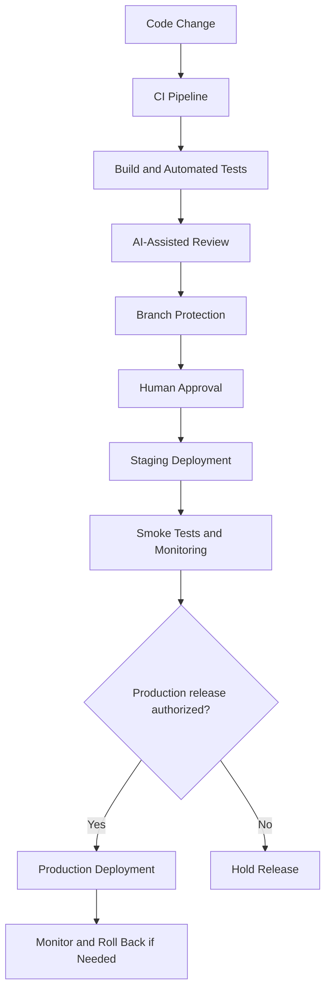
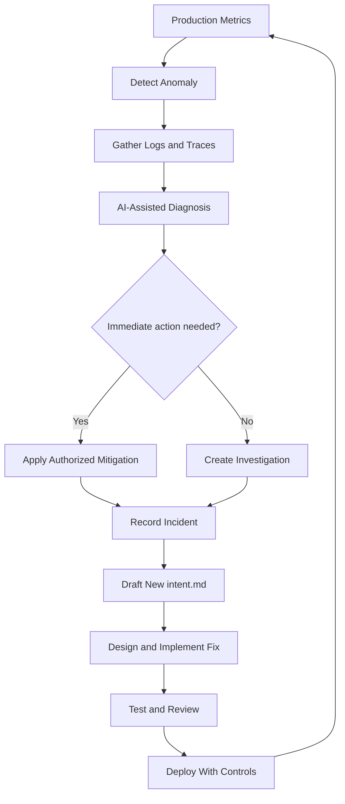
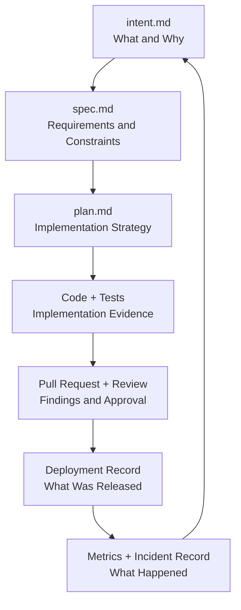
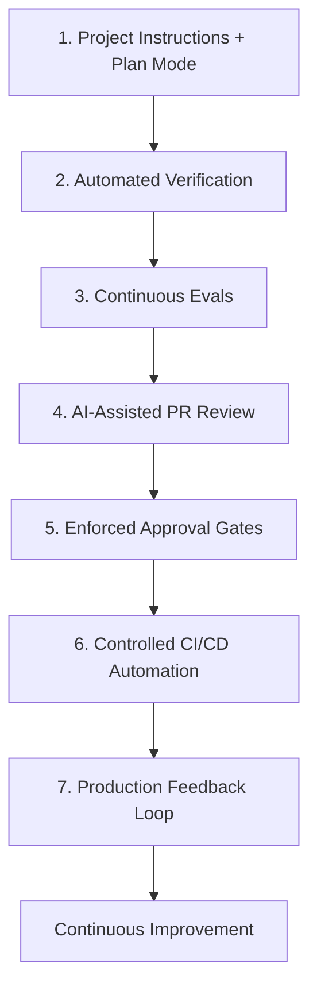
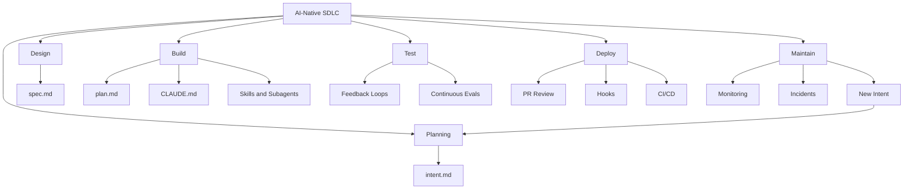

---

title: "The AI-Native SDLC Playbook" aliases:

- AI-Native Software Development Lifecycle
- Agentic SDLC
- AI-Native Software Engineering type: evergreen status: study-note created: 2026-10-22 source: "Claude — The AI-native SDLC playbook" author: Louis Claxton published: 2026-08-21 related:
- "[[AI-Native — Complete Study Notes]]"
- "[[AI-Native — Product School Perspective]]"
- "[[AI-Native Architecture]]"
- "[[AI Agents]]"
- "[[LLMOps]]"
- "[[DevOps]]"
- "[[CI-CD]]" tags:
- artificial-intelligence
- ai-native
- software-engineering
- sdlc
- agentic-ai
- claude-code
- developer-productivity
- software-architecture
- devops
- cicd
- testing
- code-review
- ai-governance
- evergreen

---

# The AI-Native SDLC Playbook

> [!abstract] Core idea **An AI-native Software Development Life Cycle (SDLC) redesigns the entire journey from idea to production around AI agents, automated verification, reusable engineering knowledge, and policy-enforced controls.**

Source: The AI-native SDLC playbook — Claude by Anthropic

Author: Louis Claxton  
Published: August 21, 2026  
Primary audience: Engineering, platform, security, and technology leaders.

The playbook describes practices for using Claude Code across planning, design, building, testing, deployment, and maintenance. Its central argument is that faster code generation is not enough: the surrounding development process must change as well. [[#1. The Core Problem — Code Is No Longer the Bottleneck]]

---

# Table of Contents

- [[#1. The Core Problem — Code Is No Longer the Bottleneck]]
- [[#2. What Is an AI-Native SDLC?]]
- [[#3. Traditional SDLC vs AI-Native SDLC]]
- [[#4. The Six Stages]]
- [[#5. Stage 1 — Plan]]
- [[#6. Stage 2 — Design]]
- [[#7. Stage 3 — Build]]
- [[#8. Stage 4 — Test]]
- [[#9. Stage 5 — Deploy]]
- [[#10. Stage 6 — Maintain]]
- [[#11. The Twelve Implementation Plays]]
- [[#12. Engineering Artifacts and Their Relationships]]
- [[#13. Security and Governance]]
- [[#14. Metrics and Measurement]]
- [[#15. Practical Implementation Roadmap]]
- [[#16. Worked Example]]
- [[#17. Limitations and Critical Thinking]]
- [[#18. Knowledge Graph]]
- [[#19. Glossary]]
- [[#20. Further Reading]]

---

# 1. The Core Problem — Code Is No Longer the Bottleneck

## 1.1 The traditional bottleneck

Traditionally, building software involved a sequence of activities:

1. Product managers gathered requirements.
2. Architects designed the system.
3. Engineers implemented the code.
4. Testers validated the implementation.
5. Reviewers inspected changes.
6. Release teams deployed the software.
7. Operations teams monitored production.

Each stage required time, coordination, documentation, and handoffs.

The implementation stage was often expensive because developers had to write and debug substantial amounts of code manually.

AI coding agents change this equation. They can generate code, tests, documentation, and proposed fixes much faster than a purely manual workflow in many tasks.

But the rest of the process may still operate at its previous speed.

## 1.2 The bottleneck moves

Imagine the following hypothetical development timeline:

|Activity|Traditional workflow|AI-assisted workflow|
|---|---|---|
|Requirements clarification|2 days|2 days|
|Design|2 days|1 day|
|Implementation|5 days|1 day|
|Testing and verification|2 days|2 days|
|Review and approvals|2 days|2 days|
|Deployment coordination|1 day|1 day|
|**Total**|**14 days**|**9 days**|

These are illustrative numbers, not measured results from the article.

Implementation became much faster, but requirements, testing, review, and deployment still consume time.

This creates a new engineering challenge: **how can the organization increase throughput without reducing software quality or weakening controls?**

The answer is not simply to ask AI to generate more code. The process surrounding the code must also be redesigned.

## 1.3 Three consequences

The playbook identifies three important consequences of faster implementation.

### A. Planning, testing, and deployment become bottlenecks

If code is produced quickly, work accumulates at stages that still require manual coordination.

### B. Existing controls may no longer scale

Reviewing every line manually may become impractical when agents generate large changesets.

This does not mean human review should disappear. It means mechanical checks and automated reviews should handle more routine work, allowing humans to focus on intent, architectural risk, security, and consequential decisions.

### C. Governance can become expensive

If every exception requires a meeting or a committee approval, faster implementation can create longer queues.

A better approach is to encode routine policies into enforceable controls and preserve explicit human approval for decisions that genuinely require judgment.

Source: Claude — The AI-native SDLC playbook

> [!important] Key lesson Increasing the speed of one stage does not automatically increase the speed of the complete system. Optimize the entire development lifecycle, not just code generation.

Related: [[Theory of Constraints]], [[DevOps]], [[Continuous Delivery]]

---

# 2. What Is an AI-Native SDLC?

## 2.1 Definition

The **AI-native SDLC** is a software development lifecycle in which AI agents participate throughout planning, design, implementation, testing, deployment, and maintenance.

AI is not limited to generating code in an editor.

It can also help:

- Convert ideas into structured requirements.
- Produce implementation plans.
- Apply institutional engineering standards.
- Generate and run tests.
- Review pull requests.
- Triage build failures.
- Assist with controlled deployment.
- Investigate production incidents.
- Turn production problems into new engineering work.

The process becomes a loop rather than a sequence of isolated handoffs.

## 2.2 Simplified explanation

Traditional development:

**Human plans → human designs → human codes → human tests → human reviews → human deploys → human monitors.**

AI-native development:

**Human defines intent → AI helps plan and implement → automated checks verify → AI assists with review and operations → humans approve consequential decisions → production feedback informs the next change.**

Humans remain accountable for decisions that require judgment.

The goal is to change the work humans do, not eliminate human responsibility.

## 2.3 What changes fundamentally?

The main changes are:

- Natural-language intent becomes a versioned starting artifact.
- Engineering knowledge is written down in reusable, machine-readable files.
- Agents can plan and implement changes across multiple steps.
- Verification happens continuously during implementation.
- AI review becomes part of the pull-request process.
- Policies can be enforced at the point where an agent attempts an action.
- Production metrics can trigger investigation and new development work.

The exact implementation depends on the organization's existing tools, regulatory requirements, and engineering maturity.

---

# 3. Traditional SDLC vs AI-Native SDLC

|Stage|Traditional approach|AI-native approach|
|---|---|---|
|Plan|Meetings, tickets, manually written requirements|AI-assisted synthesis of intent into `intent.md`|
|Design|Requirements and design often move between separate roles|An agent helps transform intent into a reviewed `spec.md`|
|Build|Engineers manually implement most code and tests|Agents help plan, generate, modify, and document code|
|Test|Verification often happens after implementation|Continuous feedback and evaluation throughout the task|
|Deploy|Human-heavy review and release coordination|Automated review layers, CI/CD integration, and policy-enforced approval gates|
|Maintain|People inspect dashboards, alerts, and incidents|Agents assist with diagnosis and feed findings into new work|

Source: Claude — The AI-native SDLC playbook

## 3.1 The critical distinction

AI-native does not mean that all six stages become fully autonomous.

It means that AI participates throughout the lifecycle, while automation, policies, and human approval are designed around the capabilities and risks of each stage.

For example:

- AI may independently draft a change in a development environment.
- Automated tests may validate the change.
- An AI reviewer may identify security concerns.
- A code owner may approve the pull request.
- A release manager may authorize production deployment.

Different actions receive different levels of autonomy.

---

# 4. The Six Stages

```
flowchart TD
    A["1. PLAN<br/>intent.md"] --> B["2. DESIGN<br/>spec.md"]
    B --> C["3. BUILD<br/>plan.md + code"]
    C --> D["4. TEST<br/>evidence + evals"]
    D --> E["5. DEPLOY<br/>PR + approval"]
    E --> F["6. MAINTAIN<br/>metrics + incidents"]
    F --> G["New intent.md"]
    G --> A
```

Each stage produces an artifact or a set of artifacts that the next stage can consume.

|Stage|Primary question|Important output|
|---|---|---|
|Plan|What problem are we solving, and why?|`intent.md`|
|Design|What should the system do, and what constraints apply?|`spec.md`|
|Build|How will we implement the change?|`plan.md`, code, tests|
|Test|How do we know it works?|Test results and evaluation evidence|
|Deploy|Is the change safe and authorized to release?|Pull request, review findings, approval records|
|Maintain|Is production behaving as expected?|Metrics, incident records, follow-up intent|

The Markdown filenames are conventions from the playbook, not universal industry requirements.

A company may use Jira, a requirements management system, or another authoritative source. The important requirement is traceability between the original intent, implementation, tests, and approval.

---

# 5. Stage 1 — Plan

## Play 1: Capture intent as `intent.md`

### 5.1 What is `intent.md`?

`intent.md` is a short, version-controlled document that captures:

- What is wanted.
- Why it is wanted.
- Who is affected.
- What constraints apply.
- What success looks like.
- What questions remain unanswered.

It acts as a bridge between the person who identifies the problem and the engineering process that implements the solution.

### 5.2 Why this matters

In a traditional process, an idea may pass through multiple people and tools:

1. A user reports a problem.
2. A product manager writes a ticket.
3. The team discusses the ticket.
4. An analyst writes requirements.
5. Engineering interprets those requirements.
6. The original intent may be diluted through handoffs.

AI can help the original problem owner turn their idea into a structured artifact while keeping the source of the request visible.

The document is reviewed and corrected by a human before it becomes the approved starting point.

### 5.3 Example

Suppose a customer support team wants customers to check the status of a support request without contacting an agent.

An `intent.md` might look like this:

```
# Intent: Support Ticket Status Self-Service

Status: Draft
Owner: Customer Support

## Problem
Customers frequently contact support to ask for ticket status.
This increases queue volume and delays responses to complex cases.

## Desired outcome
Customers can securely view their ticket status,
the next expected step, and the latest update.

## Affected users
- Customers
- Support agents
- Customer portal team

## Systems involved
- Customer portal
- Support ticket API
- Authentication service

## Constraints
- Users must only see their own tickets.
- No sensitive internal notes may be exposed.
- Existing authentication policies must remain in force.

## Success criteria
- Reduce status-only support contacts.
- Preserve correct ticket authorization.
- Display current status and update timestamps.

## Open questions
- Should customers see estimated resolution times?
- How should closed tickets be displayed?
```

### 5.4 How AI participates

The originator describes the problem in ordinary language.

The agent asks clarifying questions about scope, users, constraints, and expected outcomes.

It drafts the document, and the originator corrects any misunderstandings.

The accepted artifact is committed to version control.

### 5.5 Governance

The evidence is the reviewed document and its revision history.

The product owner or designated approver decides whether the idea proceeds to design.

**Human responsibility:** AI may help write the intent, but it cannot independently decide that the business problem is worth solving.

Source: Claude Academy — Capture as intent.md

Related: [[Product Discovery]], [[Requirements Engineering]], [[User Stories]]

---

# 6. Stage 2 — Design

## Play 2: Generate requirements and design

### 6.1 What changes?

The traditional approach may separate requirements gathering, analysis, and technical design across several roles and meetings.

The AI-native approach uses an agent to help transform the approved intent into a detailed specification, guided by the organization's standards and constraints.

The agent can identify missing information and highlight design concerns.

### 6.2 What is `spec.md`?

`spec.md` is a proposed specification that defines the behavior and constraints of the solution.

It may include:

- Functional requirements.
- Non-functional requirements.
- User flows.
- API behavior.
- Data requirements.
- Security requirements.
- Acceptance criteria.
- Failure cases.
- Open questions.

### 6.3 Example

For the support-ticket self-service application:

```
# Specification: Support Ticket Status Self-Service

## Functional requirements
- Authenticated users can view their own tickets.
- Users can see status, last update, and next steps.
- The interface supports empty and error states.

## Security requirements
- Every ticket lookup must enforce server-side authorization.
- The API must not trust ticket IDs supplied by the browser.
- Internal support notes must never appear in customer responses.

## Reliability requirements
- The page must show a useful error when the support API is unavailable.
- The displayed timestamp must reflect the source system's latest update.

## Acceptance criteria
- An authorized user can view their own ticket.
- An unauthorized user cannot view another customer's ticket.
- An unavailable API produces a controlled error state.
- Automated tests cover these behaviors.

## Open questions
- What is the acceptable API latency?
- How long should ticket status be cached?
```

### 6.4 Skills as design constraints

The playbook describes using reusable skills to encode organizational standards.

Examples include:

- Security requirements.
- Design-system conventions.
- API standards.
- Accessibility expectations.
- Regulatory requirements.
- Documentation practices.

The agent can use these standards while generating a specification.

However, AI-generated requirements and designs still require validation. A skill or instruction file is not a substitute for a complete security architecture or regulatory review.

### 6.5 Output

The specification should be sufficiently precise that engineering can implement it and testers can verify it.

Related: [[Software Design]], [[Technical Specifications]], [[Acceptance Criteria]], [[AI Skills]]

---

# 7. Stage 3 — Build

The Build stage contains four plays:

1. Claude Code plan mode as the default starting point.
2. `CLAUDE.md` as shared project knowledge.
3. Skills as institutional knowledge.
4. Parallel sessions and subagents.

## Play 3: Start with plan mode

### 7.1 Why planning comes before code

An agent can modify code quickly, but an incorrect implementation plan can still lead to substantial rework.

The playbook recommends starting with a planning step in which the agent examines the codebase and proposes an implementation strategy before changing files.

The engineer reviews and corrects the plan.

### 7.2 What should `plan.md` contain?

- Files likely to change.
- Implementation steps.
- Dependencies.
- Tests to run.
- Risks and edge cases.
- Potential backward-compatibility concerns.
- Migration or rollback considerations where applicable.

Example:

```
# Implementation Plan: Ticket Status Self-Service

## Step 1
Inspect the existing ticket API and authorization middleware.

## Step 2
Add a status endpoint using the established authentication pattern.

## Step 3
Add tests for authorized and unauthorized ticket access.

## Step 4
Build the portal status component.

## Step 5
Add loading, empty, and error states.

## Step 6
Run unit tests, integration tests, lint, and build.

## Step 7
Review the diff against spec.md and security requirements.

## Risks
- Exposing another customer's ticket.
- Returning internal notes.
- Showing stale status information.
```

### 7.3 Human review

The engineer should challenge the plan:

- What could break?
- Which change is riskiest?
- Are there simpler alternatives?
- Which files are unnecessary to modify?
- Do the tests prove the intended behavior?
- Is the change consistent with the architecture?

Once approved, the plan becomes a reference for implementation and later review.

Source: [Claude Academy — Claude Code plan mode](https://academy.claude.com/courses/ai-native-sdlc-playbook/plan-mode)

## Play 4: Maintain `CLAUDE.md`

### 7.4 What is `CLAUDE.md`?

`CLAUDE.md` is a project instruction file used by Claude Code to provide persistent guidance about a codebase.

It can contain:

- Repository structure.
- Important architectural decisions.
- Coding conventions.
- Commands for building and testing.
- Testing requirements.
- Security rules.
- Definition of done.
- Known constraints.

Think of it as a practical engineering handbook for the coding agent.

### 7.5 Example

```
# Project Instructions

## Architecture
- Use the existing service layer.
- Do not access the database directly from UI components.
- Reuse the existing authentication middleware.

## Commands
- Build: npm run build
- Test: npm test
- Lint: npm run lint

## Verification
- Run relevant tests after each change.
- Run the complete test suite before reporting completion.
- Never remove or weaken a failing test simply to obtain a passing build.

## Security
- Enforce authorization on the server.
- Never expose internal support notes.
- Never log credentials or sensitive customer information.

## Definition of Done
- Implementation matches spec.md.
- Relevant tests pass.
- Build and lint pass.
- Changes are summarized with verification evidence.
```

### 7.6 Why it matters

Without shared instructions, an agent may repeatedly make the same mistakes or overlook local conventions.

A version-controlled instruction file makes important engineering expectations reusable across sessions and team members.

Keep it concise and maintainable. If it becomes too large or contains unrelated instructions, split reusable procedures into skills or more focused documentation.

## Play 5: Use skills as institutional knowledge

### 7.7 What is an AI skill?

A skill is a reusable set of instructions and procedures for performing a specific task.

Examples:

- Creating a database migration.
- Reviewing an API for security issues.
- Generating a changelog.
- Running a release checklist.
- Following a design system.
- Preparing a compliance report.

A skill differs from a general project instruction file because it focuses on a particular workflow or capability.

### 7.8 Example skill

```
# Database Migration Review

When reviewing a database migration:

1. Check whether the migration can lose data.
2. Check compatibility with the currently deployed application.
3. Verify rollback or recovery procedures.
4. Check whether large tables require a staged migration.
5. Confirm that tests cover the schema change.
6. Flag any irreversible operation for human review.
```

The skill encodes repeatable knowledge that would otherwise be rediscovered in conversations or passed between engineers.

### 7.9 `CLAUDE.md` vs skills vs hooks

|Mechanism|Purpose|Example|
|---|---|---|
|`CLAUDE.md`|Persistent project guidance|Always use the existing authorization middleware|
|Skill|Reusable procedure or specialized knowledge|Review a database migration|
|Hook|Programmatic control around an event or action|Block a prohibited file edit or require approval before release|

The key distinction is between **instructions, reusable procedures, and enforceable controls**.

A model can overlook an instruction. A correctly implemented hook can enforce a rule at a defined execution boundary.

Hooks still need secure implementation and testing.

## Play 6: Parallel sessions and subagents

### 7.10 Why parallelize?

Some development tasks can be divided into independent pieces.

For example:

- One agent investigates the API.
- Another reviews test coverage.
- Another examines security requirements.
- A primary agent coordinates implementation.

This can reduce waiting time and allow specialized review.

### 7.11 When parallel work helps

- Independent investigation tasks.
- Separate modules with clear boundaries.
- Independent test analysis.
- Parallel research into alternative implementations.
- Different types of review.

### 7.12 When parallel work creates risk

- Agents edit the same files.
- Tasks depend heavily on one another.
- The shared context is incomplete.
- Different agents assume conflicting requirements.
- Merge conflicts become frequent.
- Multiple agents repeat expensive work.

Parallelism should follow task independence, not simply the desire to run more agents.

### Build-stage principle

**Plan first, reuse engineering knowledge, delegate independent work, and preserve clear ownership of the final changes.**

Related: [[Claude Code]], [[AI Coding Agents]], [[Git Worktrees]], [[Software Architecture]]

---

# 8. Stage 4 — Test

The Test stage contains two plays:

1. Give the agent a feedback loop.
2. Run continuous evaluations in CI.

## Play 7: Give the agent a feedback loop

### 8.1 The feedback-loop principle

An agent should be able to verify its work before declaring the task complete.

A basic loop is:

1. Implement a change.
2. Run a test or build.
3. Inspect the result.
4. Identify the failure.
5. Correct the implementation.
6. Repeat verification.

This reduces the amount of incomplete work that reaches a human reviewer.

### 8.2 Example

A developer asks an agent to add a new API field.

A weak workflow is:

- Generate the code.
- Report completion.
- Let CI or a reviewer discover the missing serialization logic.

A stronger workflow is:

- Generate the code.
- Add or update tests.
- Run the test suite.
- Inspect the API response.
- Fix failures.
- Present the diff and test output.

### 8.3 Make verification measurable

Good instructions specify observable outcomes:

- All relevant tests pass.
- The build exits successfully.
- The endpoint returns the expected field.
- The screenshot matches the intended interface.
- The security test rejects unauthorized access.

"Make sure it works" is too vague.

### 8.4 Protect the tests

A particularly important safeguard is preventing the agent from weakening the test while fixing the implementation.

For a bug fix:

1. Reproduce the bug with a failing test.
2. Confirm the test fails for the intended reason.
3. Preserve the test.
4. Modify the implementation.
5. Run the test again.
6. Review changes to the test itself.

A test suite that can be casually weakened by the same agent it is meant to verify is not a reliable control.

Source: [Claude Academy — Give Claude a feedback loop](https://academy.claude.com/courses/ai-native-sdlc-playbook/give-claude-a-feedback-loop)

## Play 8: Continuous evaluations in CI

### 8.5 What are continuous evals?

Continuous evaluations are repeatable tests of an AI system's behavior that run when relevant code, prompts, tools, or configurations change.

Traditional unit tests are still necessary. AI applications also need tests for behaviors that are difficult to capture through simple input-output assertions.

Examples:

- Does the agent use the correct tool?
- Does it respect access restrictions?
- Does it retrieve the right document?
- Does it follow the required output format?
- Does it refuse an unauthorized request?
- Does a prompt change reduce answer quality?
- Does a new model version introduce regressions?

### 8.6 Unit tests vs AI evaluations

|Test type|Primary purpose|
|---|---|
|Unit tests|Verify a small, deterministic component|
|Integration tests|Verify that components work together|
|End-to-end tests|Verify a complete user workflow|
|Security tests|Verify protection against unauthorized or unsafe behavior|
|AI evaluations|Measure model or agent behavior against defined criteria|
|Regression tests|Detect previously fixed problems returning|

These test types complement one another.

### 8.7 Evaluation example

Suppose an AI support assistant retrieves help-center documents.

An evaluation dataset might contain:

|Test case|Expected behavior|
|---|---|
|Simple policy question|Return an answer supported by the correct document|
|No relevant document exists|State that the information is unavailable|
|User asks for another customer's data|Refuse or enforce authorization restrictions|
|Prompt injection appears in a document|Treat it as untrusted content|
|Retrieval service fails|Return a controlled error or use an approved fallback|
|A previously correct answer regresses|Flag the regression|

A passing evaluation provides evidence, not proof of universal correctness. Coverage, evaluator quality, and realistic test cases matter.

### 8.8 Why evaluations must run when the setup changes

AI behavior depends on more than source code.

Changes to any of the following can affect output:

- Model version.
- System instructions.
- Skills.
- Retrieval logic.
- Tool definitions.
- Data sources.
- Workflow orchestration.
- Safety policies.

Therefore, evaluation should be connected to the changes that can affect the behavior being tested.

Related: [[Software Testing]], [[LLM Evaluation]], [[CI-CD]], [[Regression Testing]]

---

# 9. Stage 5 — Deploy

The Deploy stage contains three plays:

1. AI in the pull-request review loop.
2. Hooks as approval gates.
3. CI/CD integration and deployment.

## Play 9: AI in the PR review loop

### 9.1 What is a pull request?

A pull request (PR) is a proposed change to a code repository that others can inspect before merging it.

Traditional PR review depends heavily on the availability and attention of human reviewers.

As code generation increases, the volume of changes may outgrow that review capacity.

### 9.2 The AI-native review model

AI can perform standardized review passes for:

- Logic errors.
- Edge cases.
- Security issues.
- Compliance with requirements.
- Architectural inconsistencies.
- Missing tests.
- Potential regressions.

The review output can classify findings by severity.

Humans then focus on questions that require judgment:

- Does this change solve the right problem?
- Is the design appropriate?
- Are the risks acceptable?
- Is the evidence sufficient?
- Should this change be approved?

### 9.3 Example: `REVIEW.md`

A team can define a version-controlled review policy.

```
# Pull Request Review Policy

## Review passes

### Correctness
- Check logic errors and edge cases.
- Look for unintended behavior changes.

### Security
- Check authorization gaps.
- Check injection risks.
- Check sensitive information in logs.

### Requirements
- Compare the change against spec.md.
- Compare implementation against plan.md.

### Testing
- Check whether important behavior is covered.
- Identify missing regression tests.

## Severity
- Critical: Immediate security or data-integrity risk.
- High: Major behavior failure.
- Medium: Significant but limited defect.
- Low: Minor concern or style suggestion.

## Review constraints
- Avoid duplicating findings already enforced by CI.
- Provide evidence for every significant finding.
```

Severity labels should be adapted to the organization's own review and incident taxonomy.

### 9.4 The agent can also fix review findings

An agent may be asked to address review comments, modify its proposed change, and rerun the relevant tests.

The updated change must remain visible in the PR history.

AI-generated review findings should not automatically become authoritative merely because the model is confident. False positives and missed defects are both possible.

### 9.5 Human review remains necessary

AI review does not replace code ownership or required approvals.

The playbook recommends keeping human approval for decisions involving intent and risk, with formal approval gates where required.

Source: [Claude Academy — AI in the PR review loop](https://academy.claude.com/courses/ai-native-sdlc-playbook/ai-in-the-pr-review-loop)

## Play 10: Hooks as approval gates

### 9.6 What is a hook?

In Claude Code, a hook can run a defined program or action at a particular point in the agent's execution lifecycle.

Depending on the event and configuration, hooks can inspect an action, perform validation, or block an operation.

They are useful for enforcing controls that should not depend only on the model remembering an instruction.

### 9.7 Examples

- Block edits to protected files.
- Require tests before declaring a task complete.
- Prevent changes to a protected test during a bug fix.
- Require approval before production deployment.
- Deny prohibited tool calls.
- Enforce organization-managed policies.

### 9.8 Instructions vs hooks

Consider this instruction:

"Never deploy to production without approval."

An agent may misunderstand or fail to follow the instruction.

A stronger implementation places production deployment behind an enforceable gate that checks for authorization.

The application or pipeline must be designed so that bypassing the model's instructions does not bypass the real control.

### 9.9 Security requirements

- Test hooks against failure conditions.
- Fail closed for sensitive actions when required.
- Restrict who can modify enforcement policies.
- Record approval evidence.
- Avoid giving agents alternative routes around protected actions.
- Ensure that credentials and permissions are independently constrained.

Hooks are one control mechanism, not a replacement for operating-system security, identity management, branch protection, or deployment authorization.

## Play 11: CI/CD integration and deployment

### 9.10 What is CI/CD?

**Continuous Integration (CI)** automates activities such as building and testing changes.

**Continuous Delivery or Deployment (CD)** automates the process of preparing or releasing software.

The playbook describes using AI in CI/CD for tasks that require interpretation or judgment, such as:

- Summarizing build failures.
- Investigating flaky tests.
- Drafting release notes.
- Proposing fixes.
- Assisting with deployment diagnosis.
- Executing approved deployment or rollback tools.

### 9.11 Safe deployment architecture



This is an illustrative architecture. Approval rules and deployment steps depend on the system's risk and existing controls.

### 9.12 Sandbox and scoped credentials

Agents running in a pipeline should have only the permissions they need.

Useful controls include:

- Isolated execution environments.
- Network restrictions.
- Short-lived credentials.
- Separate credentials for development, staging, and production.
- No standing production credentials for routine agent jobs.
- Allowlisted deployment tools.
- Branch protection.
- Auditable approvals.

### 9.13 Tier autonomy by environment

|Environment|Example autonomy policy|
|---|---|
|Development|Agent may run tests and deploy to a disposable environment|
|Staging|Agent may deploy through approved tooling and run verification|
|Production|Agent prepares the release; a designated human authorizes deployment|

The appropriate policy depends on the potential impact of a failure.

### 9.14 Rollback is essential

A deployment system should have a rehearsed rollback path.

A safe workflow should define:

- What constitutes a deployment failure.
- Which metrics trigger intervention.
- Who or what can initiate rollback.
- How to restore a known-good version.
- How to verify recovery.
- How to record the incident.

Rollback should be tested before an incident occurs, not designed for the first time during an outage.

Source: [Claude Academy — CI/CD integration and deployment](https://academy.claude.com/courses/ai-native-sdlc-playbook/ci-cd-integration-and-deployment)

Related: [[DevOps]], [[CI-CD]], [[GitHub Actions]], [[Software Supply Chain Security]]

---

# 10. Stage 6 — Maintain

## Play 12: Close the loop on production metrics

### 10.1 Traditional maintenance

Operations teams monitor production dashboards and alerts.

When a metric becomes abnormal:

1. An alert fires.
2. An engineer investigates.
3. The team identifies a likely cause.
4. A ticket is created.
5. The work enters the development backlog.
6. The fix moves through the normal SDLC.

This process can introduce delays between the original problem and the corrective change.

### 10.2 AI-native maintenance

An agent can help connect production signals to engineering work.

For example, it can:

- Detect an abnormal metric.
- Gather relevant logs and traces.
- Compare current behavior with previous releases.
- Investigate possible causes.
- Produce an incident summary.
- Draft a new `intent.md` for the corrective work.
- Prepare a proposed fix or rollback.

The proposed work must still follow the appropriate validation and approval process.

### 10.3 Example

Suppose an API's error rate exceeds its normal range after a deployment.

A controlled workflow might be:

1. Monitoring detects the breach.
2. An incident workflow collects relevant telemetry.
3. An agent summarizes recent deployments and error patterns.
4. The system checks whether a predefined rollback condition has been met.
5. An authorized rollback executes if policy permits it.
6. The incident is recorded.
7. A new `intent.md` describes the root-cause investigation or permanent fix.
8. The fix proceeds through planning, testing, review, and deployment.

### 10.4 Control bands

A control band is a defined acceptable range for a metric.

Examples:

- Error rate below a specified threshold.
- Latency within a service objective.
- Resource consumption within operational limits.
- Model cost per request below a budget.
- Business outcomes within an expected range.

Thresholds should be based on service objectives and operational evidence, not arbitrary guesses.

A breach may trigger investigation or a predefined action, but a noisy metric should not automatically trigger an unsafe operation.

### 10.5 The closed loop



### 10.6 Why this is important

Maintenance becomes an input to the next development cycle instead of a separate operational activity.

The result is a more continuous relationship between:

- Product intent.
- Engineering changes.
- Deployment.
- Real-world behavior.
- Corrective work.

Related: [[Site Reliability Engineering]], [[Observability]], [[Incident Management]], [[SLO]], [[Root Cause Analysis]]

---

# 11. The Twelve Implementation Plays

The playbook organizes twelve plays across the six stages.

|No.|Stage|Play|Main purpose|
|---|---|---|---|
|1|Plan|Capture as `intent.md`|Turn ideas and problems into a versioned starting artifact|
|2|Design|Requirements and design|Generate a reviewed specification from intent|
|3|Build|Claude Code plan mode|Agree on implementation steps before code changes|
|4|Build|The `CLAUDE.md`|Preserve project instructions and engineering conventions|
|5|Build|Skills as institutional knowledge|Reuse domain-specific procedures and standards|
|6|Build|Parallel sessions and subagents|Delegate independent tasks and reviews|
|7|Test|Give Claude a feedback loop|Verify work continuously during implementation|
|8|Test|Continuous evals in CI|Detect behavioral regressions as the system changes|
|9|Deploy|AI in the PR review loop|Standardize review and reduce routine reviewer workload|
|10|Deploy|Hooks as approval gates|Enforce policies at defined execution points|
|11|Deploy|CI/CD integration and deployment|Automate judgment-oriented pipeline tasks under controls|
|12|Maintain|Closing the loop on metrics|Turn production signals into follow-up engineering work|

Source: [Claude Academy — AI-native SDLC playbook](https://academy.claude.com/courses/ai-native-sdlc-playbook)

## 11.1 Which plays can be started first?

The playbook identifies several starting points that do not depend on other plays:

- Capture intent as `intent.md`.
- Start with Claude Code plan mode.
- Create a useful `CLAUDE.md`.
- Document reusable skills.
- Give the agent a feedback loop.
- Implement hooks for approval gates.

This is useful because teams do not need to redesign the entire lifecycle before making progress.

## 11.2 Dependency-aware implementation

Some capabilities work best after foundational practices exist.

For example:

- Parallel sessions benefit from shared project instructions.
- Continuous evaluations benefit from documented expectations and reliable verification.
- Automated PR review benefits from defined policies and evaluation.
- CI/CD automation benefits from review controls and enforceable approval gates.
- Closing the maintenance loop benefits from deployment automation and a reliable intent-capture process.

Start with the practices that address the current bottleneck, then build on them.

---

# 12. Engineering Artifacts and Their Relationships

The playbook's artifact-driven approach is one of its most useful ideas.

Instead of relying exclusively on conversations, meetings, and undocumented context, each stage produces a persistent record.

## 12.1 The artifact chain



## 12.2 Why version control matters

When artifacts are version-controlled, the team can inspect:

- Who created the request.
- What changed in the requirements.
- Which implementation plan was approved.
- What code was generated or modified.
- Which tests ran.
- What reviewers found.
- Who authorized the release.
- Which production events followed.

This creates a useful audit trail.

Version control does not automatically provide complete auditability. Teams must still preserve identity, approvals, pipeline results, and links to the authoritative records.

## 12.3 Markdown vs existing enterprise systems

The playbook recognizes that enterprises may already have authoritative systems such as Jira, ServiceNow, or regulated requirements-management tools.

There are several possible strategies:

### Option A — Repository is the source of truth

The Markdown artifacts in Git are authoritative. Other systems link to the relevant commits or files.

### Option B — Existing enterprise system is the source of truth

The agent reads approved records from the existing system and writes results back through a controlled integration.

### Option C — Link the records

Each artifact records the corresponding issue ID, and the issue references the relevant commit or artifact.

The essential rule is to make the source of truth explicit and preserve traceability.

Avoid allowing two disconnected systems to become competing authoritative records.

---

# 13. Security and Governance

AI-native SDLC changes the threat model because agents can read files, modify code, invoke tools, and participate in deployment workflows.

The faster the workflow becomes, the more important enforceable controls become.

## 13.1 Core security principles

### Least privilege

Give each agent only the permissions required for its current task.

### Separation of duties

The agent that creates a change should not necessarily have unrestricted authority to approve and release that change.

### Protected branches

Require appropriate reviews and status checks before merging.

### Sandboxed execution

Limit filesystem access, network access, and credentials for automated jobs.

### Explicit approval gates

Require human authorization for consequential operations, such as production releases, where policy demands it.

### Auditability

Record the identity, action, result, and authorization associated with important operations.

### Safe rollback

Test recovery procedures and restrict who or what can invoke them.

## 13.2 Threat model

|Threat|Example|Useful control|
|---|---|---|
|Incorrect code|Agent generates a faulty API handler|Tests, code review, staging|
|Security regression|Authorization check is omitted|Security tests, static analysis, human review|
|Test weakening|Agent changes a failing test to pass|Protected tests, hooks, review|
|Prompt injection|Untrusted content attempts to alter agent behavior|Treat content as untrusted; enforce permissions outside the model|
|Credential exposure|Agent logs a secret|Secret scanning, scoped credentials, redaction|
|Unauthorized release|Agent deploys without approval|Enforced deployment gate|
|Runaway automation|Agent repeatedly executes expensive operations|Budgets, timeouts, rate limits, kill switches|
|Bad rollback|Automated recovery worsens the outage|Tested runbooks, constrained actions, monitoring|

## 13.3 Human oversight should follow risk

Not all operations need the same level of review.

Low-risk operations might be automated more freely:

- Formatting code.
- Generating documentation.
- Running tests.
- Summarizing a build failure.

Higher-risk operations need stronger controls:

- Changing authorization logic.
- Modifying security boundaries.
- Migrating critical production data.
- Changing payment behavior.
- Deploying to production.
- Disabling monitoring or safety checks.

**Rule of thumb:** Automate repetitive work aggressively, but make authority proportional to risk.

---

# 14. Metrics and Measurement

The goal is not to maximize AI-generated code. The goal is to improve the software delivery system.

## 14.1 Planning metrics

- Time from idea to approved specification.
- Number of unresolved requirement questions.
- Rework caused by misunderstood intent.
- Time spent waiting for handoffs.

## 14.2 Build metrics

- Time from approved plan to implementation.
- First-pass build success.
- Test coverage for changed behavior.
- Rework rate.
- Agent task completion rate.

## 14.3 Testing and review metrics

- Defects detected before merge.
- Regression rate.
- Review turnaround time.
- False-positive review findings.
- Percentage of changes with adequate verification evidence.
- Human correction rate.

## 14.4 Deployment metrics

- Deployment frequency.
- Lead time for changes.
- Change failure rate.
- Time to restore service.
- Rollback frequency.
- Percentage of releases requiring manual intervention.

These overlap with the well-known DORA software delivery performance measures.

## 14.5 Maintenance metrics

- Time from alert to diagnosis.
- Time from incident to corrective intent.
- Repeated incident rate.
- Percentage of incidents with linked corrective work.
- Reliability against service objectives.

## 14.6 Measure outcomes, not just activity

Weak metric:

"AI generated 10,000 lines of code."

Better metrics:

- The feature shipped sooner.
- Fewer defects escaped into production.
- Review time decreased without reducing review quality.
- The team completed more valuable work.
- Recovery from incidents became faster.
- The cost per successfully delivered change decreased.

The right target depends on the product and its risk profile.

---

# 15. Practical Implementation Roadmap

A team does not need to adopt all twelve plays simultaneously.

## Phase 1 — Establish the basics

- Create a concise `CLAUDE.md`.
- Document reliable build and test commands.
- Ask the agent to plan before editing.
- Require verification before reporting completion.
- Capture significant work in version-controlled artifacts.

**Goal:** Make AI-assisted implementation more predictable.

## Phase 2 — Improve verification

- Add tests for important behavior.
- Build repeatable local verification commands.
- Protect critical tests.
- Create an initial AI evaluation dataset.
- Run evaluations when relevant configuration changes.

**Goal:** Catch errors before human review.

## Phase 3 — Improve review

- Define a review policy.
- Introduce AI-assisted review.
- Categorize findings by severity.
- Preserve code-owner approval.
- Measure review quality and turnaround time.

**Goal:** Scale review without abandoning accountability.

## Phase 4 — Automate controlled workflows

- Add hooks for important policy checks.
- Integrate agents into CI.
- Start with read-only tasks.
- Introduce sandboxed write actions.
- Keep deployment credentials scoped.
- Require explicit production authorization.

**Goal:** Automate routine pipeline work safely.

## Phase 5 — Close the production loop

- Connect monitoring to incident records.
- Use agents to summarize and investigate failures.
- Create follow-up intent artifacts.
- Automate predefined, safe recovery operations where appropriate.
- Reuse incident evidence in future evaluations.

**Goal:** Turn operational feedback into continuous product improvement.

## Roadmap diagram



---

# 16. Worked Example

## Scenario: Build a customer support ticket API

A product team wants to let customers securely view ticket status.

### Step 1 — Plan

Create `intent.md`.

Capture the problem, expected outcome, affected users, constraints, and open questions.

### Step 2 — Design

Generate `spec.md`.

Define endpoint behavior, authentication, authorization, response format, error handling, and acceptance criteria.

### Step 3 — Build

Ask the agent to inspect the codebase and produce `plan.md`.

The engineer reviews the plan before allowing implementation.

The agent then modifies the service, API handler, and frontend where required.

### Step 4 — Test

The agent runs:

- Unit tests.
- Integration tests.
- Authorization tests.
- Build.
- Lint.

It checks that an unauthorized customer cannot view another customer's ticket.

A test should fail if the authorization requirement is violated.

### Step 5 — Review and deploy

An AI reviewer checks the diff against the specification and security policy.

The code owner reviews the intended behavior and risk.

CI verifies the change. Staging deployment runs smoke tests. Production deployment requires the configured authorization.

### Step 6 — Maintain

Monitoring tracks API errors and latency.

If the error rate exceeds the defined control band, the system creates an incident record.

An agent summarizes the relevant logs and recent changes. The team decides whether to roll back or implement a permanent fix.

The permanent fix receives a new intent artifact and repeats the development cycle.

## What this demonstrates

The AI-native SDLC is not just "ask AI to build the API."

It is a controlled process that connects:

- Intent.
- Requirements.
- Implementation.
- Verification.
- Review.
- Deployment.
- Production feedback.

The agent participates in multiple stages, but the system maintains explicit evidence and authority boundaries.

---

# 17. Limitations and Critical Thinking

The Claude playbook is based on Anthropic's internal practices and its experience with customers. Its specific tools and workflows should be treated as implementation guidance, not universal requirements for every software team.

## 17.1 Markdown is not always the best authoritative system

`intent.md`, `spec.md`, and `plan.md` are simple, versionable artifacts.

However, regulated enterprises may need formal requirements management, electronic approvals, traceability matrices, or other systems.

The correct choice is the one that preserves reliable records and integrates with the organization's existing controls.

## 17.2 AI review is imperfect

AI can identify issues, but it can also:

- Miss real defects.
- Generate false positives.
- Misunderstand requirements.
- Approve unsafe patterns.
- Repeat mistakes.

Use independent checks, strong tests, and appropriate human review.

## 17.3 Faster coding can increase total risk

More generated code can mean more changes to test, maintain, secure, and understand.

Measure the quality and long-term maintainability of the resulting software, not only the speed of generation.

## 17.4 Full autonomy is not always desirable

Some tasks are better handled through deterministic automation.

Others require human judgment because the impact of an incorrect decision is high.

The objective is controlled autonomy, not autonomy for its own sake.

## 17.5 Existing workflows may need gradual change

Large organizations often have established tools, approval structures, regulatory obligations, and responsibilities.

A gradual migration that preserves existing source-of-truth systems may be safer and more effective than replacing everything at once.

## 17.6 The playbook is Claude-oriented

The named files, skills, hooks, and Claude Code workflows are closely associated with Anthropic's tooling.

The broader principles can be applied to other coding agents and development environments, but implementation details differ.

---

# 18. Knowledge Graph

## 18.1 AI-native SDLC map



## 18.2 Obsidian internal links

### AI-native foundations

- [[AI-Native — Complete Study Notes]]
- [[AI-Native — Product School Perspective]]
- [[AI-Native Architecture]]
- [[AI Agents]]
- [[Agentic AI]]

### Software development lifecycle

- [[Software Development Life Cycle]]
- [[Requirements Engineering]]
- [[Software Design]]
- [[Software Testing]]
- [[Code Review]]
- [[DevOps]]
- [[CI-CD]]
- [[Continuous Delivery]]

### Claude Code concepts

- [[Claude Code]]
- [[CLAUDE.md]]
- [[AI Skills]]
- [[AI Hooks]]
- [[Subagents]]
- [[AI Coding Agents]]

### Testing and operations

- [[LLM Evaluation]]
- [[Regression Testing]]
- [[AI Observability]]
- [[LLMOps]]
- [[Site Reliability Engineering]]
- [[Incident Management]]
- [[Root Cause Analysis]]

### Security and governance

- [[AI Security]]
- [[Software Supply Chain Security]]
- [[Least Privilege]]
- [[Human-in-the-Loop]]
- [[AI Governance]]

## 18.3 Suggested Map of Content

Create a separate note named `MOC - AI Software Engineering.md`:

```
---
title: MOC - AI Software Engineering
tags:
  - moc
  - ai-engineering
  - software-development
---

# MOC — AI Software Engineering

## AI-Native Foundations
- [[AI-Native — Complete Study Notes]]
- [[AI-Native — Product School Perspective]]
- [[AI-Native Architecture]]
- [[The AI-Native SDLC Playbook]]

## Coding Agents
- [[Claude Code]]
- [[AI Coding Agents]]
- [[AI Skills]]
- [[Subagents]]

## Software Lifecycle
- [[Software Development Life Cycle]]
- [[Requirements Engineering]]
- [[Software Design]]
- [[Software Testing]]
- [[Code Review]]
- [[DevOps]]
- [[CI-CD]]

## Quality and Operations
- [[LLM Evaluation]]
- [[Regression Testing]]
- [[LLMOps]]
- [[AI Observability]]
- [[Site Reliability Engineering]]
- [[Incident Management]]

## Security and Governance
- [[AI Security]]
- [[Least Privilege]]
- [[Human-in-the-Loop]]
- [[AI Governance]]
```

---

# 19. Glossary

|Term|Simplified definition|
|---|---|
|SDLC|The process of taking software from idea to production and maintenance|
|AI-native SDLC|An SDLC designed around AI participation throughout the lifecycle|
|Agentic AI|AI systems that can pursue goals through multi-step actions and tools|
|`intent.md`|A structured description of what is wanted, why, and under what constraints|
|`spec.md`|A document describing required behavior, constraints, and acceptance criteria|
|`plan.md`|A proposed implementation strategy|
|`CLAUDE.md`|Project instructions for Claude Code|
|Skill|Reusable instructions for a specialized task|
|Hook|A programmatic mechanism that runs at a defined execution event and may enforce a policy|
|Subagent|A delegated agent task or specialized agent role|
|CI|Continuous Integration|
|CD|Continuous Delivery or Continuous Deployment|
|PR|Pull Request|
|Evaluation|A repeatable assessment of system behavior against defined criteria|
|Regression|A previously correct behavior breaks after a change|
|Observability|The ability to understand system behavior through telemetry and records|
|Least privilege|Granting only the permissions required for a task|
|Control band|A defined acceptable range for a monitored metric|
|Rollback|Reverting or recovering from a deployment or change|
|Audit trail|A record of actions, changes, evidence, and approvals|
|DORA metrics|Measures used to assess software delivery performance|

---

# 20. Further Reading

## Primary source

- The AI-native SDLC playbook — Claude by Anthropic

## Detailed implementation lessons

- Claude Academy — What changes and where to start
- Capture as intent.md
- [Claude Code plan mode](https://academy.claude.com/courses/ai-native-sdlc-playbook/plan-mode)
- [Give Claude a feedback loop](https://academy.claude.com/courses/ai-native-sdlc-playbook/give-claude-a-feedback-loop)
- [AI in the PR review loop](https://academy.claude.com/courses/ai-native-sdlc-playbook/ai-in-the-pr-review-loop)
- [CI/CD integration and deployment](https://academy.claude.com/courses/ai-native-sdlc-playbook/ci-cd-integration-and-deployment)

These resources provide more detailed setup steps, prerequisites, governance considerations, and measurement suggestions for individual plays.

---

# Final Mental Model

**AI-native SDLC = AI-assisted planning + AI-assisted implementation + continuous verification + automated review + enforceable governance + production feedback.**

The most important shift is that software engineering becomes less about manually producing every line of code and more about specifying intent, directing agents, validating behavior, controlling risk, and maintaining a reliable system.

The goal is not to remove humans from software development. It is to move human attention toward the decisions where it creates the most value, while making routine execution faster, more repeatable, and more auditable.