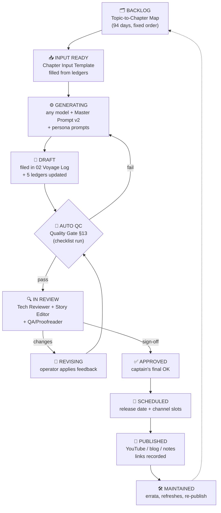

# 🏭 Production Pipeline Overview — From Backlog to Published (and Beyond)

This is the master pipeline for **Pirate Code Ventures**: how a roadmap topic becomes a generated chapter, passes human review, gets published, and stays maintained — using **any model/tool** for generation, with **full tracking**, and **large-team-safe** handoffs.

## The pipeline at a glance

## The ten statuses (one vocabulary everywhere)

| # | Status | Meaning | Who may set it |
| --- | --- | --- | --- |
| 1 | 🗂️ Backlog | Day not started; row ⬜ in the map | (default) |
| 2 | 📥 Input Ready | Chapter Input fully filled from ledgers | Generator Operator |
| 3 | ⚙️ Generating | Model run in progress (or queued) | Generator Operator |
| 4 | 📝 Draft | Chapter filed in `02 Voyage Log`, 5 ledgers updated | Generator Operator |
| 5 | 🔍 In Review | With reviewers (Tech / Story / QA) | Reviewer lead |
| 6 | 🔁 Revising | Feedback being applied | Generator Operator |
| 7 | ✅ Approved | All reviews signed off + captain's OK | Captain/Showrunner |
| 8 | 📅 Scheduled | Release date set, channel slots booked | Producer |
| 9 | 🚀 Published | Live; links + date recorded in Tracker & Chapter Index | Publisher |
| 10 | 🛠️ Maintained | Post-publish errata applied (date noted) | Continuity Keeper |

**Where status lives:** the [[fde by onepiece/05 Production Pipeline/03 Status Tracker\|Status Tracker]] is the single production board. Keep three things in sync when status changes: (1) the Tracker row, (2) the chapter file's `status:` frontmatter, (3) coverage marks (⬜/🟡/✅) in the [[fde by onepiece/04 Linking Index/Topic-to-Chapter Map\|Topic-to-Chapter Map]]. A chapter counts as **covered** in the map only at ✅ Approved or later.

## The four faces of one truth (who owns which index)

| Artifact | Answers | Owner |
| --- | --- | --- |
| [[fde by onepiece/04 Linking Index/Topic-to-Chapter Map\|Topic-to-Chapter Map]] | *What must be taught, in what order, where?* (curriculum) | Continuity Keeper |
| [[fde by onepiece/05 Production Pipeline/03 Status Tracker\|Status Tracker]] | *Where is every day in production right now?* (pipeline) | Producer |
| [[fde by onepiece/04 Linking Index/Chapter Index\|Chapter Index]] | *What is published, with what bounty/skills?* (record) | Publisher |
| [[fde by onepiece/03 Ship Project State/PROJECT STATE\|03 Ship Project State]] ledgers | *What happened in-story and in-code so far?* (continuity) | Continuity Keeper |

## Generation is model-agnostic — by design

The pipeline never hard-codes a model or vendor. Every generation run is the same recipe (full detail in [[fde by onepiece/05 Production Pipeline/05 Model Adapter Guide\|Model Adapter Guide]]): **Master Prompt v2 + spotlight personas + assembled Chapter Input + State Card** → any capable model (Claude, GPT, Gemini, local models, whatever is best that week) → draft validated against the quality gate, not against the model's reputation. Swap tools freely; the ledgers and templates are the interface.

## Cadence and batching (recommended)

- **Sprint = one saga segment of 3–5 days.** Generate in batches, review as a batch, publish on a steady rhythm (e.g., 1–2 chapters/week; batch-record video).
- **Never generate ahead of an unapproved cliffhanger dependency** unless the saga's project milestone arc was pre-planned in [[fde by onepiece/PLAN\|PLAN]] (then mark the draft "⚠️ continuity-risk: generated against planned milestone").
- **Review order:** Technical accuracy first (Track A), story/voice second (Track B), QA/format last.
- **Retro after every saga:** one short entry in [[fde by onepiece/TODO\|TODO]] (what dragged, what to change in Tone Guide / pipeline).

## Files in this folder

| File | Purpose |
| --- | --- |
| [[fde by onepiece/05 Production Pipeline/01 Content Flow\|01 Content Flow]] | The exact section-by-section flow of a chapter (structure map + diagrams) |
| [[fde by onepiece/05 Production Pipeline/02 Tone Guide\|02 Tone Guide]] | The series voice bible: Track A, Track B, per-section tone, terminology |
| [[fde by onepiece/05 Production Pipeline/03 Status Tracker\|03 Status Tracker]] | The live production board (all 95 days) |
| [[fde by onepiece/05 Production Pipeline/04 Team Roles and Handoff\|04 Team Roles and Handoff]] | Roles, entry/exit criteria, review conventions, scaling from 1 to many |
| [[fde by onepiece/05 Production Pipeline/05 Model Adapter Guide\|05 Model Adapter Guide]] | Run-any-model recipe + the State Card handoff format |
| [[fde by onepiece/05 Production Pipeline/06 Publishing and Repurposing\|06 Publishing and Repurposing]] | Channels, per-channel checklists, metadata, post-publish maintenance |
