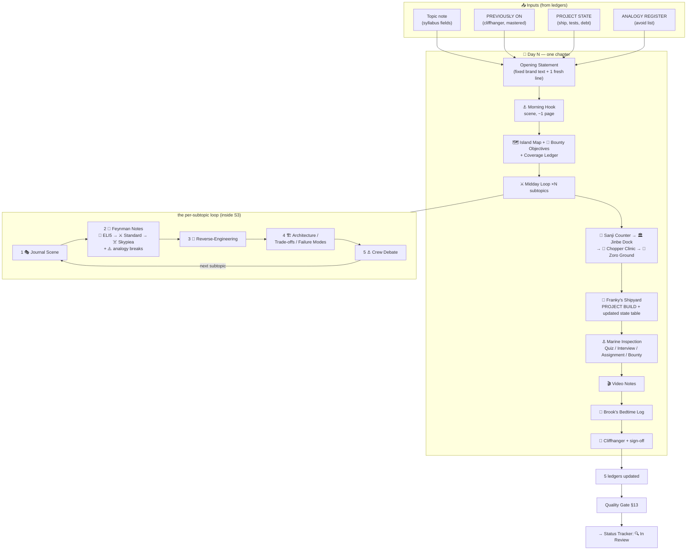

# 🌊 Content Flow — The Exact Shape of Every Chapter

The fixed skeleton every chapter follows (from [[fde by onepiece/00 Master Prompt|Master Prompt v2 §10]]), mapped to **who feeds each section, what it consumes, and how it's QC-checked**. Change the tune by editing this file + the master prompt together — they must stay in sync.

## Master flow diagram



## The two-track interleave (the reading rhythm)

```
Track B scene  →  Track A notes  →  Track B scene  →  Track A notes  → …
(laugh)           (revise)          (laugh)           (revise)
   └── problem       └── solution      └── new wall     └── new tool
```

Every Track B beat must have a Track A twin carrying the same fact — and only that order (scene first: the reader feels the wall before seeing the answer).

## Section map: inputs → owners → QC check

| # | Section | Track | Fed by | Persona owners | QC check |
| --- | --- | --- | --- | --- | --- |
| 0 | Opening Statement | brand | fixed text + topic | — | verbatim + exactly 1 fresh island line |
| 1 | Morning Hook | B | cliffhanger (PREVIOUSLY ON) | spotlight member hits the wall | ≤1 page; every joke serves the lesson; Log Pose line present |
| 2 | Island Map + Objectives + Coverage Ledger | A | exact syllabus list | Nami (as planner) | every syllabus item listed in source order; 4–6 "By sunset…" objectives; ledger table present |
| 3a | Journal Scene | B | subtopic + failure mode | spotlight + gag crew | the scene IS this subtopic's wall, not generic chaos |
| 3b | Feynman Notes | A | subtopic + register avoid-list | Luffy + Brook | 3 tiers present; ⚠️ analogy-break after EVERY analogy; analogy ≠ any register entry |
| 3c | Reverse-Engineering | A | working example | Chopper + Robin | execution order + dependencies + "what breaks if removed" + real-codebase pointer |
| 3d | Architecture / Trade-offs / Failure Modes | A | subtopic | Franky + Usopp + Jinbe | simplest approach + ≥1 alternative + when NOT to use; failure mode = symptom→cause→mitigation; completion evidence stated |
| 3e | Crew Debate | B | the above | ≥3 members | resolved by requirements/evidence; remaining trade-off named |
| 4a | Sanji's Serving Counter | A/B | topic | Sanji | who benefits + simplest valuable version + example (labeled) success measure |
| 4b | Jinbe's Industry Dock | A/B | topic | Jinbe | 1 war story labeled composite/cited; production workflow tie-in |
| 4c | Chopper's Clinic | A | topic's Common Failure Mode | Chopper | 3–5 entries symptom→diagnosis→cure→prevention; ≥1 beginner mistake |
| 4d | Zoro's Training Ground | A | topic + practice routes | Zoro | 3–5 problems easy→hard; ≥1 marked trap; hints separate from solutions |
| 5 | Franky's Shipyard (build) | A (code) | PROJECT STATE + milestone | all crew in sequence | 10-point checklist of master prompt §10; complete runnable code; PROJECT STATE updated; sandbox line present |
| 6 | Marine Inspection | A | topic + objectives | Marines (Coby/Garp/Akainu) | quiz 8–10 tagged Qs + answer key at end; 5 interview Qs; assignment with 40/30/20/10 rubric; bounty tied to artifacts |
| 7 | Video Production Notes | production | chapter | — (unless omitted by output preference) | runtime estimate, B-roll list, ≥3 direct-to-camera lines |
| 8 | Brook's Bedtime Log | A/B | whole chapter | Brook | original song/mnemonic; teach-it-back prompts; "broke in production" first-look; mastery statuses |
| 9 | Cliffhanger + sign-off | B | next map row | — | teases WITHOUT teaching next syllabus; exact sign-off line |

## Changing the flow (governance)

1. Propose the change here (or in a review note) → 2. Update **this file AND Master Prompt §10 in the same edit** → 3. Note the change in [[fde by onepiece/TODO|TODO]]'s changelog → 4. Already-published chapters are NOT retroactively restructured; only future days inherit the change. Version the change as `Flow vN` in this file's frontmatter.
