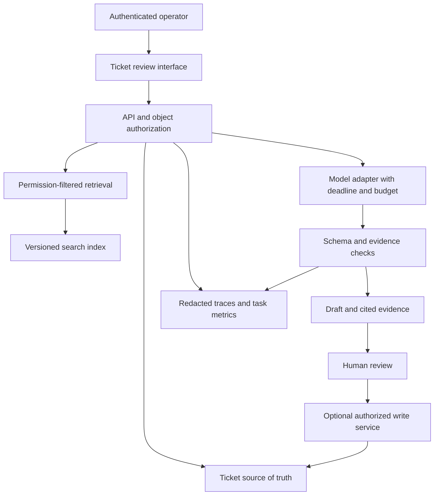

# Capstone and Delivery Playbook

[[roadmap by fde/00 Start Here|Start Here]] / [[roadmap by fde/01 Complete Topic Index|Topic Index]]

## Project: Evidence-Based Support Operations Assistant

Build a system that helps support operators investigate tickets using an approved knowledge corpus and sandbox ticket data. It should retrieve authorized evidence, draft an answer with citations, identify missing information, and propose a next action. A human approves consequential changes. Start read-only; writing to a ticket system is an optional, separately authorized extension.

This is an original practice project, not a project prescribed by roadmap.sh. Use synthetic data and local or explicitly approved sandbox services. The notes do not authorize real customer access, cloud spending, model calls, or production writes.

## 1. Discovery Before Architecture

Interview an operator, a support manager, a platform owner, and the appropriate security or data owner. Separate the sponsor's desired outcome from what operators actually do. Observe one completed ticket and one exception rather than collecting only opinions about an ideal future.

| Question | Evidence to Collect |
| --- | --- |
| Which decision is slow or inconsistent? | A real sequence of actions with timestamps and exceptions. |
| Who uses the output? | Named user roles and approval rights. |
| Where is authoritative information? | Source systems, document owners, update cadence, and access rules. |
| What happens when the answer is wrong? | Business impact, reversibility, escalation, and audit needs. |
| Why not use rules or search alone? | A baseline task and examples where simpler methods fail. |
| What would make the pilot not worthwhile? | Stop criteria covering data access, quality, cost, adoption, and risk. |

Deliverable: a one-page brief with one workflow, one sponsor, named operators, a baseline, pilot boundaries, assumptions, and a go/no-go meeting.

Related topics: [[roadmap by fde/Topics/Discovery and Scoping|Discovery and Scoping]], [[roadmap by fde/Topics/Requirements Gathering|Requirements Gathering]], [[roadmap by fde/Topics/Enterprise Workflow|Enterprise Workflow]].

## 2. Define an Honest Baseline

Measure a small representative sample of current work. Record total handling time, successful resolution, number of evidence lookups, escalation, correction effort, and the reason each ticket was difficult. Preserve cohort definitions so a later comparison does not quietly substitute easier cases.

Use a rules-only or search-only system as an engineering baseline where reasonable. A pilot may be useful even if it does not need an LLM. The goal is an improved workflow, not proving that a preferred architecture was necessary.

Do not claim a causal improvement from an uncontrolled before-and-after comparison. Note changes in ticket mix, staffing, documentation, and seasonality. For a real deployment, agree an appropriate experimental design with the business owner.

## 3. Audit the Data

Create a small synthetic dataset with at least two tenants, different access roles, missing fields, stale documents, duplicate events, and conflicting policies. This makes permission and ambiguity tests possible from the start.

| Dataset | Minimum Fields | Checks |
| --- | --- | --- |
| Tickets | ticket ID, tenant ID, status, created time, owner role | Unique key, valid state, timezone, required tenant. |
| Events | event ID, ticket ID, event time, event type | Duplicate handling, ordering, referential integrity. |
| Documents | document ID, tenant ID, version, updated time, body | Parseability, freshness, stable source location. |
| Entitlements | principal ID, tenant ID, resource scope | Revocation behavior and deny-by-default handling. |
| Review decisions | decision ID, reviewer ID, draft ID, outcome | Auditability, actor identity, stable references. |

Write the grain and owner of each dataset. Decide how corrections, deletions, and late events propagate. A vector index and its embeddings are derived data with their own retention and deletion requirements.

Exit gate: demonstrate a sampled output's lineage to the source, then replay a batch without unexplained loss or duplication.

Related topics: [[roadmap by fde/Topics/Data Modeling|Data Modeling]], [[roadmap by fde/Topics/Data Pipelines|Data Pipelines]], [[roadmap by fde/Topics/SQL|SQL]], [[roadmap by fde/Topics/Data Privacy and Compliance|Data Privacy and Compliance]].

## 4. Build a Thin Vertical Slice

The first implementation only needs to display a ticket, retrieve authorized evidence, produce a structured draft or abstention, and let the operator record a decision. Defer autonomous browsing, multi-agent delegation, and live writes until evaluation demonstrates a need.

Store identity and tenant context in trusted server-side request handling. Do not let a model choose its own tenant or invent permission claims. Treat documents and tool responses as untrusted data, even when they appear to contain instructions.

Related topics: [[roadmap by fde/Topics/React|React]], [[roadmap by fde/Topics/Backend Skills|Backend Skills]], [[roadmap by fde/Topics/APIs Design|APIs Design]], [[roadmap by fde/Topics/Authentication|Authentication]], [[roadmap by fde/Topics/API Security|API Security]].

## 5. Specify the Model Contract

For each draft, require a structured result with the ticket reference, a proposed answer, evidence identifiers, missing information, and a disposition such as draft, abstain, or escalate. This is an example contract to adapt, not a universally sufficient schema.

| Field | Validation |
| --- | --- |
| Ticket reference | Exists and belongs to the authorized tenant. |
| Answer | Fits the agreed task and display limit. |
| Evidence references | Resolve to passages actually supplied to the model. |
| Missing information | Does not conceal unsupported assumptions. |
| Disposition | A permitted enum consistent with evidence availability. |
| Proposed action | Absent in read-only mode; independently validated in write mode. |

A valid schema does not prove a supported answer. Check source correspondence and task correctness separately. A citation only proves something when the cited content actually supports the associated claim.

For provider selection, compare the same inputs under the same rubric. Record the exact model or provider version available, data-handling terms, region, rate limits, timeout behavior, and expected total task cost.

Related topics: [[roadmap by fde/Topics/Prompt Engineering|Prompt Engineering]], [[roadmap by fde/Topics/Context Engineering|Context Engineering]], [[roadmap by fde/Topics/RAGs|RAGs]], [[roadmap by fde/Topics/Choosing Model Providers|Choosing Model Providers]].

## 6. Evaluate Before Adding Autonomy

A starter suite of 30 cases is useful for development, not a statistical guarantee of production reliability. Grow coverage according to task diversity and business risk. Include ordinary cases, missing evidence, conflicting evidence, stale policy, duplicate requests, cross-tenant attempts, malicious document instructions, and provider failure.

| Dimension | Example Measure | Interpretation |
| --- | --- | --- |
| Retrieval | Recall at a chosen k on labeled evidence | Did the relevant authorized passage reach the candidate set? |
| Answer support | Fraction of checked claims supported | Is the draft grounded in the supplied evidence? |
| Task correctness | Human-reviewed rubric | Does it help resolve the actual task? |
| Abstention | Appropriate abstention and missed-answer rates | Does the system know when not to answer? |
| Tool safety | Unauthorized or invalid actions blocked | Are trusted execution boundaries effective? |
| Reliability | Completion rate and explicit error rate | Does the workflow finish or fail transparently? |
| Latency | p50 and p95 end-to-end time | What does the operator experience? |
| Cost | Model, retrieval, infrastructure, and review cost per task | Is the complete workflow affordable? |

Keep scorer execution failures separate from poor application scores. Pin dataset, model, prompt, retrieval, evaluator, and application versions. Store case-level results and analyze relevant slices instead of relying only on a mean.

Any numerical acceptance threshold must be agreed for this task and risk profile. Do not copy a generic accuracy target and call it a business requirement.

Related topics: [[roadmap by fde/Topics/Building Eval Pipelines|Building Eval Pipelines]], [[roadmap by fde/Topics/Observability|Observability]], [[roadmap by fde/Topics/Debugging Agent Logic|Debugging Agent Logic]].

## 7. Add a Bounded Tool Only if Needed

Begin with a read-only lookup that accepts explicit identifiers and returns compact structured observations. Validate arguments, enforce object access, set a deadline, and record the result. If the workflow later needs a write, separate proposing that write from executing it.

For writes, use the authenticated operator and actual permissions, an approval record, a stable idempotency key, an expected resource version where appropriate, and an auditable result. A retry after an uncertain response must not create a duplicate business action.

An agent loop needs hard iteration, elapsed-time, and spending limits enforced by application code. Define what state is persisted and how recovery distinguishes an action already committed from one never attempted.

Related topics: [[roadmap by fde/Topics/Tools and Functions|Tools and Functions]], [[roadmap by fde/Topics/Memory and State|Memory and State]], [[roadmap by fde/Topics/MCP|MCP]], [[roadmap by fde/Topics/Integration Engineering|Integration Engineering]].

## 8. Plan Deployment and Day 2

Select one deployment environment and justify it. A managed service or simple container may meet the need without Kubernetes. Document configuration, workload identity, secret locations, network boundaries, persistent stores, telemetry, and the supported operating envelope.

Release the application, prompts, model configuration, and search index as a coherent versioned system. Describe whether a rollback can restore compatible state or whether a forward fix is required. Test database restoration separately from application deployment.

| Incident | Expected Operator Response |
| --- | --- |
| Provider unavailable | Stop or use an explicitly approved fallback; communicate degraded capability. |
| Wrong or stale retrieval | Disable affected corpus version and rebuild from a known source. |
| Permission revocation | Deny access immediately within the agreed revocation behavior. |
| Quality regression | Pause rollout, identify affected versions and slices, and revert or repair. |
| Unexpected cost | Enforce limits and investigate request volume, token use, and loop behavior. |
| Suspected data exposure | Follow the agreed security incident process; do not improvise disclosure handling. |

Related topics: [[roadmap by fde/Topics/Cloud Platforms|Cloud Platforms]], [[roadmap by fde/Topics/Terraform|Terraform]], [[roadmap by fde/Topics/Docker|Docker]], [[roadmap by fde/Topics/DevOps Skills|DevOps Skills]], [[roadmap by fde/Topics/Day 2 Operations|Day 2 Operations]].

## 9. Run UAT and Measure Value

Ask representative operators to perform the real workflow with normal, difficult, and error cases. Include someone with restricted permissions. Record what they attempted, the system response, their correction work, whether they trusted the evidence, and whether they could complete the task.

Report separate technical and business outcomes. A supported-answer score measures one part of quality; realized time saved depends on usage, review, exceptions, and rework.

$$
\text{Net Benefit} = \text{Realized Benefit} - \text{Implementation Cost} - \text{Operating Cost} - \text{Review and Rework Cost}
$$

$$
\text{ROI} = \frac{\text{Net Benefit}}{\text{Total Investment}}
$$

State the accounting period and which costs are already included so that implementation cost is not accidentally double-counted. Use sensitivity ranges for adoption, workload volume, review time, and vendor pricing. Time saved is not automatically a cash saving or a causal effect of the system.

Define time-to-first-value using a real operator-approved outcome. Measure sustained value separately after repeated use. A screenshot, login, or successful API call is not sufficient evidence of customer value.

Related topics: [[roadmap by fde/Topics/UAT|UAT]], [[roadmap by fde/Topics/ROI and AI Impact|ROI and AI Impact]], [[roadmap by fde/Topics/Time-to-Value|Time-to-Value]], [[roadmap by fde/Topics/Stakeholder Management|Stakeholder Management]].

## Delivery Templates

### Pilot Brief

| Item | Fill In |
| --- | --- |
| Problem and workflow | |
| Sponsor, users, and decision owner | |
| Current baseline and measurement method | |
| Data sources, owners, and access approvals | |
| Included and excluded scope | |
| Quality, latency, cost, and risk constraints | |
| Pilot milestones and exit evidence | |
| Stop conditions and review date | |

### Decision Record

| Item | Fill In |
| --- | --- |
| Decision and owner | |
| Alternatives considered | |
| Evidence and assumptions | |
| Chosen tradeoff and rejected options | |
| Security and operational implications | |
| Revisit trigger | |

### Executive Readout

1. Recommendation: continue, narrow, revise, or stop.
2. Outcome: baseline, current result, cohort, and uncertainty.
3. Economics: realized benefit, complete cost, and sensitivity.
4. Adoption: who used it, how often, and why people declined it.
5. Risk: highest-impact failure, mitigation, and accountable owner.
6. Decision needed: exact request, responsible person, and date.

## Release Evidence Checklist

- [ ] Stakeholders approved the workflow, scope, and acceptance criteria.
- [ ] Data lineage, quality, retention, and access requirements are documented.
- [ ] Negative authorization and tenant-isolation tests pass.
- [ ] Evaluation results are versioned, case-level, and compared against a baseline.
- [ ] Outages, malformed responses, retries, and duplicate actions are exercised.
- [ ] Deployment, restore, rollback or roll-forward, and escalation are rehearsed.
- [ ] Operators complete UAT and understand limitations and fallback behavior.
- [ ] A named owner accepts ongoing operation, cost, and review obligations.
- [ ] The value report distinguishes measured evidence from assumptions.
- [ ] Repeated field needs are returned to product ownership with reproducible evidence.

## Portfolio Evidence

Present the pilot brief, system diagram, data contract, working slice, evaluation report, security tests, runbook, UAT record, and executive readout as one coherent case study. Show a failure you discovered and corrected. Explicitly distinguish synthetic practice from a real customer deployment and forecast benefits from measured outcomes.